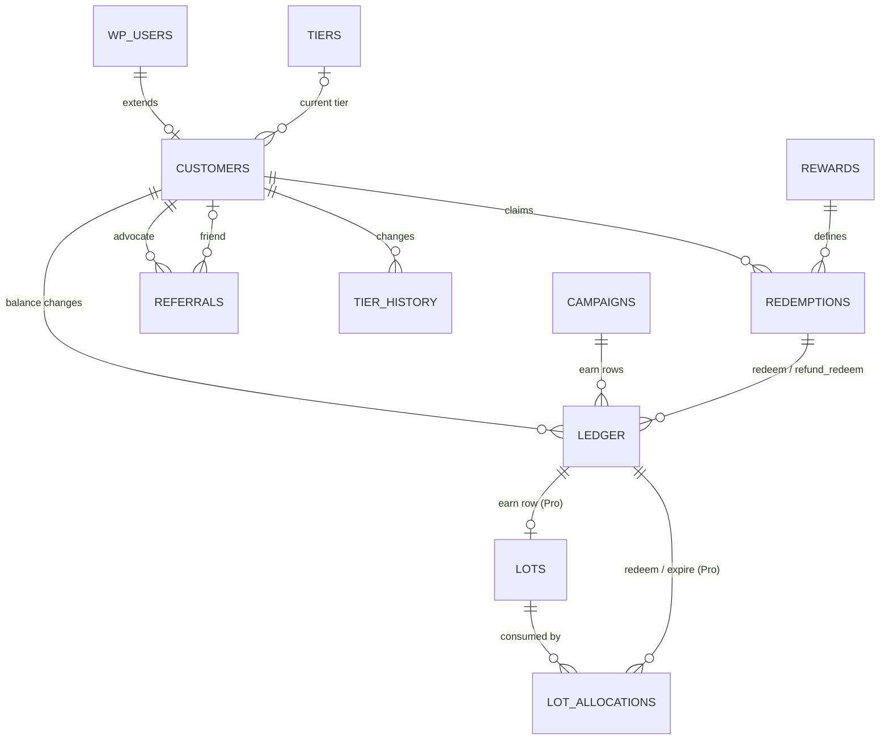

# YayLoyalty — Data Model Reference

| | |
|---|---|
| **Version** | 0.3 — supersedes the data-model section of `MVP.md` v0.2 |
| **Date** | 3 September 2026 |
| **Scope** | Every table YayLoyalty owns across Free, Pro and later releases, every column, and how they relate |
| **Companion docs** | `project-roadmap.md` · `codebase-summary.md` · `system-architecture.md` |

## Implementation Status

**Implemented (v1.0):** `yayloyalty_campaigns`, `yayloyalty_customers`, `yayloyalty_ledger`

**Not implemented:** `rewards`, `redemptions`, `referrals`, `referral_visits`, `tiers`, `tier_history`, `lots`, `lot_allocations`, `events`

See [`project-roadmap.md`](./project-roadmap.md) for implementation status by phase and known gaps. The table specifications below are the authoritative schema design; unimplemented tables are the work plan for phases 1.1, 1.2, and 2.0.

## Conventions

All tables use the site prefix (`{$wpdb->prefix}yayloyalty_*`), InnoDB, `utf8mb4_unicode_520_ci`. Every `DATETIME` is UTC; conversion to the site timezone happens at the edges (admin forms, emails). Points columns are `BIGINT` signed, not `INT` — a store awarding 1 point per VND or per JPY can push a lifetime total past 2.1 billion. Money is `DECIMAL(19,4)`. Ids are `BIGINT UNSIGNED`. JSON is stored in `LONGTEXT` and validated in PHP (WooCommerce's minimum MySQL/MariaDB versions do not guarantee a native `JSON` type); every JSON blob carries a `schema_version` key so formats can evolve without table migrations. Foreign keys are logical, enforced by the services, not by `FOREIGN KEY` constraints — WordPress installs cannot rely on them.

Tables are created with `dbDelta` and versioned by the `yayloyalty_db_version` option; columns marked with a later phase are added by that release's migration, not created empty in 1.0.

Two design rules apply everywhere:

1. **The ledger is the truth; `customers` is a cache.** Every number on a customer row can be rebuilt by replaying that customer's ledger, and a "Rebuild balances" tool does exactly that.
2. **Status is intent; liveness is derived.** `status` columns store what the merchant chose (`active`, `paused`, `draft`). Whether something is live *right now* is computed from `status` plus `starts_at`/`ends_at` at read time. No job flips statuses on a clock.

## Table overview

| Table | Kind | Phase | One row per |
|---|---|---|---|
| `yayloyalty_campaigns` | definition | 1.0 | earning rule |
| `yayloyalty_rewards` | definition | 1.0 | way to spend points |
| `yayloyalty_customers` | state | 1.0 | member (extends `wp_users`) |
| `yayloyalty_ledger` | fact, append-only | 1.0 | balance change |
| `yayloyalty_redemptions` | fact | 1.0 | reward claim |
| `yayloyalty_referrals` | fact | 1.1 | referral relationship |
| `yayloyalty_referral_visits` | fact, prunable | 1.1 | referral link click |
| `yayloyalty_tiers` | definition | 1.2 | VIP level |
| `yayloyalty_tier_history` | fact | 1.2 | tier change |
| `yayloyalty_lots` | fact | 1.0 Pro | expiring batch of earned points |
| `yayloyalty_lot_allocations` | fact | 1.0 Pro | consumption of a lot |
| `yayloyalty_events` | fact, outbox | 2.0 | domain event for webhooks/analytics |

---

## `yayloyalty_campaigns` — earning rules (1.0)

One row per way to earn points. Free seeds three built-in rows and shows only #1 as a settings page; Pro shows the list. For any event, the engine takes the live campaigns of that trigger type in priority order and applies the first whose conditions match.

| Column | Type | Null / default | Meaning |
|---|---|---|---|
| `id` | BIGINT UNSIGNED AI | PK | Row id. Referenced by `ledger.campaign_id`. |
| `name` | VARCHAR(191) | not null | Merchant-facing label. Appears in the customer's history ("Earned — Double Points Weekend") and Pro analytics. |
| `slug` | VARCHAR(64) | unique | Stable machine key. Built-ins are `default-purchase`, `signup`, `review`; templates get their own. Code, filters and import/export address campaigns by slug because ids differ between sites. |
| `trigger` | VARCHAR(20) | not null, idx | The event that fires the campaign: `purchase`, `signup`, `review` (1.0); `birthday`, `first_order`, `order_count`, `spend_milestone`, `referral`, `social`, `renewal` (Pro). Determines which keys `config` may contain. |
| `status` | VARCHAR(10) | not null, `active` | Merchant intent only: `active`, `paused`, `draft`. Never `scheduled` or `ended` — those are computed from the dates. |
| `priority` | INT | not null, `0` | Among live campaigns of the same trigger, the highest priority wins; ties go to the newest (`id` DESC). The default purchase campaign is `0`, so any Pro campaign that matches replaces it. |
| `config` | LONGTEXT (JSON) | not null | The numbers. `purchase`: `points_per_unit`, `base` (`after_discounts` \| `before_discounts`), `rounding` (`down` \| `nearest` \| `up`), `min_subtotal`, `exclude_coupon_orders`, `excluded_product_ids[]`, `excluded_category_ids[]`, Pro: `max_points_per_order`, `daily_cap`. `signup`: `points`. `review`: `points`, `require_verified`, `one_per_product`, `daily_cap`, Pro: `media_bonus_points`. |
| `conditions` | LONGTEXT (JSON) | not null, `[]` | Pro eligibility rules, ANDed: `{type, operator, value}` for roles, product categories, products, lifetime spend, order count, currency, tier. Empty in Free. |
| `starts_at` | DATETIME | null | Live from this instant (inclusive). Null = no start bound. Free never sets it. |
| `ends_at` | DATETIME | null | Live until this instant (exclusive), so back-to-back campaigns never overlap. Null = no end bound. |
| `is_builtin` | TINYINT(1) | `0` | `1` for the three seeded rows: cannot be deleted; the Free UI binds to them. |
| `created_by` | BIGINT UNSIGNED | null | Admin who created it (audit). |
| `created_at` | DATETIME | not null | |
| `updated_at` | DATETIME | not null | Bumped on every save; used to invalidate the active-campaign cache. |

Indexes: PK; UNIQUE `slug`; `(trigger, status, priority)` for selection; `starts_at`, `ends_at` so the cache TTL can be set to the nearest future boundary.

Liveness: `status = 'active' AND (starts_at IS NULL OR starts_at <= now) AND (ends_at IS NULL OR ends_at > now)`, evaluated against the event's timestamp (the order's award time, not the request time).

## `yayloyalty_rewards` — ways to spend points (1.0)

One row per reward. Free seeds row #1 (the flexible cart discount) and shows it as the "Redeeming" settings page; Pro shows the list and adds catalog items.

| Column | Type | Null / default | Meaning |
|---|---|---|---|
| `id` | BIGINT UNSIGNED AI | PK | Referenced by `redemptions.reward_id`. |
| `name` | VARCHAR(191) | not null | Label in the launcher, catalog and history ("$5 off", "Free shipping"). |
| `slug` | VARCHAR(64) | unique | Stable key; built-in is `cart-discount`. |
| `type` | VARCHAR(20) | not null | `flexible_discount` (slider; any amount within limits) in 1.0. Pro: `fixed_coupon`, `percent_coupon`, `free_shipping`, `free_product` — each claim issues a real single-use WooCommerce coupon. |
| `status` | VARCHAR(10) | not null, `active` | `active`, `paused`, `draft`. |
| `sort_order` | INT | `0` | Display order in launcher and catalog. |
| `cost_points` | BIGINT | null | Fixed cost for catalog items. Null for `flexible_discount` (the customer chooses). |
| `config` | LONGTEXT (JSON) | not null | `flexible_discount`: `points_per_currency_unit` (100 = 1.00), `min_points`, `max_points_per_order`, `max_percent_of_subtotal`, `increment`, `show_on[]` (`cart`, `checkout`), `refund_policy` (`proportional` \| `full` \| `none`). `fixed_coupon`: `amount`, `min_order`, `coupon_expiry_days`, `exclude_sale_items`. `percent_coupon`: `percent`, `max_discount`. `free_product`: `product_id`, `variation_id`, `qty`. |
| `conditions` | LONGTEXT (JSON) | not null, `[]` | Pro availability: `tier_ids[]`, `roles[]`, `once_per_customer`. |
| `starts_at` / `ends_at` | DATETIME | null | Availability window, same semantics as campaigns. |
| `is_builtin` | TINYINT(1) | `0` | `1` for row #1; cannot be deleted. |
| `created_at` / `updated_at` | DATETIME | not null | |

Indexes: PK; UNIQUE `slug`; `(status, sort_order)`.

## `yayloyalty_customers` — one row per member (1.0)

A 1:1 extension of `wp_users`, created lazily on the first earn (or on signup when the signup campaign is on). Holds cached aggregates for O(1) storefront reads and indexed columns for admin sorting/filtering, plus state that is not a ledger aggregate at all (expiry, tier, referral code). Updated only by the `Ledger` service (aggregates) and the tier/referral services (their columns), always inside the same transaction as the fact row that justifies the change; the `UPDATE … SET balance = balance + ?` row lock is what serialises concurrent earns and redeems.

| Column | Type | Null / default | Meaning |
|---|---|---|---|
| `user_id` | BIGINT UNSIGNED | PK | `wp_users.ID`. Row existence = "is a member". |
| `balance` | BIGINT | not null, `0` | Spendable points. Signed: a clawback after a refund can push it below zero, which the dashboard flags. Equals `SUM(ledger.points)` for the user. |
| `pending_points` | BIGINT UNSIGNED | not null, `0` | Points on orders that exist but have not reached the award status. Shown as "pending" in the launcher; never spendable. Equals the sum of `_yayloyalty_points_pending` across the user's unawarded orders. |
| `lifetime_earned` | BIGINT | not null, `0` | Net points ever earned: `earn` + positive `adjust` − `refund_earn`. Unaffected by `redeem` and `expire`. This, not `balance`, is the tier basis in points mode — so spending points never demotes anyone. |
| `lifetime_redeemed` | BIGINT UNSIGNED | not null, `0` | `|redeem|` − `refund_redeem`. Dashboard and per-customer stats. |
| `lifetime_spend` | DECIMAL(19,4) | `0` (1.2) | Net paid order totals in base currency, maintained from order award/refund events. Tier basis in spend mode. The one aggregate not derivable from the ledger; rebuilt from orders. |
| `last_activity_at` | DATETIME | null | Timestamp of the last `earn` or `redeem`. Drives inactivity expiry. |
| `expires_at` | DATETIME | null, idx | `last_activity_at` + expiry days from settings; null when expiry is off. The daily expiry job selects on this index. |
| `reminder_sent_at` | DATETIME | null | When the "expiring soon" email last went out; cleared on activity so the next window gets one reminder, never two. |
| `tier_id` | BIGINT UNSIGNED | null, idx (1.2) | Current tier; null = base level. Latest row of `tier_history`. |
| `tier_evaluated_at` | DATETIME | null (1.2) | When the tier was last evaluated; the downgrade job uses it to find customers whose evaluation window has ended. |
| `tier_progress_value` | DECIMAL(19,4) | null (1.2) | Cached basis value for "$120 to Gold" in the launcher when the basis is rolling-12-month (which is expensive to compute per request). |
| `referral_code` | VARCHAR(32) | null, unique (1.1) | Generated the first time the customer opens the referral UI. Upper-case, ambiguity-free alphabet. Rotatable; old codes live on in `referrals.referral_code`. |
| `birthday_month` / `birthday_day` | TINYINT | null (Pro) | No year — only the annual trigger needs it, and it keeps the row out of sensitive-data territory. Idempotency for the yearly award is the ledger's unique key with `reference_type = 'birthday'`, `reference_id = year`. |
| `joined_at` | DATETIME | not null | When the row was created — the program join date for cohorts. |
| `updated_at` | DATETIME | not null | |

Indexes: PK; `expires_at`; `tier_id`; UNIQUE `referral_code`; `balance` and `last_activity_at` for admin sorting.

## `yayloyalty_ledger` — every balance change (1.0)

Append-only journal. Nothing updates or deletes rows except GDPR erasure (which sets `user_id = 0`, `actor_id = NULL`, clears `note`). One `earn` row per order, because stacking is highest-priority-only. The unique key on `(type, reference_type, reference_id)` is the idempotency guarantee against duplicate hooks, status bouncing and webhook retries.

| Column | Type | Null / default | Meaning |
|---|---|---|---|
| `id` | BIGINT UNSIGNED AI | PK | Referenced by `lots.ledger_id`, `lot_allocations.ledger_id`, `referrals.advocate_ledger_id`. |
| `user_id` | BIGINT UNSIGNED | not null, idx | Whose balance changed. |
| `points` | BIGINT | not null | Signed delta. Positive for `earn`, `refund_redeem`, positive `adjust`; negative for `redeem`, `refund_earn`, `expire`, negative `adjust`. |
| `balance_after` | BIGINT | not null | Balance immediately after this row. Display in history, and a chain check for the audit tool (`prev.balance_after + points = this.balance_after`). |
| `type` | VARCHAR(20) | not null, idx | What kind of movement: `earn`, `redeem`, `refund_earn` (clawback of earned points after a refund), `refund_redeem` (return of redeemed points), `expire`, `adjust` (manual). |
| `source` | VARCHAR(20) | not null | Why: `order`, `signup`, `review`, `referral`, `birthday`, `milestone`, `social`, `renewal`, `manual`, `import`, `expiry`, `system`. Lets history and analytics group without decoding references. |
| `reference_type` | VARCHAR(20) | null | Namespace of `reference_id`: `order`, `refund`, `comment`, `redemption`, `referral`, `user`, `birthday`, `import`. |
| `reference_id` | BIGINT UNSIGNED | null | The id in that namespace: order id for `earn`, refund id for both `refund_*` types (so each partial refund is its own row), comment id for review earn, redemption id for `redeem`, year for `birthday`. |
| `campaign_id` | BIGINT UNSIGNED | null, idx | The campaign that produced an `earn` row. Null for everything else. Per-campaign analytics is `GROUP BY campaign_id`. |
| `redemption_id` | BIGINT UNSIGNED | null, idx | For `redeem` and `refund_redeem` rows: the claim this movement belongs to, so partial refunds can be tied back to one redemption. |
| `order_id` | BIGINT UNSIGNED | null, idx | Denormalised for every order-related row (`earn`, `refund_earn`, `redeem`, `refund_redeem`), so "all points activity for order #1234" is one indexed query for the order screen and support. |
| `note` | VARCHAR(500) | null | Admin reason on `adjust` rows only. System rows have no stored text: their description is composed at render time from `type`/`source`/reference, so it is translatable and never goes stale. |
| `actor_id` | BIGINT UNSIGNED | null | Admin user for manual rows; null for the system. |
| `created_at` | DATETIME | not null | UTC. |

Indexes: PK; `(user_id, created_at)` for history pages; UNIQUE `(type, reference_type, reference_id)`; `campaign_id`; `redemption_id`; `order_id`; `(type, created_at)` for dashboard aggregates ("issued last 30 days").

Not on this table any more: `expires_at`. Per-earning expiry lives in `lots` (below) so the ledger stays immutable.

## `yayloyalty_redemptions` — one row per reward claim (1.0)

Created at order creation for the flexible discount, or at claim time for Pro catalog rewards. It exists because a refund needs the value *and the rate at redemption time*, multi-currency stores need the currency of the discount as a fact, and catalog claims have no order yet. The ledger's `redeem`/`refund_redeem` rows reference this row uniformly for every reward type.

| Column | Type | Null / default | Meaning |
|---|---|---|---|
| `id` | BIGINT UNSIGNED AI | PK | Referenced by `ledger.redemption_id` and `ledger.reference_id` (with `reference_type = 'redemption'`). |
| `user_id` | BIGINT UNSIGNED | not null, idx | |
| `reward_id` | BIGINT UNSIGNED | not null, idx | Which reward. |
| `order_id` | BIGINT UNSIGNED | null, idx | The order the discount applied to. Null for a catalog coupon not yet used. |
| `points` | BIGINT UNSIGNED | not null | Points spent. |
| `value` | DECIMAL(19,4) | not null | Discount value in `currency`. |
| `currency` | CHAR(3) | not null | Currency the customer checked out in (YayCurrency display currency). |
| `base_value` | DECIMAL(19,4) | not null | The same value in the store's base currency, for reports. |
| `rate_snapshot` | DECIMAL(12,4) | not null | Points per currency unit at redemption time. Refunds use this, never today's rate. |
| `coupon_code` | VARCHAR(64) | null | `yayloyalty-redeem` (virtual) for the flexible discount; the issued single-use code for catalog rewards. |
| `coupon_id` | BIGINT UNSIGNED | null | `shop_coupon` post id for catalog rewards (Pro). Null for virtual coupons. |
| `status` | VARCHAR(12) | not null | Flexible: `applied` (order exists, points debited) → `completed` (order paid) \| `cancelled` (order cancelled/failed; points restored) \| `refunded` (fully restored via refund). Catalog: `issued` → `used` \| `expired` \| `cancelled`. |
| `restored_points` | BIGINT UNSIGNED | `0` | Points already returned through refunds, so repeated partial refunds can never restore more than was spent. |
| `expires_at` | DATETIME | null | Catalog coupon expiry (Pro). |
| `created_at` / `updated_at` | DATETIME | not null | |

Indexes: PK; `user_id`; `order_id`; `reward_id`; `(status, created_at)`.

## `yayloyalty_referrals` — one row per referral relationship (1.1)

Tracks a friend from first click to payout. Hashes, not raw emails or IPs, so fraud checks work without storing PII.

| Column | Type | Null / default | Meaning |
|---|---|---|---|
| `id` | BIGINT UNSIGNED AI | PK | |
| `advocate_user_id` | BIGINT UNSIGNED | not null, idx | The referrer. |
| `referral_code` | VARCHAR(32) | not null, idx | Code used, snapshotted (codes can be rotated). |
| `friend_user_id` | BIGINT UNSIGNED | null, idx | Set when the friend has an account. |
| `friend_email_hash` | CHAR(64) | null, idx | SHA-256 of lower-cased email + site salt. Duplicate and self-referral detection. |
| `friend_ip_hash` | CHAR(64) | null | Hashed IP at attribution. Velocity and same-IP checks. |
| `source` | VARCHAR(20) | not null | How attribution happened: `link`, `code_at_checkout`, `share_email`, `share_whatsapp`, `share_x`, `share_facebook`. |
| `first_order_id` | BIGINT UNSIGNED | null, idx | The friend's qualifying order. |
| `status` | VARCHAR(12) | not null, idx | `pending` (attributed, no account) → `signed_up` → `ordered` (qualifying order placed, in hold) → `completed` \| `rejected` \| `expired`. |
| `attributed_at` | DATETIME | not null | Click or code capture. Start of the cookie window. |
| `signed_up_at` / `ordered_at` / `completed_at` | DATETIME | null | Milestones. |
| `hold_until` | DATETIME | null, idx | `ordered_at` + hold days. The daily job completes referrals past this instant whose order was not refunded. |
| `advocate_ledger_id` | BIGINT UNSIGNED | null | The advocate's `earn` row (`source = referral`). |
| `friend_ledger_id` | BIGINT UNSIGNED | null | The friend's `earn` row when the friend reward is points. |
| `friend_coupon_id` | BIGINT UNSIGNED | null | The friend's issued coupon when the friend reward is a coupon. |
| `rejection_reason` | VARCHAR(50) | null | `self_referral`, `same_email`, `same_ip`, `order_refunded`, `below_min_order`, `coupon_order`, `manual`. |
| `created_at` / `updated_at` | DATETIME | not null | |

Indexes: PK; `advocate_user_id`; `friend_user_id`; `friend_email_hash`; `first_order_id`; `(status, hold_until)`.

## `yayloyalty_referral_visits` — link clicks (1.1, prunable)

| Column | Type | Meaning |
|---|---|---|
| `id` | BIGINT UNSIGNED AI | |
| `referral_code` | VARCHAR(32), idx | Code in the link. |
| `visitor_hash` | CHAR(64) | SHA-256 of IP + user agent + salt. |
| `landing_path` | VARCHAR(255) | Where they landed. |
| `http_referrer` | VARCHAR(255) | Where they came from (channel analytics). |
| `created_at` | DATETIME, idx | |

Pruned daily to the cookie window plus 30 days. Exists only for the referral report's click → signup → order funnel.

## `yayloyalty_tiers` — VIP levels (1.2)

| Column | Type | Null / default | Meaning |
|---|---|---|---|
| `id` | BIGINT UNSIGNED AI | PK | Referenced by `customers.tier_id`, `tier_history`, and inside `campaigns.conditions` / `rewards.conditions`. |
| `name` | VARCHAR(191) | not null | "Gold". |
| `slug` | VARCHAR(64) | unique | `gold`. |
| `rank` | INT | not null, unique | Order of levels, 1 = lowest. Thresholds must increase with rank (validated on save). |
| `threshold` | DECIMAL(19,4) | not null | Entry value in the program's basis unit — points if the basis is lifetime or rolling points, currency if it is lifetime spend. The basis itself is a program-wide setting so every tier is measured the same way. |
| `perks` | LONGTEXT (JSON) | not null | `points_multiplier`, `free_shipping`, `birthday_bonus_points`, `reward_ids[]` (tier-only rewards), `badge_color`, `badge_icon`, `description`. |
| `status` | VARCHAR(10) | not null | `active`, `paused`. |
| `created_at` / `updated_at` | DATETIME | not null | |

Program-level tier settings live in `yayloyalty_settings`: `tier_basis` (`lifetime_points` \| `rolling_points` \| `lifetime_spend`), `evaluation_window_months`, `downgrade_policy` (`never` \| `window_end`).

## `yayloyalty_tier_history` — every tier change (1.2)

| Column | Type | Meaning |
|---|---|---|
| `id` | BIGINT UNSIGNED AI | |
| `user_id` | BIGINT UNSIGNED, idx | |
| `from_tier_id` | BIGINT UNSIGNED NULL | Null = base level. |
| `to_tier_id` | BIGINT UNSIGNED NULL | Null = demoted to base. |
| `reason` | VARCHAR(20) | `threshold` (crossed on earn), `window_end` (downgrade job), `manual`, `import`. |
| `basis_value` | DECIMAL(19,4) | The basis value at evaluation — the evidence for the change. |
| `actor_id` | BIGINT UNSIGNED NULL | Admin for `manual`. |
| `created_at` | DATETIME, idx | |

Tier emails, the customer's timeline and tier-movement analytics all read this table; `customers.tier_id` is only the latest row.

## `yayloyalty_lots` and `yayloyalty_lot_allocations` — per-earning expiry (1.0 Pro)

Lot-based expiry needs a mutable "remaining" counter. Keeping it here, not on the ledger, preserves the ledger's immutability.

`yayloyalty_lots` — one per `earn` row when lot expiry is on:

| Column | Type | Meaning |
|---|---|---|
| `id` | BIGINT UNSIGNED AI | |
| `ledger_id` | BIGINT UNSIGNED, unique | The `earn` row this lot came from. |
| `user_id` | BIGINT UNSIGNED, idx | |
| `points` | BIGINT UNSIGNED | Original size. |
| `remaining` | BIGINT UNSIGNED | Not yet consumed. The only mutable counter in the fact tables. |
| `expires_at` | DATETIME, idx | When the remainder expires. |
| `status` | VARCHAR(10) | `open`, `consumed`, `expired`. |
| `created_at` | DATETIME | |

`yayloyalty_lot_allocations` — how each redemption or expiry consumed lots, FIFO by `expires_at`:

| Column | Type | Meaning |
|---|---|---|
| `id` | BIGINT UNSIGNED AI | |
| `lot_id` | BIGINT UNSIGNED, idx | |
| `ledger_id` | BIGINT UNSIGNED, idx | The `redeem` or `expire` row that consumed from the lot. |
| `points` | BIGINT UNSIGNED | Amount taken from this lot. |
| `created_at` | DATETIME | |

A `refund_redeem` re-opens allocations in reverse order (latest lot first) so returned points keep their original expiry.

## `yayloyalty_events` — outbox (2.0)

| Column | Type | Meaning |
|---|---|---|
| `id` | BIGINT UNSIGNED AI | |
| `event` | VARCHAR(40), idx | `points.earned`, `points.redeemed`, `points.expired`, `tier.changed`, `referral.completed`, … |
| `user_id` | BIGINT UNSIGNED, idx | |
| `payload` | LONGTEXT (JSON) | Snapshot delivered to webhooks and ESP integrations. |
| `created_at` | DATETIME, idx | |
| `delivered_at` | DATETIME NULL | Null until every subscriber has acknowledged; the delivery job selects on it. |

Written in the same transaction as the fact that caused it, so a webhook can never fire for a change that rolled back.

---

## Not tables, but part of the model

**Order meta** (HPOS-safe via `WC_Order::update_meta_data`): `_yayloyalty_points_pending`, `_yayloyalty_points_earned`, `_yayloyalty_campaign_id`, `_yayloyalty_points_redeemed`, `_yayloyalty_redeem_value`, `_yayloyalty_base_amount`, `_yayloyalty_referral_id` (1.1). Projections for the order edit screen, YayMail placeholders and the customer's order page; never read to compute a balance.

**Options**: `yayloyalty_settings` (JSON: points naming, award status, expiry policy, tier basis and window, redemption placement, fraud limits), `yayloyalty_design` (launcher/dashboard theme), `yayloyalty_wizard_completed`, `yayloyalty_db_version`.

**WooCommerce session**: `yayloyalty_redeem_points` carries the amount the shopper chose between cart and checkout until the order exists.

**Cache**: a transient (object cache when available) of live campaigns per trigger type and of live rewards. Cleared on any campaign or reward save; its TTL is the nearest future `starts_at`/`ends_at` across all rows, capped at one hour, so it expires itself exactly at a schedule boundary with no job.

**Action Scheduler jobs** (the only ones): daily inactivity expiry, daily reminders, referral hold completion (1.1), tier window evaluation (1.2), lot expiry (Pro), event delivery (2.0). None of them watch a clock to flip a status.

---

## Relationships

| From | To | Cardinality | Via |
|---|---|---|---|
| `wp_users` | `customers` | 1 : 0..1 | `customers.user_id` |
| `customers` | `ledger` | 1 : N | `ledger.user_id` |
| `customers` | `redemptions` | 1 : N | `redemptions.user_id` |
| `customers` | `referrals` (as advocate) | 1 : N | `referrals.advocate_user_id` |
| `customers` | `referrals` (as friend) | 0..1 : N | `referrals.friend_user_id` |
| `customers` | `tier_history` | 1 : N | `tier_history.user_id` |
| `tiers` | `customers` | 1 : N | `customers.tier_id` |
| `campaigns` | `ledger` (`earn` rows) | 1 : N | `ledger.campaign_id` |
| `rewards` | `redemptions` | 1 : N | `redemptions.reward_id` |
| `redemptions` | `ledger` (`redeem`, `refund_redeem`) | 1 : N | `ledger.redemption_id` |
| WC order | `ledger` | 1 : N (one `earn`, many `refund_*`, `redeem`) | `ledger.order_id`, `reference_*` |
| WC refund | `ledger` | 1 : 0..2 (`refund_earn`, `refund_redeem`) | `reference_type = 'refund'` |
| `wp_comments` | `ledger` | 1 : 0..1 | `reference_type = 'comment'` |
| `referrals` | `ledger` / WC coupon | 1 : 0..1 each | `advocate_ledger_id`, `friend_ledger_id`, `friend_coupon_id` |
| `ledger` (`earn`) | `lots` | 1 : 0..1 | `lots.ledger_id` |
| `lots` | `lot_allocations` | 1 : N | `lot_allocations.lot_id` |
| `ledger` (`redeem`, `expire`) | `lot_allocations` | 1 : N | `lot_allocations.ledger_id` |

## Invariants

- `customers.balance = SUM(ledger.points)` per user.
- `customers.lifetime_earned = SUM(earn) + SUM(adjust > 0) − SUM(|refund_earn|)`; `redeem` and `expire` never touch it.
- `customers.lifetime_redeemed = SUM(|redeem|) − SUM(refund_redeem)`.
- `customers.pending_points = SUM(_yayloyalty_points_pending)` over the user's orders not yet awarded or cancelled.
- `redemptions.restored_points ≤ redemptions.points`, always.
- Exactly one `earn` row per order; exactly one `redeem` row per redemption.
- `ledger.balance_after` forms an unbroken chain per user.
- Only the `Ledger` service inserts ledger rows or updates `customers` aggregates, and it does both in one transaction.

## Write paths, table by table

| Event | Rows written |
|---|---|
| Order created | order meta `_points_pending`; `customers.pending_points += N` |
| Order reaches award status | `ledger` `earn` (with `campaign_id`, `order_id`); `customers` balance, lifetime_earned, pending, last_activity_at, expires_at; order meta; `lots` (Pro); `tier_history` if a threshold was crossed (1.2); `events` (2.0) |
| Redemption at checkout | `redemptions` (`applied`); `ledger` `redeem` (with `redemption_id`, `order_id`); `customers` balance, lifetime_redeemed; `lot_allocations` (Pro); order meta |
| Order paid | `redemptions.status = completed` |
| Order cancelled / failed | `customers.pending_points −= N`; if redeemed: `ledger` `refund_redeem`, `redemptions.status = cancelled`, `restored_points` |
| Refund created | `ledger` `refund_earn` (reference = refund id); `ledger` `refund_redeem` per policy; `customers` aggregates; `redemptions.restored_points` |
| Review approved / unapproved | `ledger` `earn` / `refund_earn` (reference = comment id) |
| Manual adjustment | `ledger` `adjust` (with `actor_id`, `note`); `customers` |
| Inactivity expiry job | `ledger` `expire`; `customers.balance = 0`, `expires_at = NULL` |
| Referral completes (1.1) | `referrals.status = completed`; `ledger` `earn` for advocate; `ledger` `earn` or WC coupon for friend |
| Tier evaluation (1.2) | `tier_history`; `customers.tier_id`, `tier_evaluated_at` |

---

## Implementation notes added during Phase 1

These do not change the model; they record how it must be expressed in code so the invariants above survive contact with WordPress.

**dbDelta index grammar.** Every index in `CREATE TABLE` statements must be written as `UNIQUE KEY name (cols)` or `KEY name (cols)`. `dbDelta` only recognises those forms; a bare `UNIQUE (cols)` succeeds on first install and then fails to normalise on every upgrade run, silently dropping the index. The ledger idempotency guarantee depends on `UNIQUE KEY` on `(type, reference_type, reference_id)` existing after upgrades, not just after installs.

**NULLs are distinct in unique keys.** Because MySQL treats NULL as distinct, `adjust` rows — which carry NULL `reference_type`/`reference_id` — never collide on the ledger unique key. Manual adjustments are therefore deliberately **not** idempotent: an admin can grant the same points twice on purpose. This is intended behaviour, not a defect.

**`customers.user_id` is the PRIMARY KEY**, and it is what makes lazy row creation safe. `SELECT ... FOR UPDATE` on a row that does not yet exist takes a gap lock, not a row lock, so a check-then-create pattern lets two concurrent first-touch writes create two rows and permanently break `balance = SUM(ledger.points)`. Always materialise the row (insert-or-ignore on the primary key) **before** locking it.

**Money is bound as `%s`, never `%f`.** Every `DECIMAL` column here — `rate_snapshot`, `base_value`, `value`, `lifetime_spend`, `threshold`, `tier_progress_value`, `basis_value` — loses precision if passed through a float. Carry these values as strings end to end.

**The connection is shared.** WooCommerce and sibling plugins issue their own `START TRANSACTION` on the same `$wpdb`. Code writing these tables must assume it may already be inside someone else's transaction and use a savepoint rather than starting a new one.
