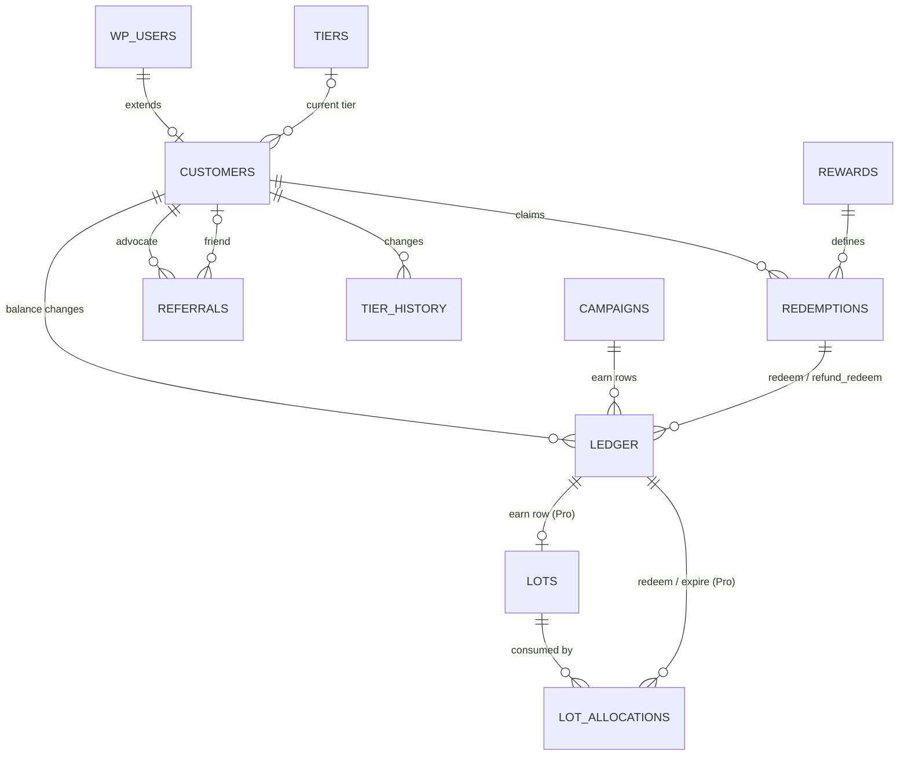

# YayLoyalty — Data Model Reference

|                    |                                                                                                    |
| ------------------ | -------------------------------------------------------------------------------------------------- |
| **Version**        | 0.8 — redemption scaffold reconciled                                                               |
| **Date**           | 23 September 2026                                                                                  |
| **Scope**          | Every table YayLoyalty owns across Free, Pro and later releases, every column, and how they relate |
| **Companion docs** | `project-roadmap.md` · `codebase-summary.md` · `system-architecture.md`                            |

## Implementation Status

**Implemented (1.0):** `yayloyalty_campaigns`, `yayloyalty_rewards`, `yayloyalty_customers`, `yayloyalty_ledger`

**Not implemented:** `redemptions`, `referrals`, `referral_visits`, `tiers`, `tier_history`, `lots`, `lot_allocations`, `events`

Note: `rewards` table exists with schema and repository; seeding works; checkout integration not built.

Note: `redemptions` has a schema class (`Database/Schema/RedemptionsTable.php`), a model (`Models/Redemption.php`, real) and a repository (`Repositories/RedemptionRepository.php`, stubs), but no table — `RedemptionsTable` is deliberately absent from `Installer::schemas()` and its `definition()` throws, so nothing creates it. Registering it there is the F08 step that installs the table on the next upgrade.

See [`project-roadmap.md`](./project-roadmap.md) for implementation status by phase and known gaps. The table specifications below are the authoritative schema design; unimplemented tables are the work plan for phases 1.1, 1.2, and 2.0.

## Conventions

All tables use the site prefix (`{$wpdb->prefix}yayloyalty_*`), InnoDB, `utf8mb4_unicode_520_ci`. Every `DATETIME` is UTC; conversion to the site timezone happens at the edges (admin forms, emails). Points columns are `BIGINT` signed, not `INT` — a store awarding 1 point per VND or per JPY can push a lifetime total past 2.1 billion. Money is `DECIMAL(19,4)`. Ids are `BIGINT UNSIGNED`. JSON is stored in `LONGTEXT` and validated in PHP (WooCommerce's minimum MySQL/MariaDB versions do not guarantee a native `JSON` type); every JSON blob carries a `schema_version` key so formats can evolve without table migrations. Foreign keys are logical, enforced by the services, not by `FOREIGN KEY` constraints — WordPress installs cannot rely on them.

Tables are created with `dbDelta` and versioned by the `yayloyalty_db_version` option; columns marked with a later phase are added by that release's migration, not created empty in 1.0.

Two design rules apply everywhere:

1. **The ledger is the truth; `customers` is a cache.** Every number on a customer row can be rebuilt by replaying that customer's ledger, and a "Rebuild balances" tool does exactly that.
2. **Status is intent; liveness is derived.** `status` columns store what the merchant chose (`active`, `paused`, `draft`). Whether something is live _right now_ is computed from `status` plus `starts_at`/`ends_at` at read time. No job flips statuses on a clock.

## Table overview

| Table                        | Kind              | Phase   | One row per                         |
| ---------------------------- | ----------------- | ------- | ----------------------------------- |
| `yayloyalty_campaigns`       | definition        | 1.0     | earning rule                        |
| `yayloyalty_rewards`         | definition        | 1.0     | way to spend points                 |
| `yayloyalty_customers`       | state             | 1.0     | member (extends `wp_users`)         |
| `yayloyalty_ledger`          | fact, append-only | 1.0     | balance change                      |
| `yayloyalty_redemptions`     | fact              | 1.0     | reward claim                        |
| `yayloyalty_referrals`       | fact              | 1.1     | referral relationship               |
| `yayloyalty_referral_visits` | fact, prunable    | 1.1     | referral link click                 |
| `yayloyalty_tiers`           | definition        | 1.2     | VIP level                           |
| `yayloyalty_tier_history`    | fact              | 1.2     | tier change                         |
| `yayloyalty_lots`            | fact              | 1.0 Pro | expiring batch of earned points     |
| `yayloyalty_lot_allocations` | fact              | 1.0 Pro | consumption of a lot                |
| `yayloyalty_events`          | fact, outbox      | 2.0     | domain event for webhooks/analytics |

---

## `yayloyalty_campaigns` — earning rules (1.0)

One row per way to earn points. Free seeds three built-in rows and shows only #1 as a settings page; Pro shows the list. For any event, the engine takes the live campaigns of that trigger type in priority order and applies the first whose conditions match.

| Column         | Type               | Null / default                                                             | Meaning                                                                                                                                                                                                                                                                                                                                                                                                                                                                                        |
| -------------- | ------------------ | -------------------------------------------------------------------------- | ---------------------------------------------------------------------------------------------------------------------------------------------------------------------------------------------------------------------------------------------------------------------------------------------------------------------------------------------------------------------------------------------------------------------------------------------------------------------------------------------- |
| `id`           | BIGINT UNSIGNED AI | PK                                                                         | Row id. Referenced by `ledger.campaign_id`.                                                                                                                                                                                                                                                                                                                                                                                                                                                    |
| `name`         | VARCHAR(191)       | not null                                                                   | Merchant-facing label. Appears in the customer's history ("Earned — Double Points Weekend") and Pro analytics.                                                                                                                                                                                                                                                                                                                                                                                 |
| `slug`         | VARCHAR(64)        | unique                                                                     | Stable machine key. Built-ins are `default-purchase`, `signup`, `review`; templates get their own. Code, filters and import/export address campaigns by slug because ids differ between sites.                                                                                                                                                                                                                                                                                                 |
| `trigger_type` | VARCHAR(32)        | not null, idx                                                              | The event that fires the campaign: `purchase`, `signup`, `review` (1.0); `birthday`, `first_order`, `order_count`, `spend_milestone`, `referral`, `social`, `renewal` (Pro). Determines which keys `config` may contain. Named `trigger_type`, not `trigger` — `trigger` is a reserved word in MySQL/MariaDB. `Enums\CampaignTrigger`: `all()` is what this build can fire, `all_known()` is the full stored vocabulary; `referral`/`social`/`renewal` are recognised but not yet implemented. |
| `status`       | VARCHAR(20)        | not null, `active`                                                         | Merchant intent only: `active`, `paused`, `draft`, `archived`. Never `scheduled` or `ended` stored — those are derived at read time by `Enums\Status::resolve_display()` from an `active` status plus the date window.                                                                                                                                                                                                                                                                         |
| `priority`     | INT                | not null, `0`                                                              | Among live campaigns of the same trigger, the highest priority wins; ties go to the newest (`id` DESC). The default purchase campaign is `0`, so any Pro campaign that matches replaces it.                                                                                                                                                                                                                                                                                                    |
| `config`       | LONGTEXT (JSON)    | not null, no SQL default (TEXT columns cannot carry one — PHP writes `{}`) | The numbers, keyed by `trigger_type`. Validated on save against a per-trigger map (`Campaign::config_schema()` for the 1.0 triggers, typed; the four Pro triggers via the `yayloyalty_campaign_config_whitelist` seam). Unknown keys and wrong types are rejected before the row is written. Shapes below.                                                                                                                                                                                     |
| `conditions`   | LONGTEXT (JSON)    | not null, no SQL default (PHP writes `[]`)                                 | Eligibility rules, ANDed — no OR, no nesting. A JSON list of `{type, operator, value}`; `[]` means "applies to everyone". Full schema in [`conditions` — eligibility rules](#conditions--eligibility-rules) below. Empty in Free; authored in Pro.                                                                                                                                                                                                                                             |
| `starts_at`    | DATETIME           | null                                                                       | Live from this instant (inclusive). Null = no start bound. Free never sets it.                                                                                                                                                                                                                                                                                                                                                                                                                 |
| `ends_at`      | DATETIME           | null                                                                       | Live until this instant (exclusive), so back-to-back campaigns never overlap. Null = no end bound.                                                                                                                                                                                                                                                                                                                                                                                             |
| `is_builtin`   | TINYINT(1)         | `0`                                                                        | `1` for the three seeded rows: cannot be deleted, cannot be archived; the Free UI binds to them.                                                                                                                                                                                                                                                                                                                                                                                               |
| `created_by`   | BIGINT UNSIGNED    | null                                                                       | Admin who created it (audit).                                                                                                                                                                                                                                                                                                                                                                                                                                                                  |
| `updated_by`   | BIGINT UNSIGNED    | null                                                                       | Admin who last saved it (audit).                                                                                                                                                                                                                                                                                                                                                                                                                                                               |
| `created_at`   | DATETIME           | not null                                                                   | UTC.                                                                                                                                                                                                                                                                                                                                                                                                                                                                                           |
| `updated_at`   | DATETIME           | not null                                                                   | UTC. Bumped on every save.                                                                                                                                                                                                                                                                                                                                                                                                                                                                     |
| `archived_at`  | DATETIME           | null                                                                       | UTC. Set by `Campaign::set_status()` when `status` becomes `archived`, cleared when it leaves.                                                                                                                                                                                                                                                                                                                                                                                                 |

All `DATETIME` columns are UTC (see Conventions). `starts_at` is inclusive, `ends_at` is **exclusive** — a campaign the merchant ends on 30 Nov is stored as `2026-12-01 00:00:00`, so back-to-back windows never overlap.

Indexes: PK; `UNIQUE KEY uk_slug (slug)`; `KEY idx_lookup (trigger_type, status, priority)` for selection; `KEY idx_archived (status, archived_at)` for the archived-campaigns view. The former single-column `starts_at` / `ends_at` indexes were dropped: selection filters the date window in SQL.

Liveness: `status = 'active' AND (starts_at IS NULL OR starts_at <= now) AND (ends_at IS NULL OR ends_at > now)`, evaluated against the event's timestamp (the order's award time, not the request time). `Enums\Status::is_live_at()`.

Caching: `CampaignRepository::all_non_archived()` is cached in `wp_cache` group `yayloyalty` key `campaigns_non_archived` with TTL 3600 seconds. Cache is flushed on insert, update, or delete. Method `flush_cache()` is public for testing.

### config shapes

`config` keys per `trigger_type`. The 1.0 triggers are typed and validated in `Campaign::config_schema()`; the Pro triggers are key lists contributed by `YayLoyaltyPro::add_config_keys()` (kept whitelisted in Free so a downgrade does not lose them).

| Trigger           | Keys                                                                                                                                                                                                                                                                                                                                                                                                                                                                |
| ----------------- | ------------------------------------------------------------------------------------------------------------------------------------------------------------------------------------------------------------------------------------------------------------------------------------------------------------------------------------------------------------------------------------------------------------------------------------------------------------------- |
| `purchase`        | `points_per_unit` (number ≥ 0), `base` (`after_discounts` \| `before_discounts`), `mode` (`rate` \| `multiplier`, for point calculation mode), `multiplier` (for multiplier mode), `include_shipping` (bool), `include_tax` (bool), `rounding` (`down` \| `nearest` \| `up`), `min_subtotal` (number ≥ 0), `exclude_coupon_orders` (bool), `excluded_product_ids[]` (int), `excluded_category_ids[]` (int), `max_points_per_order` (int ≥ 0), `daily_cap` (int ≥ 0) |
| `signup`          | `points` (int ≥ 0)                                                                                                                                                                                                                                                                                                                                                                                                                                                  |
| `review`          | `points` (int ≥ 0, default 50), `require_verified` (bool, default true), `one_per_product` (bool, default true), `daily_cap` (int ≥ 0, default 0), `media_bonus_points` (int ≥ 0, Pro)                                                                                                                                                                                                                                                                              |
| `first_order`     | `points`, `min_subtotal`                                                                                                                                                                                                                                                                                                                                                                                                                                            |
| `order_count`     | `points`, `order_count` (the N to reach), `repeat` (fire every N, or once)                                                                                                                                                                                                                                                                                                                                                                                          |
| `spend_milestone` | `points`, `spend_amount` (threshold), `repeat`                                                                                                                                                                                                                                                                                                                                                                                                                      |
| `birthday`        | `points`, `days_before` (fire this many days ahead of the date)                                                                                                                                                                                                                                                                                                                                                                                                     |

Built-in seed configs: `default-purchase` — 1 pt/unit, `after_discounts`, shipping and tax excluded, rounding `down`; `signup` — 100 pts; `review` — 50 pts, verified only.

### `conditions` — eligibility rules

One row's `conditions` is a JSON **list** of `{type, operator, value}` objects, stored via the `{schema_version, items:[]}` envelope (`Json::encode_list`). All entries are **ANDed**; there is no OR and no nesting. `[]` (the default) means no restrictions. At most **one entry per type** — a duplicate type is rejected on save.

`Enums\CampaignConditionType` holds the vocabulary and the per-type map (operators + value shape); `Models\CampaignConditionSet` validates and normalises a set on save (`CampaignRestController` runs `Campaign::conditions_are_valid()` and answers 4xx; `Campaign::set_conditions()` normalises), mirroring the `config` pair. `Models\CampaignCondition` is the per-entry value object. Named `Campaign*` rather than a bare `Condition*`: rewards have their own condition vocabulary (`Enums\RewardConditionType` / `Models\RewardConditionSet` / `Models\RewardCondition` — see the rewards table's own `conditions` section), and the two must not collide. The two implementations are independent — neither `extends` the other, each free to diverge — except for two things that are genuinely identical between them today, shared rather than duplicated: `Enums\ConditionTypeMethods`, a trait supplying `all()`/`all_known()`/`is_valid()`/`is_known()`/`operators_for()`/`assert()` (each enum still declares its own `schema()` and `UNAVAILABLE`), and `Utils\ConditionValueRules`, the value-shape logic (`int`, `int_list`, `string_list`, and the `between`/list-cap/integer checks underneath them). Both exist so a fix to that logic is made once, not twice.

**Types** — declared cheap-first: the ones above the line are satisfied from data already loaded for the order; the three below each need their own aggregate query, so a future evaluator checks them last and short-circuits on the first failure.

| Type               | Operators                                 | Value                                                                                                                                                                                                                                                                                                                                                                                                               |
| ------------------ | ----------------------------------------- | ------------------------------------------------------------------------------------------------------------------------------------------------------------------------------------------------------------------------------------------------------------------------------------------------------------------------------------------------------------------------------------------------------------------- |
| `user_role`        | `in`, `not_in`                            | list of WP role slugs (lower-cased)                                                                                                                                                                                                                                                                                                                                                                                 |
| `customer_ids`     | `in`, `not_in`                            | list of user ids (int). **Hard cap 100** — past that, save is rejected pointing the merchant at `user_role` or `tier`                                                                                                                                                                                                                                                                                               |
| `currency`         | `in`, `not_in`                            | list of ISO 4217 codes (upper-cased, validated)                                                                                                                                                                                                                                                                                                                                                                     |
| `payment_method`   | `in`, `not_in`                            | list of WooCommerce gateway ids                                                                                                                                                                                                                                                                                                                                                                                     |
| `country`          | `in`, `not_in`                            | `{ "countries": [ISO 3166-1 alpha-2, …], "source": "shipping" \| "billing" \| "any" }`. `source` is **required, no default** — the shipping address is absent on virtual and downloadable orders, so it is never assumed. Codes upper-cased and validated. Replaces what would have been `shipping_country`.                                                                                                        |
| `product_in_cart`  | `in`, `not_in`                            | list of product ids (int)                                                                                                                                                                                                                                                                                                                                                                                           |
| `category_in_cart` | `in`, `not_in`                            | list of category term ids (int)                                                                                                                                                                                                                                                                                                                                                                                     |
| `tier`             | `in`, `not_in`, `gte`, `lte`              | tier slug, or a list for `in`/`not_in`. **Not available yet** — the tier system is a later task, so `tier` is defined in the vocabulary (`CampaignConditionType::all_known()`) but excluded from `all()`, so a merchant cannot create one today. `gte`/`lte` are ordinal ("Silver or above"), which is why the future `yayloyalty_tiers` table needs an integer ordinal column (`rank`, see the tiers table below). |
| `lifetime_points`  | `gte`, `lte`, `gt`, `lt`, `eq`, `between` | integer; `between` takes `[low, high]`, `low <= high`                                                                                                                                                                                                                                                                                                                                                               |
| `order_count`      | `gte`, `lte`, `gt`, `lt`, `eq`, `between` | integer; `between` as above                                                                                                                                                                                                                                                                                                                                                                                         |
| `lifetime_spend`   | `gte`, `lte`, `gt`, `lt`, `eq`, `between` | `{ "amount": <number>, "currency": "USD" }` — **never a bare number**. `currency` is required and ISO 4217 validated (upper-cased on save). Only orders **in that same currency** count toward the total; there is no exchange-rate conversion. For `between`, `amount` is `[low, high]`.                                                                                                                           |

Operators are **not** interchangeable — each type accepts only the operators listed. An operator outside the set, an unknown type, a wrong value shape, an empty list value, a missing required sub-key (`currency`, `source`), a duplicate type, or `customer_ids` over cap — all are rejected before the row is written.

**Normalisation on save:** a scalar is widened to a one-element array where the type expects a list; ids are cast to int; country and currency codes are upper-cased; role slugs are lower-cased; lists are de-duplicated; entries are re-ordered cheap-first.

**`product_in_cart` / `category_in_cart` are order-level gates, not line-item scopes.** If the order contains a matching item, the order qualifies and the campaign's **full** point calculation applies to the **entire** order — these do **not** restrict points to the matching line items. Per-line scoping (excluding products/categories from the points base) belongs in `config` (`excluded_product_ids` / `excluded_category_ids`), not here.

**Evaluation** (Pro; `Pro\Services\ConditionsEvaluator`, attached via the `yayloyalty_campaign_conditions_evaluator` seam). The seam passes the engine `Context` — customer facts pre-read by `ContextFactory::customer_facts()` (`Engine\Points\CustomerFacts`) plus the order's own currency, coupons and lines — so the evaluator is meant to compare, never query. Interim: it still folds `explain()` over the user id, so today it covers the customer-fact conditions — `user_role`, `customer_ids`, `lifetime_points`, `order_count`, `lifetime_spend` (same-currency, capped at the 100 newest paid orders). `product_in_cart` / `category_in_cart` fall back to purchase history until the award engine passes the order. `currency`, `country` and `payment_method` describe the order, not the customer, so they are reported as `unsupported_condition_type` — and, per Pro's fail-closed rule for anything it cannot evaluate, do not match — until that engine lands. `tier` is unevaluable until the tier system exists. Lite has no evaluator, so it treats any non-empty set as matching.

## `yayloyalty_rewards` — ways to spend points (1.0)

One row per reward. Free seeds one built-in row (the flexible cart discount) and shows it as the "Redeeming" settings page; Pro shows the list and adds catalog items, each backed by a real single-use WooCommerce coupon issued at claim time.

| Column        | Type               | Null / default                                                             | Meaning                                                                                                                                                                                                                                                                                                                                                                                                                                                                     |
| ------------- | ------------------ | -------------------------------------------------------------------------- | --------------------------------------------------------------------------------------------------------------------------------------------------------------------------------------------------------------------------------------------------------------------------------------------------------------------------------------------------------------------------------------------------------------------------------------------------------------------------- |
| `id`          | BIGINT UNSIGNED AI | PK                                                                         | Referenced by `redemptions.reward_id`.                                                                                                                                                                                                                                                                                                                                                                                                                                      |
| `name`        | VARCHAR(191)       | not null                                                                   | Label in the launcher, catalog and history ("$5 off", "Free shipping").                                                                                                                                                                                                                                                                                                                                                                                                     |
| `slug`        | VARCHAR(64)        | unique                                                                     | Stable machine key. Built-in is `cart-discount`. Same rationale as campaigns: code, filters and import/export address rewards by slug because ids differ between sites.                                                                                                                                                                                                                                                                                                     |
| `type`        | VARCHAR(32)        | not null                                                                   | What redeeming this reward does: `flexible_discount` (1.0) — a slider; the customer picks the amount within limits. Pro: `fixed_coupon`, `percent_coupon`, `free_shipping`, `free_product` — fixed-cost catalog items. `Enums\RewardType`: `all()` is what this build offers, `all_known()` is the full stored vocabulary — same asymmetry as `CampaignTrigger`, for the same downgrade-safety reason.                                                                      |
| `status`      | VARCHAR(20)        | not null, `active`                                                         | Merchant intent only: `active`, `paused`, `draft`, `archived`. Same rule as campaigns — never `scheduled` or `ended` stored; those are derived at read time by `Enums\Status::resolve_display()`.                                                                                                                                                                                                                                                                           |
| `sort_order`  | INT                | not null, `0`                                                              | Display order in launcher and catalog.                                                                                                                                                                                                                                                                                                                                                                                                                                      |
| `cost_points` | BIGINT UNSIGNED    | null                                                                       | Fixed cost for a catalog item. **Coupled to `type`, enforced in PHP**: null for `flexible_discount` — the customer picks the amount, so a fixed cost would be meaningless — and required, `>= 1`, for every other type. The database cannot express a rule that depends on another column's value, so `Reward::cost_points_is_valid()` checks both directions before the row is written; a `fixed_coupon` that slipped through with a null cost would be a free redemption. |
| `config`      | LONGTEXT (JSON)    | not null, no SQL default (TEXT columns cannot carry one — PHP writes `{}`) | The numbers, keyed by `type`. Validated on save against a per-type map (`Reward::config_schema()` for `flexible_discount`, the 1.0 type, typed; the four Pro types via the `yayloyalty_reward_config_whitelist` seam — key names only, untyped, mirroring how campaigns treat their own Pro-only triggers). Unknown keys and wrong types are rejected before the row is written. Shapes below.                                                                              |
| `conditions`  | LONGTEXT (JSON)    | not null, no SQL default (PHP writes `[]`)                                 | Availability rules, ANDed — no OR, no nesting. A JSON list of `{type, operator, value}`; `[]` means "available to everyone". Full schema in [`conditions` — availability rules](#conditions--availability-rules) below.                                                                                                                                                                                                                                                     |
| `starts_at`   | DATETIME           | null                                                                       | Live from this instant (inclusive). Null = no start bound.                                                                                                                                                                                                                                                                                                                                                                                                                  |
| `ends_at`     | DATETIME           | null                                                                       | Live until this instant (exclusive), so back-to-back availability windows never overlap. Null = no end bound.                                                                                                                                                                                                                                                                                                                                                               |
| `is_builtin`  | TINYINT(1)         | `0`                                                                        | `1` for the seeded cart-discount row: cannot be deleted, cannot be archived; the Free UI binds to it.                                                                                                                                                                                                                                                                                                                                                                       |
| `created_by`  | BIGINT UNSIGNED    | null                                                                       | Admin who created it (audit).                                                                                                                                                                                                                                                                                                                                                                                                                                               |
| `updated_by`  | BIGINT UNSIGNED    | null                                                                       | Admin who last saved it (audit).                                                                                                                                                                                                                                                                                                                                                                                                                                            |
| `created_at`  | DATETIME           | not null                                                                   | UTC.                                                                                                                                                                                                                                                                                                                                                                                                                                                                        |
| `updated_at`  | DATETIME           | not null                                                                   | UTC. Bumped on every save.                                                                                                                                                                                                                                                                                                                                                                                                                                                  |
| `archived_at` | DATETIME           | null                                                                       | UTC. Set by `Reward::set_status()` when `status` becomes `archived`, cleared when it leaves.                                                                                                                                                                                                                                                                                                                                                                                |

All `DATETIME` columns are UTC (see Conventions). `starts_at` is inclusive, `ends_at` is **exclusive** — same convention as campaigns.

Indexes: PK; `UNIQUE KEY uk_slug (slug)`; `KEY idx_catalog (status, sort_order)` for the launcher/catalog listing; `KEY idx_archived (status, archived_at)` for the archived-rewards view.

Liveness: `status = 'active' AND (starts_at IS NULL OR starts_at <= now) AND (ends_at IS NULL OR ends_at > now)` — `Enums\Status::is_live_at()`, the same implementation campaigns use.

No caching: `RewardRepository` queries the table directly; nothing yet knows the right cache key or invalidation, and the table is small. That belongs to whichever task builds the redemption engine.

### config shapes

`config` keys per `type`. `flexible_discount` is typed and validated in `Reward::config_schema()`; the Pro types are key lists contributed by `YayLoyaltyPro::add_reward_config_keys()` (kept whitelisted in Free so a downgrade does not lose them).

| Type                | Keys                                                                                                                                                                                                                                                                                                                                                                                                                  |
| ------------------- | --------------------------------------------------------------------------------------------------------------------------------------------------------------------------------------------------------------------------------------------------------------------------------------------------------------------------------------------------------------------------------------------------------------------- |
| `flexible_discount` | `currency` (ISO 4217, **required**), `points_per_currency_unit` (number ≥ 0), `min_points` (int ≥ 0), `max_points_per_order` (number ≥ 0, nullable — null means uncapped), `max_percent_of_subtotal` (number ≥ 0, nullable), `increment` (int ≥ 1), `show_on[]` (`cart` \| `checkout`), `refund_policy` (`proportional` \| `full` \| `none`), `max_total` (number ≥ 0, nullable — a global redemption cap; see below) |
| `fixed_coupon`      | `currency`, `amount`, `min_order`, `coupon_expiry_days`, `exclude_sale_items`, `max_total`                                                                                                                                                                                                                                                                                                                            |
| `percent_coupon`    | `percent`, `max_discount`, `currency`, `min_order`, `coupon_expiry_days`, `exclude_sale_items`, `max_total`                                                                                                                                                                                                                                                                                                           |
| `free_shipping`     | `min_order`, `currency`, `coupon_expiry_days`, `max_total`                                                                                                                                                                                                                                                                                                                                                            |
| `free_product`      | `product_id`, `variation_id`, `qty`, `coupon_expiry_days`, `max_total`                                                                                                                                                                                                                                                                                                                                                |

`currency` is required wherever a type's config carries a money value — without it, an amount or a points-to-currency rate is ambiguous on any store whose base currency changes or that sells in more than one. `flexible_discount` is the only type this build type-checks that requirement for; Pro validates its own.

`max_total` is a global redemption cap, present on every type, null for unlimited. It exists so an uncapped discount cannot be drained further than the merchant intended once something enforces it — stored from 1.0 even though nothing does yet.

Built-in seed config (`cart-discount`, `flexible_discount`): store currency, 100 points per currency unit, 100-point minimum, no per-order or per-cent caps, a 100-point increment, shown on both cart and checkout, proportional refund policy, no global cap.

### `conditions` — availability rules

One row's `conditions` is a JSON **list** of `{type, operator, value}` objects, stored via the `{schema_version, items:[]}` envelope (`Json::encode_list`), same shape as campaigns. All entries are **ANDed**; there is no OR and no nesting. `[]` (the default) means available to everyone. At most **one entry per type** — a duplicate type is rejected on save.

`Enums\RewardConditionType` holds the vocabulary and the per-type map; `Models\RewardConditionSet` validates and normalises a set on save (`Reward::conditions_are_valid()` rejects — no reward write path calls it yet; `Reward::set_conditions()` normalises), mirroring the `config` pair — the same relationship `CampaignConditionSet` has to campaigns. It is an **independent implementation**, not a subclass or a shared set: rewards and campaigns are independent features expected to diverge, so each has its own vocabulary file, value object (`Models\RewardCondition`, identical in shape to `CampaignCondition` today; kept separate so each side can grow its own accessors) and Set class. Two things are shared, both because they were byte-identical, not because the vocabularies were merged: `Enums\ConditionTypeMethods`, a trait (not a base class — neither type `extends` the other) supplying `all()`/`all_known()`/`is_valid()`/`is_known()`/`operators_for()`/`assert()`, while `schema()` and `UNAVAILABLE` stay on each class; and `Utils\ConditionValueRules` for the `int` / `int_list` / `string_list` value-shape checks and their edge cases (`between` pairs, list caps, the integer check).

**Types** — declared cheap-first, same convention as campaigns: `user_role` and `customer_ids` are already known for the customer being evaluated; `tier` reads a column on the same row (gated, see below); `lifetime_points` needs one extra read; `redemption_count` needs its own query and is checked last.

| Type               | Operators                                 | Value                                                                                                                                                                                                                                                                                                                                                                                                                                                                                       |
| ------------------ | ----------------------------------------- | ------------------------------------------------------------------------------------------------------------------------------------------------------------------------------------------------------------------------------------------------------------------------------------------------------------------------------------------------------------------------------------------------------------------------------------------------------------------------------------------- |
| `user_role`        | `in`, `not_in`                            | list of WP role slugs (lower-cased)                                                                                                                                                                                                                                                                                                                                                                                                                                                         |
| `customer_ids`     | `in`, `not_in`                            | list of user ids (int). **Hard cap 100** — past that, save is rejected pointing the merchant at `user_role` or `tier`                                                                                                                                                                                                                                                                                                                                                                       |
| `tier`             | `in`, `not_in`, `gte`, `lte`              | tier slug, or a list for `in`/`not_in`. **Not available yet** — same gating as campaigns: defined in the vocabulary (`RewardConditionType::all_known()`) but excluded from `all()` until the tier system exists.                                                                                                                                                                                                                                                                            |
| `lifetime_points`  | `gte`, `lte`, `gt`, `lt`, `eq`, `between` | integer; `between` takes `[low, high]`, `low <= high`                                                                                                                                                                                                                                                                                                                                                                                                                                       |
| `redemption_count` | `lt`, `lte`, `eq`                         | non-negative integer. How many times **this customer** has already redeemed **this reward**. `{"type":"redemption_count","operator":"lt","value":1}` is "once per customer"; `lt 3` is "up to three times". Replaces what would have been a boolean `once_per_customer` flag — a flag would have been the only condition in this vocabulary with no operator and no value, a special case in validation, normalisation and any future UI row, and it could never express a limit above one. |

Operators are **not** interchangeable — each type accepts only the operators listed; note `redemption_count` has no `gte`/`gt`/`between`, only the "fewer than" shapes a cap needs. An operator outside the set, an unknown type, a wrong value shape, an empty list value, a duplicate type, `customer_ids` over cap, or a negative `redemption_count` — all are rejected before the row is written.

**Normalisation on save:** a scalar is widened to a one-element array where the type expects a list; ids are cast to int; role slugs are lower-cased; lists are de-duplicated; entries are re-ordered cheap-first.

**Conditions vs `config` — a per-customer fact is a condition; a reward-level property is `config`.** `redemption_count` is per customer, so it is a condition. `config`'s `max_total` looks similar (it caps how much a reward can be redeemed) but is a single global limit across every customer, not a fact about the one being evaluated — so it stays in `config`. Use this test, not the ones a type "looks like it belongs with", when adding a new one.

**Evaluation timing differs from campaigns.** Reward conditions are evaluated **at claim time**, against the instant of the claim. A customer who qualifies as Gold, claims, then drops to Silver keeps the coupon already issued — there is no retroactive re-check, and no order-award timestamp the way `Campaign::is_live_at()` / campaign condition evaluation has one. Do not assume the two evaluate alike.

**Evaluation** (engine and UI not built yet — a later task). The engine must evaluate `redemption_count` at claim time, not against any stored liveness window, and query via `COUNT(*) FROM yayloyalty_redemptions WHERE reward_id = ? AND user_id = ?` using the composite index above.

## `yayloyalty_customers` — one row per member (1.0)

A 1:1 extension of `wp_users`. Created eagerly at WP registration — `user_register` (fired by `wp_insert_user()`, including admin-created accounts) → `CustomerActivityListener::on_user_register()` → `CustomerRepository::ensure_row()`, balance 0, no ledger write; staff (a user with `edit_posts` or `manage_woocommerce`, WooCommerce's own back-office rule) are skipped. `ensure_row()` is also still called from inside `LedgerService::record()`, so a member who somehow reaches a ledger write without going through registration (legacy row, external insert) still self-heals. Holds cached aggregates for O(1) storefront reads and indexed columns for admin sorting/filtering, plus state that is not a ledger aggregate at all (expiry, tier, referral code). Updated inside the same transaction as the ledger row that justifies the change, always after `CustomerRepository::lock_and_get()` — that row lock is what serialises concurrent earns and redeems for one user. `balance`, like every other aggregate (`lifetime_earned`, `lifetime_redeemed`, `last_activity_at`), is written by `LedgerService`/`CustomerRepository::apply_delta()` in PHP — a relative `balance = balance + %d` update issued from inside the same row lock as the other aggregate writes, not a DB trigger; the others are conditional on `LedgerType`, not a plain running sum, which is why they cannot be triggers either. Tier/referral columns are updated by their own services.

The `(1.1)`/`(1.2)`/`(Pro)` tags below mark when a column's _feature_ ships, not when the _column_ does — `lifetime_spend`, `tier_*`, `referral_code` and `birthday_*` are all created by the 1.0 install so that a later release is a data migration (populate an existing NULL/0 column), not a schema change. See `CustomersTable::definition()`.

| Column | Type | Null / default | Meaning |
|---|---|---|---|
| `user_id` | BIGINT UNSIGNED | PK | `wp_users.ID`. Row existence = "is a member" — since the `user_register` hook, that now means every non-staff WP user, not only ones with loyalty activity. |
| `balance` | BIGINT | not null, `0` | Spendable points. Signed: a clawback after a refund can push it below zero, which the dashboard flags. Equals `SUM(ledger.points)` for the user. |
| `pending_points` | BIGINT UNSIGNED | not null, `0` | Points on orders that exist but have not reached the award status. Shown as "pending" in the launcher; never spendable. Equals the sum of `_yayloyalty_points_pending` across the user's unawarded orders. |
| `lifetime_earned` | BIGINT | not null, `0` | Net points ever earned: `earn` + positive `adjust` − `refund_earn`. Unaffected by `redeem` and `expire`. This, not `balance`, is the tier basis in points mode — so spending points never demotes anyone. |
| `lifetime_redeemed` | BIGINT UNSIGNED | not null, `0` | `|redeem|` − `refund_redeem`. Dashboard and per-customer stats. |
| `lifetime_spend` | DECIMAL(19,4) | `0` (1.2) | Net paid order totals in base currency, maintained from order award/refund events. Tier basis in spend mode. The one aggregate not derivable from the ledger; rebuilt from orders. |
| `last_activity_at` | DATETIME | null | Timestamp of the last `earn` or `redeem`. Drives inactivity expiry. |
| `expires_at` | DATETIME | null, idx | `last_activity_at` + expiry days from settings; null when expiry is off. The daily expiry job selects on this index. |
| `reminder_sent_at` | DATETIME | null | When the "expiring soon" email last went out; cleared on activity so the next window gets one reminder, never two. |
| `tier_id` | BIGINT UNSIGNED | null, idx (1.2) | Current tier; null = base level. Latest row of `tier_history`. |
| `tier_evaluated_at` | DATETIME | null (1.2) | When the tier was last evaluated; the downgrade job uses it to find customers whose evaluation window has ended. |
| `tier_progress_value` | DECIMAL(19,4) | null (1.2) | Cached basis value for "$120 to Gold" in the launcher when the basis is rolling-12-month (which is expensive to compute per request). |
| `referral_code` | VARCHAR(32) | null, unique (1.1) | Generated the first time the customer opens the referral UI. Upper-case, ambiguity-free alphabet. Rotatable; old codes live on in `referrals.referral_code`. |
| `birthday_month` / `birthday_day` | TINYINT | null (Pro) | No year — only the annual trigger needs it, and it keeps the row out of sensitive-data territory. Idempotency for the yearly award is the ledger's `idempotency_key` `earn:{user_id}:birthday:{year}:birthday`. |
| `joined_at` | DATETIME | not null | When the row was created — the program join date for cohorts. |
| `updated_at` | DATETIME | not null | |

Indexes: PK; `expires_at`, `tier_id`, `balance`, `last_activity_at`, `lifetime_earned`, `lifetime_redeemed`, `joined_at` (each a single-column index for sorting/filtering); UNIQUE `referral_code`; `idx_tier_review (tier_id, tier_evaluated_at)` (1.2) — the downgrade job's query is "customers in tier X whose evaluation window has ended", and the single-column `tier_id` index alone would still force scanning every customer in the tier.

**`deleted_at` (F09, real — derived, never a column).** The customer drawer's `GET /customers/{id}`
response carries `deleted_at: string | null` (`CustomerItemSchema::properties()`), and there will
never be a `deleted_at` column on this table: this row and its `balance` are kept forever,
byte-identical, after the underlying WP user is deleted — that frozen balance IS the outstanding
liability the drawer must keep showing. `deleted_at` is instead DERIVED, at read time, from the
latest `account_deleted` row in `yayloyalty_customer_meta` (below), gated on `get_userdata()`
currently returning `false` too — not row existence alone, so a WP user id that is deleted then
reinstated (backup restore, migration tooling) automatically stops rendering as deleted, with no
"undelete" event needed. Identity (`name`/`email`) falls back to that row's `display_name`/`email`
snapshot once the live `WP_User` is gone. See `CustomerItemFormatter::format()`.

## `yayloyalty_ledger` — every balance change (1.0)

Append-only journal. Nothing updates or deletes rows except GDPR erasure (which sets `user_id = 0`, `actor_id = NULL`, clears `note`) — a future erasure/export tool must also reach `yayloyalty_customer_meta` (below), the one other place PII survives a WP user deletion, AND every OTHER customer's rows too: `actor_name` snapshots the display name of whichever staff member performed an action, scattered across an unbounded number of other customers' activity logs, so a staff member's own erasure request has no defined scope without walking `customer_meta` broadly, not just the deleted customer's own row. One `earn` row per order **per trigger**: within a trigger stacking is highest-priority-only, across triggers an order may earn once each (`purchase`, then Pro's `first_order` …). The idempotency guarantee against duplicate hooks, status bouncing and webhook retries is one column under one unique index: `idempotency_key`, composed by `Engine\Earning\IdempotencyKey` as `{type}:{user_id}:{reference_type}:{reference_id}:{qualifier}` (`earn:7:order:1234:purchase`, `redeem:7:redemption:88:flexible_discount`). The qualifier is a `CampaignTrigger` on `earn`/`refund_earn` rows and a `RewardType` on `redeem`/`refund_redeem` rows — any build's, so a Pro value stays composable after a downgrade. The user is in the key because one reference can pay two people (a referral order pays advocate and friend); the qualifier because one reference may move points once per trigger when earning and once per reward type when redeeming. The former composite `uniq_ledger_event (user_id, source, reference_type, reference_id)` is no longer in the DDL; `Installer::run_migrations()` drops it on upgraded sites (stubbed until F01-4 — until then both indexes coexist there, harmlessly, since only NULL-keyed adjust rows exist).

| Column | Type | Null / default | Meaning |
|---|---|---|---|
| `id` | BIGINT UNSIGNED AI | PK | Referenced by `lots.ledger_id`, `lot_allocations.ledger_id`, `referrals.advocate_ledger_id`. |
| `user_id` | BIGINT UNSIGNED | not null, idx | Whose balance changed. |
| `points` | BIGINT | not null | Signed delta. Positive for `earn`, `refund_redeem`, positive `adjust`; negative for `redeem`, `refund_earn`, `expire`, negative `adjust`. |
| `balance_after` | BIGINT | not null | Balance immediately after this row. Display in history, and a chain check for a future audit tool (`prev.balance_after + points = this.balance_after`). |
| `type` | VARCHAR(20) | not null, idx | What kind of movement: `earn`, `redeem`, `refund_earn` (clawback of earned points after a refund), `refund_redeem` (return of redeemed points), `expire`, `adjust` (manual). |
| `source` | VARCHAR(20) | not null | Why: values from `Enums\LedgerSource` — `order`, `signup`, `review`, `referral`, `birthday`, `milestone`, `social`, `renewal`, `manual`, `import`, `expiry`, `system`. Lets history and analytics group without decoding references. |
| `reference_type` | VARCHAR(20) | null | Namespace of `reference_id`: values from `Enums\ReferenceType` — `order`, `refund`, `comment`, `redemption`, `referral`, `user`, `birthday`, `import`. |
| `reference_id` | BIGINT UNSIGNED | null | The id in that namespace: order id for `earn`, refund id for both `refund_*` types (so each partial refund is its own row), comment id for review earn, redemption id for `redeem`, year for `birthday`. |
| `campaign_id` | BIGINT UNSIGNED | null, idx | The campaign that produced an `earn` row. Null for everything else. Per-campaign analytics is `GROUP BY campaign_id`. `GET /campaigns/{id}/performance` is fixture-backed today but will aggregate over this column when implemented. |
| `redemption_id` | BIGINT UNSIGNED | null, idx | For `redeem` and `refund_redeem` rows: the claim this movement belongs to, so partial refunds can be tied back to one redemption. |
| `order_id` | BIGINT UNSIGNED | null, idx | Denormalised for every order-related row (`earn`, `refund_earn`, `redeem`, `refund_redeem`), so "all points activity for order #1234" is one indexed query for the order screen and support. |
| `note` | VARCHAR(500) | null | Admin reason on `adjust` rows only. System rows have no stored text: their description is composed at render time from `type`/`source`/reference, so it is translatable and never goes stale. |
| `actor_id` | BIGINT UNSIGNED | null | Admin user for manual rows; null for the system. |
| `idempotency_key` | VARCHAR(96) | null, unique | `Engine\Earning\IdempotencyKey::compose()` for system rows; NULL for `adjust`, which is deliberately not idempotent. The unique index is the guard; `LedgerService::earn()` and its redemption sibling `redeem()` attempt the insert and turn MySQL 1062 into `Outcome::duplicate`, a normal return. |
| `created_at` | DATETIME | not null | UTC. |

Indexes: PK; `idx_user_history (user_id, id)` for paged history and `ORDER BY id DESC LIMIT 1` balance lookups — `id`, not `created_at`, because same-second rows from one request would otherwise tie; UNIQUE `uniq_idempotency_key (idempotency_key)`; `campaign_id`; `redemption_id`; `order_id`; `(type, created_at)` for dashboard aggregates ("issued last 30 days").

Not on this table any more: `expires_at`. Per-earning expiry lives in `lots` (below) so the ledger stays immutable.

## `yayloyalty_customer_meta` — non-points customer facts + activity log (1.0)

Generic per-customer key-value event log, added to capture account-deletion + a first slice of the
activity log. `meta_key` doubles as the activity log's `event_type`; `created_at` doubles as
`occurred_at`; `meta_value` is a JSON envelope carrying `data` plus the three activity display
fields. Append-only by convention (no caller ever updates or deletes a row) — same discipline as
the ledger, but no unique key: multiple rows per key are normal (repeated `points_adjusted`), and
`account_created`/`account_deleted` once-only-ness is a write-side `has()` check, not a DB
constraint (an accepted, cosmetic-only race under concurrency).

| Column       | Type               | Null / default | Meaning                                                                                                                              |
| ------------ | ------------------ | -------------- | ------------------------------------------------------------------------------------------------------------------------------------ |
| `id`         | BIGINT UNSIGNED AI | PK             |                                                                                                                                      |
| `user_id`    | BIGINT UNSIGNED    | not null       | The member this fact/event belongs to.                                                                                               |
| `meta_key`   | VARCHAR(50)        | not null       | Also the activity log's `event_type`.                                                                                                |
| `meta_value` | LONGTEXT           | not null       | JSON envelope, see below. Validated in PHP (WooCommerce's minimum MySQL has no native JSON), same pattern as `campaigns.conditions`. |
| `created_at` | DATETIME           | not null       | UTC. Also the activity log's `occurred_at`.                                                                                          |

Indexes: PK; `idx_user_history (user_id, id)` (paged history, same rationale as the ledger's own index — `created_at` can tie within a second); `idx_user_key (user_id, meta_key)`, serving BOTH the group filter (`meta_key IN (...)`) and the `latest(user_id, 'account_deleted')` lookup — no standalone `meta_key` index, this table is never selective without `user_id`.

`meta_value` envelope (`schema_version = 1`):

```json
{
  "schema_version": 1,
  "data": {},
  "actor_kind": "staff|automatic|customer",
  "actor_name": "Jane|null",
  "staff_only": false
}
```

Eight `meta_key`/`event_type` values (`Enums\ActivityEvent::ALL`), only three of which have a writer today:

| `event_type`                                                                                        | Writer                                                                                                                                          | Status                                                                                                                                                                                                                                                  |
| --------------------------------------------------------------------------------------------------- | ----------------------------------------------------------------------------------------------------------------------------------------------- | ------------------------------------------------------------------------------------------------------------------------------------------------------------------------------------------------------------------------------------------------------- |
| `account_created`                                                                                   | `CustomerActivityService::record_account_created()`, on `yayloyalty_ledger_recorded`                                                            | **Real.** Means "first loyalty activity", NOT "WP user registered" — unlike `yayloyalty_customers` (now created eagerly at registration, see above), this activity row still appears lazily, only on first ledger write. No backfill: a member created before this shipped has no row.                                   |
| `points_adjusted`                                                                                   | `CustomerActivityService::record_points_adjusted()`, on `yayloyalty_ledger_recorded`, filtered to `LedgerType::ADJUST` + `LedgerSource::MANUAL` | **Real.**                                                                                                                                                                                                                                               |
| `account_deleted`                                                                                   | `CustomerActivityService::record_account_deleted()`, on `delete_user`/`wpmu_delete_user`                                                        | **Real.** One row: `email`/`display_name` snapshot, real `balance_at_deletion`/`kept_ledger_entries`, `void_coupons`/`credited_referrals`/`counted_in_members` always `null` (no redemptions/referrals/member-count feature exists — never fabricated). |
| `tier_changed`, `expiry_reset`, `reward_redeemed`, `balance_email_sent`, `expiring_soon_email_sent` | none                                                                                                                                            | **Unwritten** — tiers, the expiry job, redemptions and balance/expiry emails don't exist as features yet. A customer whose only history would be one of these legitimately has zero activity rows; that is the honest answer, not a bug.                |

**Lost-capture diagnostic (account-deletion capture is fire-and-forget by design — never blocks the real WP deletion, so a DB failure at the exact moment of `delete_user` loses that snapshot forever).** No tooling ships for this; it is a documented support/admin query only:

```sql
SELECT c.user_id
FROM yayloyalty_customers c
LEFT JOIN yayloyalty_customer_meta m
  ON m.user_id = c.user_id AND m.meta_key = 'account_deleted'
WHERE m.id IS NULL
```

Cross-check each returned `user_id` against `get_userdata()` returning `false` to confirm it is a real lost capture, not simply a live member who has never been deleted.

## Activity log — F09 Wave A/B, designed and partially implemented

The customer drawer's Activity log tab (F09) is a per-customer timeline distinct from the ledger:
tier changes, expiry resets, balance/expiring-soon reminder emails and admin actions — none of
which are balance changes, so none belong in `yayloyalty_ledger`. It is backed by
`yayloyalty_customer_meta` above. `GET /customers/{id}/activity` is a real, routed endpoint with
paging, a grouped filter and search, reading real rows for the three captured event types
(`includes/Controllers/ActivityRestController.php`); a customer whose only history would be one of
the five unwritten types gets an honest empty page, not an error.

The row shape: `{ id, occurred_at, event_type, data: {...}, actor_kind:
'staff'|'automatic'|'customer', actor_name: ?string, staff_only: bool }` — see `activity.schema.ts`
/ `ActivityRestController::define_item_schema()`. Same rule as the ledger's `note`/system-row
descriptions: no sentence is stored, `data` is structured and copy composes from `event_type` +
`data` at render time. `search` is a PHP-side match against `data`'s real content fields (+
`actor_name`), never the JSON envelope's structural keys — see
`CustomerMetaRepository::paginate_activity()`'s own docblock. `after`/`before` are UTC day bounds,
no site-timezone conversion, same as every other drawer date filter.

## Customer drawer wire blocks not backed by a table — F09 Wave B

- **`loose_ends`** — non-null exactly when `deleted_at` is non-null (above). `kept_ledger_entries`
  is always real (`COUNT(*)` on the ledger); `void_coupons`/`credited_referrals`/`counted_in_members`
  are always `null` — no redemptions/referrals/member-count feature exists — and render as "Not
  tracked yet" in the SPA rather than being hidden or fabricated. See
  `CustomerItemFormatter::format()`.
- **`negative_balance`** (labelled F23 in code) — `{ cause_ledger_id, cause_reason, cause_amount,
reversal_status }`, explaining a negative balance in place (a refund reversed more than was
  left). `null` whenever `balance >= 0`; the real path would have to walk the ledger backwards to
  assemble it, which it doesn't do yet.
- **`expiry.batches`** — the Pro FIFO lot table on the expiring-points panel: an array of
  `{ earned_from, earned_to, points, expires_at }`, or `null` on the Free build or when the store's
  expiry model has no batches. This is a **display-only preview** of what
  `yayloyalty_lots`/`yayloyalty_lot_allocations` (below) will eventually back — those tables are
  still unimplemented (Pro 1.0), so nothing here reads or writes them.
- **`points_per_currency_unit`** — a single number (not the removed `worth` object), the rate 4b's/
  5a's money-equivalent figures multiply by. Restored narrowly after an earlier commit removed
  `worth` wholesale.

All four parse through the same Zod schema (`customer.schema.ts`), same discipline as everything
else in this drawer.

**Admin Customers list (`CustomerRepository::paginate_list()`).** `LEFT JOIN`s `wp_users` (was
`INNER JOIN`): a deleted member's `customers` row must still appear in the list, with the total
liability it represents, not vanish from the result set/pagination/every filter.
`CustomerListFormatter::format_row()` falls back to the `account_deleted` snapshot for
`name`/`email` when the joined `u.*` columns come back `NULL` — display-only: the query's own
sort/search still runs against the raw (possibly `NULL`) joined columns, no `COALESCE` added.

## `yayloyalty_redemptions` — one row per reward claim (1.0, NOT IMPLEMENTED)

**Status:** Table not created. Schema designed, and since F08's scaffold the design is also in code: `Database/Schema/RedemptionsTable.php` declares `expected_columns()`/`expected_indexes()` matching the table below (its `definition()` is a `TODO(F08)` stub that throws), `Models\Redemption` is real and round-trips the row, `Repositories\RedemptionRepository` is stubs. Nothing installs it until `RedemptionsTable` joins `Installer::schemas()`, which is the step that creates the table on the next upgrade.

**F09 Wave B (phase 05):** `GET /customers/{id}/redemptions` is a real, routed, paginated endpoint
today (`includes/Controllers/RedemptionsRestController.php`), always answering an empty envelope
on the real path. Its wire row is a **deliberate simplification** of the table below, not a preview
of it: `{ id, reward_id, reward_name, order_id, points (signed), value, currency, status, created_at }`
drops `base_value`/`rate_snapshot`/`coupon_code`/`coupon_id`/`restored_points`/`expires_at` (this
tab never displays them) and adds `reward_name`, a display string the real table does not store —
resolving `reward_id` to a name is an open question (client-side lookup vs. server join), the same
one the ledger's `campaign_name` already has, deliberately not solved here. `status` is a display
enum (`applied`/`returned`/`issued`), not the real table's full lifecycle vocabulary above.

When built, it will be created at claim time. It exists because a refund needs the value _and the rate at redemption time_, multi-currency stores need the currency of the discount as a fact, and catalog claims have no order yet. The ledger's `redeem`/`refund_redeem` rows reference this row uniformly for every reward type.

| Column                      | Type               | Null / default | Meaning                                                                                                                                                                                                                                   |
| --------------------------- | ------------------ | -------------- | ----------------------------------------------------------------------------------------------------------------------------------------------------------------------------------------------------------------------------------------- |
| `id`                        | BIGINT UNSIGNED AI | PK             | Referenced by `ledger.redemption_id` and `ledger.reference_id` (with `reference_type = 'redemption'`).                                                                                                                                    |
| `user_id`                   | BIGINT UNSIGNED    | not null, idx  |                                                                                                                                                                                                                                           |
| `reward_id`                 | BIGINT UNSIGNED    | not null, idx  | Which reward.                                                                                                                                                                                                                             |
| `order_id`                  | BIGINT UNSIGNED    | null, idx      | The order the discount applied to. Null for a catalog coupon not yet used.                                                                                                                                                                |
| `points`                    | BIGINT UNSIGNED    | not null       | Points spent.                                                                                                                                                                                                                             |
| `value`                     | DECIMAL(19,4)      | not null       | Discount value in `currency`.                                                                                                                                                                                                             |
| `currency`                  | CHAR(3)            | not null       | Currency the customer checked out in (YayCurrency display currency).                                                                                                                                                                      |
| `base_value`                | DECIMAL(19,4)      | not null       | The same value in the store's base currency, for reports.                                                                                                                                                                                 |
| `rate_snapshot`             | DECIMAL(12,4)      | not null       | Points per currency unit at redemption time. Refunds use this, never today's rate.                                                                                                                                                        |
| `coupon_code`               | VARCHAR(64)        | null           | `yayloyalty-redeem` (virtual) for the flexible discount; the issued single-use code for catalog rewards.                                                                                                                                  |
| `coupon_id`                 | BIGINT UNSIGNED    | null           | `shop_coupon` post id for catalog rewards (Pro). Null for virtual coupons.                                                                                                                                                                |
| `status`                    | VARCHAR(12)        | not null       | Flexible: `applied` (order exists, points debited) → `completed` (order paid) \| `cancelled` (order cancelled/failed; points restored) \| `refunded` (fully restored via refund). Catalog: `issued` → `used` \| `expired` \| `cancelled`. |
| `restored_points`           | BIGINT UNSIGNED    | `0`            | Points already returned through refunds, so repeated partial refunds can never restore more than was spent.                                                                                                                               |
| `expires_at`                | DATETIME           | null           | Catalog coupon expiry (Pro).                                                                                                                                                                                                              |
| `created_at` / `updated_at` | DATETIME           | not null       |                                                                                                                                                                                                                                           |

Indexes: PK; UNIQUE `uk_order_reward (order_id, reward_id)`; `user_id`; `order_id`; `reward_id`; `idx_status_created (status, created_at)`; **`idx_reward_user (reward_id, user_id)`, REQUIRED** — the `redemption_count` reward condition (see rewards' `conditions` section above) runs `COUNT(*) WHERE reward_id = ? AND user_id = ?` on every evaluation; without this composite index that is a full table scan per claim. Do not create this table without it.

`uk_order_reward` is the double-debit guard, not an optimisation: an order may carry one claim of a given reward and no more, so a retried checkout, a doubled hook or two concurrent commits collide on the index instead of debiting twice. `Engine\Redemption\CommitWriter` reads through it first (`RedemptionRepository::find_by_order()`) under the customer's row lock and treats the insert's 1062 as the same duplicate answer.

## `yayloyalty_referrals` — one row per referral relationship (1.1)

Tracks a friend from first click to payout. Hashes, not raw emails or IPs, so fraud checks work without storing PII.

**F09 Wave B (phase 06):** `GET /customers/{id}/referrals` is a real, routed, paginated endpoint
today (`includes/Controllers/ReferralsRestController.php`), always answering an empty envelope on
the real path. Its wire row is a **deliberate simplification** of the table below, not a preview of
it: `{ id, referred_name, referred_email, signed_up_at, first_order_id, first_order_total,
referrer_points, friend_coupon: { label, used }, status ('completed'|'pending'|'lapsed'),
window_closes_at }` — plain display fields (a name/email pair, not hashes; a `status` for what the
admin sees, not the real table's attribution/hold-window state machine). `referred_name`/
`referred_email` are personal data of a THIRD PARTY (the referred customer, not the drawer's own
subject) — the real endpoint must keep the same `CAP::VIEW` gate and never expose them to a lower
capability. The envelope also carries `referral_link` and a `campaign` block (`referrer_points`,
`friend_coupon_label`, `window_days`) — both derived from settings/user data, not new columns.

| Column                                         | Type               | Null / default | Meaning                                                                                                                                   |
| ---------------------------------------------- | ------------------ | -------------- | ----------------------------------------------------------------------------------------------------------------------------------------- |
| `id`                                           | BIGINT UNSIGNED AI | PK             |                                                                                                                                           |
| `advocate_user_id`                             | BIGINT UNSIGNED    | not null, idx  | The referrer.                                                                                                                             |
| `referral_code`                                | VARCHAR(32)        | not null, idx  | Code used, snapshotted (codes can be rotated).                                                                                            |
| `friend_user_id`                               | BIGINT UNSIGNED    | null, idx      | Set when the friend has an account.                                                                                                       |
| `friend_email_hash`                            | CHAR(64)           | null, idx      | SHA-256 of lower-cased email + site salt. Duplicate and self-referral detection.                                                          |
| `friend_ip_hash`                               | CHAR(64)           | null           | Hashed IP at attribution. Velocity and same-IP checks.                                                                                    |
| `source`                                       | VARCHAR(20)        | not null       | How attribution happened: `link`, `code_at_checkout`, `share_email`, `share_whatsapp`, `share_x`, `share_facebook`.                       |
| `first_order_id`                               | BIGINT UNSIGNED    | null, idx      | The friend's qualifying order.                                                                                                            |
| `status`                                       | VARCHAR(12)        | not null, idx  | `pending` (attributed, no account) → `signed_up` → `ordered` (qualifying order placed, in hold) → `completed` \| `rejected` \| `expired`. |
| `attributed_at`                                | DATETIME           | not null       | Click or code capture. Start of the cookie window.                                                                                        |
| `signed_up_at` / `ordered_at` / `completed_at` | DATETIME           | null           | Milestones.                                                                                                                               |
| `hold_until`                                   | DATETIME           | null, idx      | `ordered_at` + hold days. The daily job completes referrals past this instant whose order was not refunded.                               |
| `advocate_ledger_id`                           | BIGINT UNSIGNED    | null           | The advocate's `earn` row (`source = referral`).                                                                                          |
| `friend_ledger_id`                             | BIGINT UNSIGNED    | null           | The friend's `earn` row when the friend reward is points.                                                                                 |
| `friend_coupon_id`                             | BIGINT UNSIGNED    | null           | The friend's issued coupon when the friend reward is a coupon.                                                                            |
| `rejection_reason`                             | VARCHAR(50)        | null           | `self_referral`, `same_email`, `same_ip`, `order_refunded`, `below_min_order`, `coupon_order`, `manual`.                                  |
| `created_at` / `updated_at`                    | DATETIME           | not null       |                                                                                                                                           |

Indexes: PK; `advocate_user_id`; `friend_user_id`; `friend_email_hash`; `first_order_id`; `(status, hold_until)`.

## `yayloyalty_referral_visits` — link clicks (1.1, prunable)

| Column          | Type               | Meaning                                   |
| --------------- | ------------------ | ----------------------------------------- |
| `id`            | BIGINT UNSIGNED AI |                                           |
| `referral_code` | VARCHAR(32), idx   | Code in the link.                         |
| `visitor_hash`  | CHAR(64)           | SHA-256 of IP + user agent + salt.        |
| `landing_path`  | VARCHAR(255)       | Where they landed.                        |
| `http_referrer` | VARCHAR(255)       | Where they came from (channel analytics). |
| `created_at`    | DATETIME, idx      |                                           |

Pruned daily to the cookie window plus 30 days. Exists only for the referral report's click → signup → order funnel.

## `yayloyalty_tiers` — VIP levels (1.2)

| Column                      | Type               | Null / default   | Meaning                                                                                                                                                                                                           |
| --------------------------- | ------------------ | ---------------- | ----------------------------------------------------------------------------------------------------------------------------------------------------------------------------------------------------------------- |
| `id`                        | BIGINT UNSIGNED AI | PK               | Referenced by `customers.tier_id`, `tier_history`, and inside `campaigns.conditions` / `rewards.conditions`.                                                                                                      |
| `name`                      | VARCHAR(191)       | not null         | "Gold".                                                                                                                                                                                                           |
| `slug`                      | VARCHAR(64)        | unique           | `gold`.                                                                                                                                                                                                           |
| `rank`                      | INT                | not null, unique | Order of levels, 1 = lowest. Thresholds must increase with rank (validated on save).                                                                                                                              |
| `threshold`                 | DECIMAL(19,4)      | not null         | Entry value in the program's basis unit — points if the basis is lifetime or rolling points, currency if it is lifetime spend. The basis itself is a program-wide setting so every tier is measured the same way. |
| `perks`                     | LONGTEXT (JSON)    | not null         | `points_multiplier`, `free_shipping`, `birthday_bonus_points`, `reward_ids[]` (tier-only rewards), `badge_color`, `badge_icon`, `description`.                                                                    |
| `status`                    | VARCHAR(10)        | not null         | `active`, `paused`.                                                                                                                                                                                               |
| `created_at` / `updated_at` | DATETIME           | not null         |                                                                                                                                                                                                                   |

Program-level tier settings live in `yayloyalty_settings`: `tier_basis` (`lifetime_points` \| `rolling_points` \| `lifetime_spend`), `evaluation_window_months`, `downgrade_policy` (`never` \| `window_end`).

## `yayloyalty_tier_history` — every tier change (1.2)

| Column         | Type                 | Meaning                                                                          |
| -------------- | -------------------- | -------------------------------------------------------------------------------- |
| `id`           | BIGINT UNSIGNED AI   |                                                                                  |
| `user_id`      | BIGINT UNSIGNED, idx |                                                                                  |
| `from_tier_id` | BIGINT UNSIGNED NULL | Null = base level.                                                               |
| `to_tier_id`   | BIGINT UNSIGNED NULL | Null = demoted to base.                                                          |
| `reason`       | VARCHAR(20)          | `threshold` (crossed on earn), `window_end` (downgrade job), `manual`, `import`. |
| `basis_value`  | DECIMAL(19,4)        | The basis value at evaluation — the evidence for the change.                     |
| `actor_id`     | BIGINT UNSIGNED NULL | Admin for `manual`.                                                              |
| `created_at`   | DATETIME, idx        |                                                                                  |

Tier emails, the customer's timeline and tier-movement analytics all read this table; `customers.tier_id` is only the latest row.

## `yayloyalty_lots` and `yayloyalty_lot_allocations` — per-earning expiry (1.0 Pro)

Lot-based expiry needs a mutable "remaining" counter. Keeping it here, not on the ledger, preserves the ledger's immutability.

`yayloyalty_lots` — one per `earn` row when lot expiry is on:

| Column       | Type                    | Meaning                                                        |
| ------------ | ----------------------- | -------------------------------------------------------------- |
| `id`         | BIGINT UNSIGNED AI      |                                                                |
| `ledger_id`  | BIGINT UNSIGNED, unique | The `earn` row this lot came from.                             |
| `user_id`    | BIGINT UNSIGNED, idx    |                                                                |
| `points`     | BIGINT UNSIGNED         | Original size.                                                 |
| `remaining`  | BIGINT UNSIGNED         | Not yet consumed. The only mutable counter in the fact tables. |
| `expires_at` | DATETIME, idx           | When the remainder expires.                                    |
| `status`     | VARCHAR(10)             | `open`, `consumed`, `expired`.                                 |
| `created_at` | DATETIME                |                                                                |

`yayloyalty_lot_allocations` — how each redemption or expiry consumed lots, FIFO by `expires_at`:

| Column       | Type                 | Meaning                                                  |
| ------------ | -------------------- | -------------------------------------------------------- |
| `id`         | BIGINT UNSIGNED AI   |                                                          |
| `lot_id`     | BIGINT UNSIGNED, idx |                                                          |
| `ledger_id`  | BIGINT UNSIGNED, idx | The `redeem` or `expire` row that consumed from the lot. |
| `points`     | BIGINT UNSIGNED      | Amount taken from this lot.                              |
| `created_at` | DATETIME             |                                                          |

A `refund_redeem` re-opens allocations in reverse order (latest lot first) so returned points keep their original expiry.

## `yayloyalty_events` — outbox (2.0)

| Column         | Type                 | Meaning                                                                                       |
| -------------- | -------------------- | --------------------------------------------------------------------------------------------- |
| `id`           | BIGINT UNSIGNED AI   |                                                                                               |
| `event`        | VARCHAR(40), idx     | `points.earned`, `points.redeemed`, `points.expired`, `tier.changed`, `referral.completed`, … |
| `user_id`      | BIGINT UNSIGNED, idx |                                                                                               |
| `payload`      | LONGTEXT (JSON)      | Snapshot delivered to webhooks and ESP integrations.                                          |
| `created_at`   | DATETIME, idx        |                                                                                               |
| `delivered_at` | DATETIME NULL        | Null until every subscriber has acknowledged; the delivery job selects on it.                 |

Written in the same transaction as the fact that caused it, so a webhook can never fire for a change that rolled back.

---

## Not tables, but part of the model

**Order meta** (HPOS-safe via `WC_Order::update_meta_data`): `_yayloyalty_points_pending`, `_yayloyalty_points_earned`, `_yayloyalty_campaign_id`, `_yayloyalty_points_redeemed`, `_yayloyalty_redeem_value`, `_yayloyalty_base_amount`, `_yayloyalty_referral_id` (1.1). Projections for the order edit screen, YayMail placeholders and the customer's order page; never read to compute a balance.

**User meta**: `_yayloyalty_opted_out` (truthy = the customer stopped earning; `Engine\Earning\ProgramGate`).

**Options**: `yayloyalty_settings` (JSON: points naming, `general.excluded_roles`, award status, expiry policy, tier basis and window, redemption placement, fraud limits), `yayloyalty_design` (JSON, own option, never merged into `yayloyalty_settings`; six groups: `launcher`, `storefront_text`, `visibility` [Free]; `tier`, `panel`, `typography` [Pro]; schema with `schema_version` stamp via `DesignHelper`; Pro fields declared in both builds, UI editability gated by `IS_PRO_BUILD`; admin-side only, nothing yet renders on storefront), `yayloyalty_reviewed`, `yayloyalty_db_version`, `yayloyalty_caps_version`, `yayloyalty_upgrading` (install lock). Planned, not in code: `yayloyalty_wizard_completed`.

**WooCommerce session**: `yayloyalty_redeem_points` carries the amount the shopper chose between cart and checkout until the order exists.

**Cache**: `CampaignRepository` caches non-archived campaigns in `wp_cache` (TTL 3600 seconds) and `DashboardCache` uses transients for aggregates (above 10k members, TTL 5 minutes). Nothing else cached.

**Action Scheduler jobs** (the only ones): daily inactivity expiry, daily reminders, referral hold completion (1.1), tier window evaluation (1.2), lot expiry (Pro), event delivery (2.0). None of them watch a clock to flip a status.

---

## Relationships

| From                          | To                                   | Cardinality                                   | Via                                                          |
| ----------------------------- | ------------------------------------ | --------------------------------------------- | ------------------------------------------------------------ |
| `wp_users`                    | `customers`                          | 1 : 0..1                                      | `customers.user_id`                                          |
| `customers`                   | `ledger`                             | 1 : N                                         | `ledger.user_id`                                             |
| `customers`                   | `redemptions`                        | 1 : N                                         | `redemptions.user_id`                                        |
| `customers`                   | `referrals` (as advocate)            | 1 : N                                         | `referrals.advocate_user_id`                                 |
| `customers`                   | `referrals` (as friend)              | 0..1 : N                                      | `referrals.friend_user_id`                                   |
| `customers`                   | `tier_history`                       | 1 : N                                         | `tier_history.user_id`                                       |
| `tiers`                       | `customers`                          | 1 : N                                         | `customers.tier_id`                                          |
| `campaigns`                   | `ledger` (`earn` rows)               | 1 : N                                         | `ledger.campaign_id`                                         |
| `rewards`                     | `redemptions`                        | 1 : N                                         | `redemptions.reward_id`                                      |
| `redemptions`                 | `ledger` (`redeem`, `refund_redeem`) | 1 : N                                         | `ledger.redemption_id`                                       |
| WC order                      | `ledger`                             | 1 : N (one `earn`, many `refund_*`, `redeem`) | `ledger.order_id`, `reference_*`                             |
| WC refund                     | `ledger`                             | 1 : 0..2 (`refund_earn`, `refund_redeem`)     | `reference_type = 'refund'`                                  |
| `wp_comments`                 | `ledger`                             | 1 : 0..1                                      | `reference_type = 'comment'`                                 |
| `referrals`                   | `ledger` / WC coupon                 | 1 : 0..1 each                                 | `advocate_ledger_id`, `friend_ledger_id`, `friend_coupon_id` |
| `ledger` (`earn`)             | `lots`                               | 1 : 0..1                                      | `lots.ledger_id`                                             |
| `lots`                        | `lot_allocations`                    | 1 : N                                         | `lot_allocations.lot_id`                                     |
| `ledger` (`redeem`, `expire`) | `lot_allocations`                    | 1 : N                                         | `lot_allocations.ledger_id`                                  |



## Invariants

- `customers.balance = SUM(ledger.points)` per user.
- `customers.lifetime_earned = SUM(earn) + SUM(adjust > 0) − SUM(|refund_earn|)`; `redeem` and `expire` never touch it.
- `customers.lifetime_redeemed = SUM(|redeem|) − SUM(refund_redeem)`.
- `customers.pending_points = SUM(_yayloyalty_points_pending)` over the user's orders not yet awarded or cancelled.
- `redemptions.restored_points ≤ redemptions.points`, always.
- Exactly one `earn` row per order per trigger; exactly one `redeem` row per redemption.
- `ledger.balance_after` forms an unbroken chain per user.
- Only `LedgerService` inserts ledger rows or updates `customers` aggregates, and it does both in one transaction.

## Write paths, table by table

| Event                        | Rows written                                                                                                                                                                                                             |
| ---------------------------- | ------------------------------------------------------------------------------------------------------------------------------------------------------------------------------------------------------------------------ |
| Order created                | order meta `_points_pending`; `customers.pending_points += N`                                                                                                                                                            |
| Order reaches award status   | `ledger` `earn` (with `campaign_id`, `order_id`); `customers` balance, lifetime_earned, pending, last_activity_at, expires_at; order meta; `lots` (Pro); `tier_history` if a threshold was crossed (1.2); `events` (2.0) |
| Redemption at checkout       | `redemptions` (`applied`); `ledger` `redeem` (with `redemption_id`, `order_id`); `customers` balance, lifetime_redeemed; `lot_allocations` (Pro); order meta                                                             |
| Order paid                   | `redemptions.status = completed`                                                                                                                                                                                         |
| Order cancelled / failed     | `customers.pending_points −= N`; if redeemed: `ledger` `refund_redeem`, `redemptions.status = cancelled`, `restored_points`                                                                                              |
| Refund created               | `ledger` `refund_earn` (reference = refund id); `ledger` `refund_redeem` per policy; `customers` aggregates; `redemptions.restored_points`                                                                               |
| Review approved / unapproved | `ledger` `earn` / `refund_earn` (reference = comment id)                                                                                                                                                                 |
| Manual adjustment            | `ledger` `adjust` (with `actor_id`, `note`); `customers`                                                                                                                                                                 |
| Inactivity expiry job        | `ledger` `expire`; `customers.balance = 0`, `expires_at = NULL`                                                                                                                                                          |
| Referral completes (1.1)     | `referrals.status = completed`; `ledger` `earn` for advocate; `ledger` `earn` or WC coupon for friend                                                                                                                    |
| Tier evaluation (1.2)        | `tier_history`; `customers.tier_id`, `tier_evaluated_at`                                                                                                                                                                 |

---

## Implementation notes added during Phase 1

These do not change the model; they record how it must be expressed in code so the invariants above survive contact with WordPress.

**dbDelta index grammar.** Every index in `CREATE TABLE` statements must be written as `UNIQUE KEY name (cols)` or `KEY name (cols)`. `dbDelta` only recognises those forms; a bare `UNIQUE (cols)` succeeds on first install and then fails to normalise on every upgrade run, silently dropping the index. The ledger idempotency guarantee depends on `UNIQUE KEY uniq_idempotency_key` existing after upgrades, not just after installs. `dbDelta` also never *drops* an index: superseded ones (`uniq_ledger_event`) go through `Installer::run_migrations()`.

**NULLs are distinct in unique keys.** Because MySQL treats NULL as distinct, `adjust` rows — which carry a NULL `idempotency_key` — never collide on the ledger unique key. Manual adjustments are therefore deliberately **not** idempotent: an admin can grant the same points twice on purpose. This is intended behaviour, not a defect.

**`customers.user_id` is the PRIMARY KEY**, and it is what makes lazy row creation safe. `SELECT ... FOR UPDATE` on a row that does not yet exist takes a gap lock, not a row lock, so a check-then-create pattern lets two concurrent first-touch writes create two rows and permanently break `balance = SUM(ledger.points)`. Always materialise the row (insert-or-ignore on the primary key) **before** locking it.

**Money is bound as `%s`, never `%f`.** Every `DECIMAL` column here — `rate_snapshot`, `base_value`, `value`, `lifetime_spend`, `threshold`, `tier_progress_value`, `basis_value` — loses precision if passed through a float. Carry these values as strings end to end.

**The connection is shared.** WooCommerce and sibling plugins issue their own `START TRANSACTION` on the same `$wpdb`. Code writing these tables must assume it may already be inside someone else's transaction and use a savepoint rather than starting a new one.
