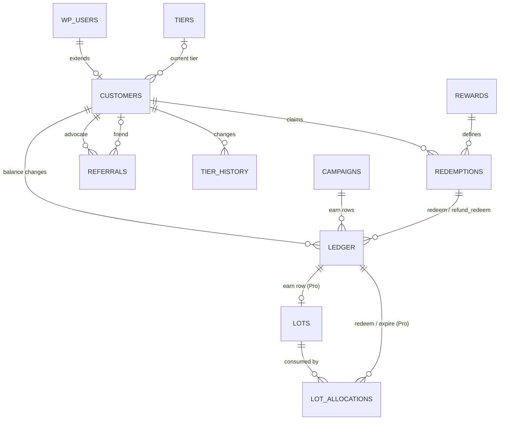

# YayLoyalty — Data Model Reference

|                    |                                                                                                    |
| ------------------ | -------------------------------------------------------------------------------------------------- |
| **Version**        | 0.9 — per-table specs split into `data-model/`                                                     |
| **Date**           | 23 September 2026                                                                                  |
| **Scope**          | Every table YayLoyalty owns across Free, Pro and later releases, every column, and how they relate |
| **Companion docs** | `project-roadmap.md` · `codebase-summary.md` · `system-architecture.md`                            |

## Implementation Status

**Implemented (1.0):** `yayloyalty_campaigns`, `yayloyalty_rewards`, `yayloyalty_customers`, `yayloyalty_ledger`

**Not implemented:** `redemptions`, `referrals`, `referral_visits`, `tiers`, `tier_history`, `lots`, `lot_allocations`, `events`

Note: `rewards` table exists with schema and repository; seeding works; checkout integration not built.

Note: `redemptions` has a schema class (`Database/Schema/RedemptionsTable.php`), a model (`Models/Redemption.php`, real) and a repository (`Repositories/RedemptionRepository.php`, stubs), but no table — `RedemptionsTable` is deliberately absent from `Installer::schemas()` and its `definition()` throws, so nothing creates it. Registering it there is the F08 step that installs the table on the next upgrade.

See [`project-roadmap.md`](./project-roadmap.md) for implementation status by phase and known gaps. The per-table specifications (linked under Table overview) are the authoritative schema design; unimplemented tables are the work plan for phases 1.1, 1.2, and 2.0.

## Conventions

All tables use the site prefix (`{$wpdb->prefix}yayloyalty_*`), InnoDB, `utf8mb4_unicode_520_ci`. Every `DATETIME` is UTC; conversion to the site timezone happens at the edges (admin forms, emails). Points columns are `BIGINT` signed, not `INT` — a store awarding 1 point per VND or per JPY can push a lifetime total past 2.1 billion. Money is `DECIMAL(19,4)`. Ids are `BIGINT UNSIGNED`. JSON is stored in `LONGTEXT` and validated in PHP (WooCommerce's minimum MySQL/MariaDB versions do not guarantee a native `JSON` type); every JSON blob carries a `schema_version` key so formats can evolve without table migrations. Foreign keys are logical, enforced by the services, not by `FOREIGN KEY` constraints — WordPress installs cannot rely on them.

Tables are created with `dbDelta` and versioned by the `yayloyalty_db_version` option; columns marked with a later phase are added by that release's migration, not created empty in 1.0.

Two design rules apply everywhere:

1. **The ledger is the truth; `customers` is a cache.** Every number on a customer row can be rebuilt by replaying that customer's ledger, and a "Rebuild balances" tool does exactly that.
2. **Status is intent; liveness is derived.** `status` columns store what the merchant chose (`active`, `paused`, `draft`). Whether something is live _right now_ is computed from `status` plus `starts_at`/`ends_at` at read time. No job flips statuses on a clock.

### Expressing the model in code

These do not change the model; they record how it must be expressed in code so the invariants survive contact with WordPress. Two more live with their tables: the NULL idempotency key on the [ledger](./data-model/customers-and-ledger.md#yayloyalty_ledger--every-balance-change-10) and the `customers.user_id` primary key on [customers](./data-model/customers-and-ledger.md#yayloyalty_customers--one-row-per-member-10).

**dbDelta index grammar.** Every index in `CREATE TABLE` statements must be written as `UNIQUE KEY name (cols)` or `KEY name (cols)`. `dbDelta` only recognises those forms; a bare `UNIQUE (cols)` succeeds on first install and then fails to normalise on every upgrade run, silently dropping the index. The ledger idempotency guarantee depends on `UNIQUE KEY uniq_idempotency_key` existing after upgrades, not just after installs. `dbDelta` also never *drops* an index: superseded ones (`uniq_ledger_event`) go through `Installer::run_migrations()`.

**Money is bound as `%s`, never `%f`.** Every `DECIMAL` column here — `rate_snapshot`, `base_value`, `value`, `lifetime_spend`, `threshold`, `tier_progress_value`, `basis_value` — loses precision if passed through a float. Carry these values as strings end to end.

**The connection is shared.** WooCommerce and sibling plugins issue their own `START TRANSACTION` on the same `$wpdb`. Code writing these tables must assume it may already be inside someone else's transaction and use a savepoint rather than starting a new one.

## Table overview

| Table                        | Kind              | Phase   | One row per                         |
| ---------------------------- | ----------------- | ------- | ----------------------------------- |
| `yayloyalty_campaigns`       | definition        | 1.0     | earning rule                        |
| `yayloyalty_rewards`         | definition        | 1.0     | way to spend points                 |
| `yayloyalty_customers`       | state             | 1.0     | member (extends `wp_users`)         |
| `yayloyalty_ledger`          | fact, append-only | 1.0     | balance change                      |
| `yayloyalty_redemptions`     | fact              | 1.0     | reward claim                        |
| `yayloyalty_referrals`       | fact              | 1.1     | referral relationship               |
| `yayloyalty_referral_visits` | fact, prunable    | 1.1     | referral link click                 |
| `yayloyalty_tiers`           | definition        | 1.2     | VIP level                           |
| `yayloyalty_tier_history`    | fact              | 1.2     | tier change                         |
| `yayloyalty_lots`            | fact              | 1.0 Pro | expiring batch of earned points     |
| `yayloyalty_lot_allocations` | fact              | 1.0 Pro | consumption of a lot                |
| `yayloyalty_events`          | fact, outbox      | 2.0     | domain event for webhooks/analytics |

**Per-table specs:**

- [`data-model/campaigns.md`](./data-model/campaigns.md) — `yayloyalty_campaigns`, its `config` map and `conditions` vocabulary
- [`data-model/rewards.md`](./data-model/rewards.md) — `yayloyalty_rewards`, its `config` map and `conditions` vocabulary
- [`data-model/customers-and-ledger.md`](./data-model/customers-and-ledger.md) — `yayloyalty_customers`, `yayloyalty_ledger`, `yayloyalty_customer_meta`, the activity log, and customer drawer wire blocks not backed by a table
- [`data-model/redemptions.md`](./data-model/redemptions.md) — `yayloyalty_redemptions` (designed, not created)
- [`data-model/future-tables.md`](./data-model/future-tables.md) — referrals, referral visits, tiers, tier history, lots and lot allocations, events

---

## Not tables, but part of the model

**Order meta** (HPOS-safe via `WC_Order::update_meta_data`): `_yayloyalty_points_pending`, `_yayloyalty_points_earned`, `_yayloyalty_campaign_id`, `_yayloyalty_points_redeemed`, `_yayloyalty_redeem_value`, `_yayloyalty_base_amount`, `_yayloyalty_referral_id` (1.1). Projections for the order edit screen, YayMail placeholders and the customer's order page; never read to compute a balance.

**User meta**: `_yayloyalty_opted_out` (truthy = the customer stopped earning; `Engine\Earning\ProgramGate`).

**Options**: `yayloyalty_settings` (JSON: points naming, `general.excluded_roles`, award status, expiry policy, tier basis and window, redemption placement, fraud limits), `yayloyalty_design` (JSON, own option, never merged into `yayloyalty_settings`; six groups: `launcher`, `storefront_text`, `visibility` [Free]; `tier`, `panel`, `typography` [Pro]; schema with `schema_version` stamp via `DesignHelper`; Pro fields declared in both builds, UI editability gated by `IS_PRO_BUILD`; admin-side only, nothing yet renders on storefront), `yayloyalty_reviewed`, `yayloyalty_db_version`, `yayloyalty_caps_version`, `yayloyalty_upgrading` (install lock). Planned, not in code: `yayloyalty_wizard_completed`.

**WooCommerce session**: `yayloyalty_redeem_points` carries the amount the shopper chose between cart and checkout until the order exists.

**Cache**: `CampaignRepository` caches non-archived campaigns in `wp_cache` (TTL 3600 seconds) and `DashboardCache` uses transients for aggregates (above 10k members, TTL 5 minutes). Nothing else cached.

**Action Scheduler jobs** (the only ones): daily inactivity expiry, daily reminders, referral hold completion (1.1), tier window evaluation (1.2), lot expiry (Pro), event delivery (2.0). None of them watch a clock to flip a status.

---

## Relationships

| From                          | To                                   | Cardinality                                   | Via                                                          |
| ----------------------------- | ------------------------------------ | --------------------------------------------- | ------------------------------------------------------------ |
| `wp_users`                    | `customers`                          | 1 : 0..1                                      | `customers.user_id`                                          |
| `customers`                   | `ledger`                             | 1 : N                                         | `ledger.user_id`                                             |
| `customers`                   | `redemptions`                        | 1 : N                                         | `redemptions.user_id`                                        |
| `customers`                   | `referrals` (as advocate)            | 1 : N                                         | `referrals.advocate_user_id`                                 |
| `customers`                   | `referrals` (as friend)              | 0..1 : N                                      | `referrals.friend_user_id`                                   |
| `customers`                   | `tier_history`                       | 1 : N                                         | `tier_history.user_id`                                       |
| `tiers`                       | `customers`                          | 1 : N                                         | `customers.tier_id`                                          |
| `campaigns`                   | `ledger` (`earn` rows)               | 1 : N                                         | `ledger.campaign_id`                                         |
| `rewards`                     | `redemptions`                        | 1 : N                                         | `redemptions.reward_id`                                      |
| `redemptions`                 | `ledger` (`redeem`, `refund_redeem`) | 1 : N                                         | `ledger.redemption_id`                                       |
| WC order                      | `ledger`                             | 1 : N (one `earn`, many `refund_*`, `redeem`) | `ledger.order_id`, `reference_*`                             |
| WC refund                     | `ledger`                             | 1 : 0..2 (`refund_earn`, `refund_redeem`)     | `reference_type = 'refund'`                                  |
| `wp_comments`                 | `ledger`                             | 1 : 0..1                                      | `reference_type = 'comment'`                                 |
| `referrals`                   | `ledger` / WC coupon                 | 1 : 0..1 each                                 | `advocate_ledger_id`, `friend_ledger_id`, `friend_coupon_id` |
| `ledger` (`earn`)             | `lots`                               | 1 : 0..1                                      | `lots.ledger_id`                                             |
| `lots`                        | `lot_allocations`                    | 1 : N                                         | `lot_allocations.lot_id`                                     |
| `ledger` (`redeem`, `expire`) | `lot_allocations`                    | 1 : N                                         | `lot_allocations.ledger_id`                                  |

## Invariants

- `customers.balance = SUM(ledger.points)` per user.
- `customers.lifetime_earned = SUM(earn) + SUM(adjust) − SUM(|refund_earn|)`; `redeem`, `expire` and `correction` (a balance-only manual adjustment) never touch it — fully rebuildable from the ledger, since the type itself, not a separate flag, decides.
- `customers.lifetime_redeemed = SUM(|redeem|) − SUM(refund_redeem)`.
- `customers.pending_points = SUM(_yayloyalty_points_pending)` over the user's orders not yet awarded or cancelled.
- `redemptions.restored_points ≤ redemptions.points`, always.
- Exactly one `earn` row per order per trigger; exactly one `redeem` row per redemption.
- `ledger.balance_after` forms an unbroken chain per user.
- Only `LedgerService` inserts ledger rows or updates `customers` aggregates, and it does both in one transaction.

## Write paths, table by table

| Event                        | Rows written                                                                                                                                                                                                             |
| ---------------------------- | ------------------------------------------------------------------------------------------------------------------------------------------------------------------------------------------------------------------------ |
| Order created                | order meta `_points_pending`; `customers.pending_points += N`                                                                                                                                                            |
| Order reaches award status   | `ledger` `earn` (with `campaign_id`, `order_id`); `customers` balance, lifetime_earned, pending, last_activity_at, expires_at; order meta; `lots` (Pro); `tier_history` if a threshold was crossed (1.2); `events` (2.0) |
| Redemption at checkout       | `redemptions` (`applied`); `ledger` `redeem` (with `redemption_id`, `order_id`); `customers` balance, lifetime_redeemed; `lot_allocations` (Pro); order meta                                                             |
| Order paid                   | `redemptions.status = completed`                                                                                                                                                                                         |
| Order cancelled / failed     | `customers.pending_points −= N`; if redeemed: `ledger` `refund_redeem`, `redemptions.status = cancelled`, `restored_points`                                                                                              |
| Refund created               | `ledger` `refund_earn` (reference = refund id); `ledger` `refund_redeem` per policy; `customers` aggregates; `redemptions.restored_points`                                                                               |
| Review approved / unapproved | `ledger` `earn` / `refund_earn` (reference = comment id)                                                                                                                                                                 |
| Manual adjustment            | `ledger` `adjust` (with `actor_id`, `note`); `customers`                                                                                                                                                                 |
| Inactivity expiry job        | `ledger` `expire`; `customers.balance = 0`, `expires_at = NULL`                                                                                                                                                          |
| Referral completes (1.1)     | `referrals.status = completed`; `ledger` `earn` for advocate; `ledger` `earn` or WC coupon for friend                                                                                                                    |
| Tier evaluation (1.2)        | `tier_history`; `customers.tier_id`, `tier_evaluated_at`                                                                                                                                                                 |
