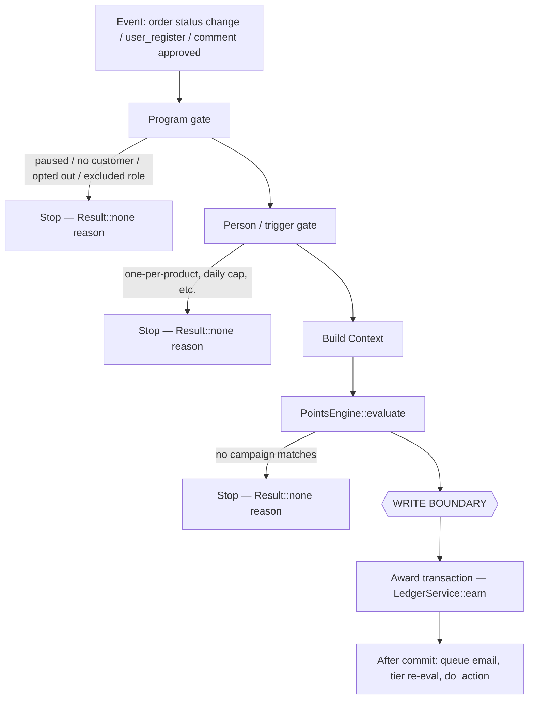
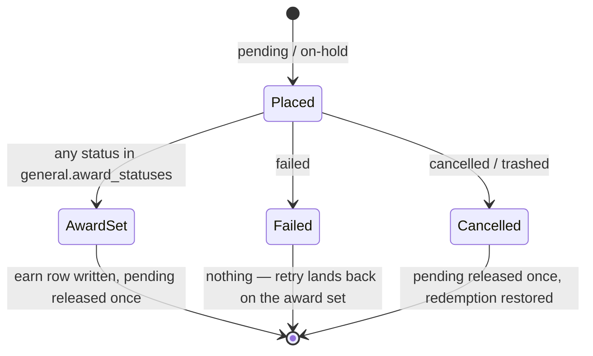

# YayLoyalty — Data Model: Points Lifecycle

Part of the [data model reference](../data-model.md), which owns the conventions, relationships,
invariants and write paths every table here follows. This is a process spec, not a table spec: it
walks how an order (or a signup, or a review) becomes an `earn` ledger row, and how a cancellation
or refund takes the points back — the write paths `data-model.md` §"Write paths, table by table"
only summarises in one line each. Read [`customers-and-ledger.md`](./customers-and-ledger.md) first
for the `ledger`/`customers` column meanings this spec assumes.

## Implementation status

Points in (§01–§05) are owned by
[`includes/Engine/Earning/README.md`](../../includes/Engine/Earning/README.md): its invariants are
the rules and its § Status says what is built. This spec adds only the reasoning and the
per-trigger map. Points back out (§06–§08) are
designed here and have no code yet: `LedgerService` has no `refund_earn()` / `refund_redeem()`.

## 01 — The two moments

An order is evaluated twice, at creation and at the award status, at the same timestamp — the
order's creation date (README invariant 1).

Using the award time instead would silently deny a customer a promotion they shopped for (a
Black-Friday 2× campaign that ended before the merchant got around to marking the order
Completed), and would make the points depend on when staff happened to click a button. The
creation date also makes re-running `evaluate()` a year later return the identical number —
liveness is `Enums\Status::is_live_at()` against that same fixed instant, not against whatever is
live today.

## 02 — The pipeline

Gates run before the engine because they are cheap and because the engine must not know about
users, roles or the ledger — it is pure, replayable, and runs from cron. Each gate exits with a
reason string (`Gate::check()` returns `?string`), never a bare `false`; that reason is what an
admin's "customers aren't earning" banner would read, and what `Result::none()` / `Outcome::skipped()`
carry back to the caller. `EarningService::blocked_reason()` walks the gate list in order and the
first non-null reason wins.

Everything above the write boundary is re-runnable and side-effect-free. Everything below it runs
exactly once per idempotency key. A gate that needs the ledger (e.g. a daily-cap check) belongs
above the boundary but outside the engine — the engine only ever sees a `Context`.

## 03 — The write transaction

`LedgerService::earn()`: create-then-lock the customer row, insert under the `uniq_idempotency_key`
guard, move the aggregates, fire hooks after commit — README invariants 3, 4, 8 and 9; the lock
reasoning is in [`customers-and-ledger.md`](./customers-and-ledger.md).

## 04 — Triggers

A deferred trigger (purchase, first order) stages pending points at order creation and awards
later, at the award status. An immediate trigger (signup, review) evaluates and writes in one
step — there's nothing to stage because there's no order waiting to be paid.

| Trigger | Shape | Hook | Idempotency key | Fireable in this build? |
|---|---|---|---|---|
| Purchase | Deferred | `woocommerce_order_status_changed`, `woocommerce_new_order` | `earn:{user_id}:order:{order_id}:purchase` | Yes |
| First order | Deferred | `woocommerce_order_status_changed`, `woocommerce_new_order` | `earn:{user_id}:order:{order_id}:first_order` | Pro only — `CampaignTrigger::FIRST_ORDER` is recognised but not in `lite_triggers()` |
| Signup | Immediate | `user_register` | `earn:{user_id}:user:{user_id}:signup` | Yes |
| Review | Immediate | `comment_post` / `transition_comment_status` | `earn:{user_id}:comment:{comment_id}:review` | Yes |

Keys are composed by `IdempotencyKey::compose()` (README invariant 3); why the user id and the
qualifier are both in it is in
[`customers-and-ledger.md`](./customers-and-ledger.md#yayloyalty_ledger--every-balance-change-10).

## 05 — Guards

Double award: the UNIQUE key (README invariant 4). Broken `balance_after` chain: the customer row
lock (invariant 8). Pending underflow on a status bounce: the release-once flag (invariant 2).

## 06 — The reversal grid (designed, not implemented)

Earning is provisional until the award; spending is immediate. So reversing an earn is a ledger row
**only if the award already happened**; reversing a spend always is.

| | Not yet awarded | Already awarded |
|---|---|---|
| No points spent | Pending only — decrement `pending_points`, no ledger row at all | One row — `refund_earn`, negative, keyed by refund id |
| Points spent | One row — decrement pending **and** `refund_redeem` | Two rows — `refund_redeem` then `refund_earn` |

Restore before clawback, always. Both land in one transaction either way, but `balance_after` is a
stored chain the customer reads in their history — restoring first avoids recording a transient
negative that immediately corrects itself.

None of this grid has a writer yet: `LedgerService` has no `refund_earn()` / `refund_redeem()`
method, and `CommitWriter`'s own docblock names this "Zone 3 ... undesigned" — it needs
`LedgerService::refund_redeem()` and `Redemption::restored_points` before it can be built at all.

## 07 — Status machine

Only two order-status transitions act. `failed` looks like it should but does nothing, because the
order is still payable.

Refund events are driven by refund **objects** (`woocommerce_order_refunded`), never by the
`refunded` status — a status alone carries no refund id to key the ledger row on, and an order can
be partially refunded more than once. One exception: `get_total_refunded() === 0` on a `refunded`
order means an admin reversed it outside WooCommerce, a full reversal referenced to the *order*,
not to a refund id. A deleted refund (`refund_deleted`) writes the inverse of that refund's own
ledger rows — no separate bookkeeping of "what was clawed" is needed, because the rows keyed to
that refund id already are that record.

`pending_points` is `bigint unsigned` (`CustomersTable::definition()`); releasing it twice for the
same order must therefore be guarded (the release-once flag, README invariant 2) rather than relied on to fail safe —
an unsigned column doesn't go negative on a double release, it wraps.

## 08 — Clawback maths (designed, not implemented)

Points were earned on the order's **earning base** (subtotal minus discounts, in the campaign's
terms), so a refund claws back in proportion to the base it removed — a shipping-only or tax-only
refund removes none of that base and claws back nothing. Each refund recomputes the **total now
owed** from scratch rather than adding its own slice, because summing per-refund roundings strands
points: three sequential one-third refunds of a 100-point order at `floor(33.33)` each claw back
99, not 100. Recomputing cumulatively — `floor(100 × 1/3)`, `floor(100 × 2/3)`, then a shortcut of
exactly 100 once the order is fully refunded — lands exactly on 100 with no residue.

Bounds this needs once built:

- `points_clawed_back ≤ points_earned`, checked on every refund — a merchant who marks an order
  Refunded and later adds a real refund object must not claw twice.
- `redemptions.restored_points ≤ redemptions.points` (already listed as an invariant in
  [`data-model.md`](../data-model.md#invariants)) — repeated partial refunds can never return more
  points than were spent.
- A zero-difference clawback writes no ledger row at all.

## Still open

- **Reversal policy.** Four decisions are unmade: whether refunds claw back at all (a goodwill
  mode), whether partial refunds restore proportionally, whether balances may go negative, and what
  happens when a cancelled order is un-cancelled. Nothing in §06–§08 can be implemented until these
  are answered.
- **F01 vs later phases.** §01–§05 (points in) track the F01 plan; §06–§08 (points back out) are
  designed here but belong to a later phase (`CommitWriter`'s Zone 3, `LedgerService::redeem()`'s
  `TODO(F08)`). Confirm the phase label for §06–§08 before scheduling it — this document does not
  assign one.

Resolved since the design first circulated (kept here so the resolution isn't re-litigated):
campaign liveness is scored at the order's *creation* date, not its award date
(`docs/data-model/campaigns.md`, `docs/code-standards.md` §11 — both corrected to match
`ContextFactory::from_order()`); `data-model.md`'s write-path table no longer pairs `cancelled` and
`failed` under one row, since `failed` writes nothing and `cancelled` releases and restores; and the
ledger's unique index is `uniq_idempotency_key` alone — the former composite
`uniq_ledger_event (user_id, source, reference_type, reference_id)` is dropped by
`Installer::run_migrations()`, so one order legitimately earning from two triggers is not blocked
by a stale composite key.
