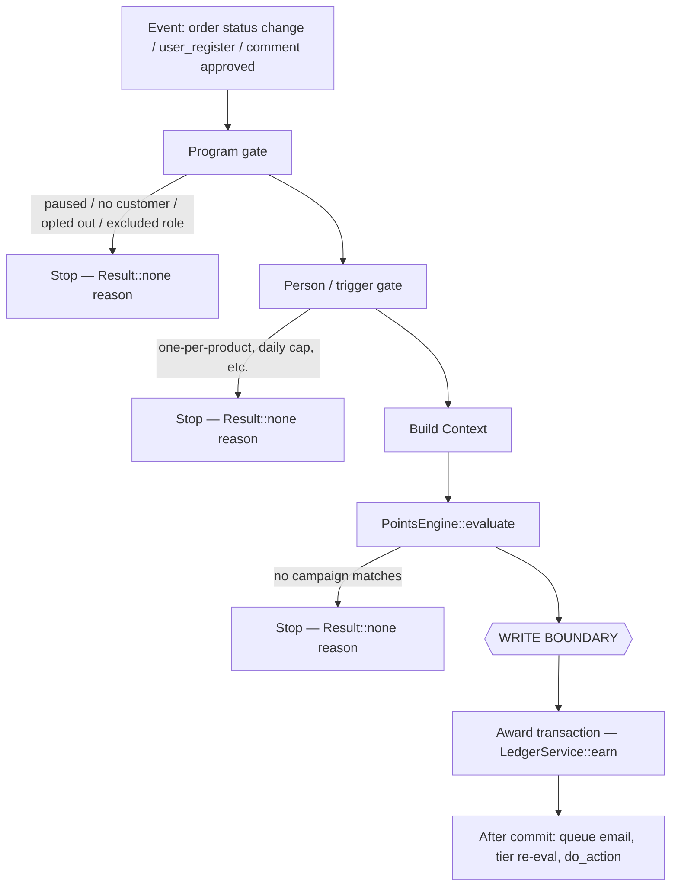
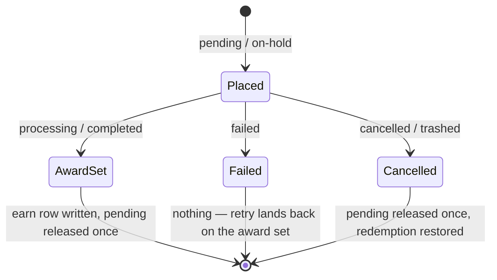

# YayLoyalty — Data Model: Points Lifecycle

Part of the [data model reference](../data-model.md), which owns the conventions, relationships,
invariants and write paths every table here follows. This is a process spec, not a table spec: it
walks how an order (or a signup, or a review) becomes an `earn` ledger row, and how a cancellation
or refund takes the points back — the write paths `data-model.md` §"Write paths, table by table"
only summarises in one line each. Read [`customers-and-ledger.md`](./customers-and-ledger.md) first
for the `ledger`/`customers` column meanings this spec assumes.

## Implementation status

**This is the authoritative design for both directions. Part one (points in) is mostly built; part
two (points back out) is designed here but has no corresponding code yet — do not assume any of
§06–§08 exists in the codebase.** Status per component:

| Component | File | Status |
|---|---|---|
| `PointsEngine::evaluate()` | `Engine/Points/PointsEngine.php` | **Implemented** |
| `ContextFactory::from_order()` | `Engine/Points/ContextFactory.php` | **Implemented** |
| `ContextFactory::from_user()` / `from_comment()` | same | Stub |
| `ContextFactory::customer_facts()` | same | **Implemented** — calls `CustomerFactsReader::read()` when evaluator attached |
| `CustomerFactsReader::read()` | `Engine/Points/CustomerFactsReader.php` | **Implemented** |
| `PurchaseHandler`, `Registry`, `IdempotencyKey::compose()` | `Engine/Points/Triggers/*`, `Engine/Earning/IdempotencyKey.php` | **Implemented** |
| `LedgerService::earn()` | `Services/LedgerService.php` | **Implemented** |
| `LedgerService::redeem()` | `Services/LedgerService.php` | Stub (`TODO(F08)`) |
| `LedgerService::refund_earn()` / `refund_redeem()` | `Services/LedgerService.php` | **Does not exist.** No refund entry point has been added to the ledger writer yet |
| `EarningService::build()` | `Engine/Earning/EarningService.php` | **Implemented** |
| `EarningService::preview()` / `award()` | `Engine/Earning/EarningService.php` | Stub |
| `PendingPoints::stage()` / `release()` / `mark_awarded()` | `Engine/Earning/PendingPoints.php` | Stub |
| `ProgramGate::check()` | `Engine/Earning/ProgramGate.php` | **Implemented** |
| `OrderListener::register()` / `on_status_changed()` / `on_order_created()` / `route()` / `award_statuses()` | `Engine/Earning/Listeners/OrderListener.php` | **Implemented** — hooks only; `on_stageable()` and `on_awardable()` **implemented** (call `preview_and_log()`); `on_cancelled()`/`on_refunded()` bodies still Stub |
| `ReviewListener`, `SignupListener` — `register()` and their hook adapters | same directory | **Implemented** — hooks only; `on_approved()`/`on_unapproved()`/`on_registered()` bodies still Stub |
| `CommitWriter::commit()` (redemption) | `Engine/Redemption/CommitWriter.php` | Stub — its own docblock calls the cancel/refund side "Zone 3 ... undesigned" |

Every stub above already carries a docblock that states its intended contract; this document and
those docblocks agree by construction (same source). Where they don't, the code's docblock is a
bug in this document — fix here, not there.

## 01 — The two moments

An order is evaluated twice: once at creation, for the pending figure shown to the shopper, and
once at the award status, for the real one — because the order (or the campaign catalogue) can
change in between. Both calls receive the **same timestamp: the order's creation date**
(`WC_Order::get_date_created()`), never the award date and never `now()`. `ContextFactory::from_order()`
throws if the order has no creation date rather than falling back to `now()` — an order without one
is a caller bug, not license to invent an event time.

Using the award time instead would silently deny a customer a promotion they shopped for (a
Black-Friday 2× campaign that ended before the merchant got around to marking the order
Completed), and would make the points depend on when staff happened to click a button. The
creation date also makes re-running `evaluate()` a year later return the identical number —
liveness is `Enums\Status::is_live_at()` against that same fixed instant, not against whatever is
live today.

`PointsEngine::evaluate( $trigger, $ctx )` reads `$ctx->get_occurred_at()` itself; there is no
separate `$at` parameter to keep in sync with the Context.

## 02 — The pipeline

Gates run before the engine because they are cheap and because the engine must not know about
users, roles or the ledger — it is pure, replayable, and runs from cron. Each gate exits with a
reason string (`Gate::check()` returns `?string`), never a bare `false`; that reason is what an
admin's "customers aren't earning" banner would read, and what `Result::none()` / `Outcome::skipped()`
carry back to the caller. `ProgramGate` is implemented and evaluates paused status, no customer, opt-out meta, and excluded roles. `EarningService::blocked_reason()` walks the gate list in order and the
first non-null reason wins; other gates attach via `yayloyalty_earning_gates` filter.

Everything above the write boundary is re-runnable and side-effect-free. Everything below it runs
exactly once per idempotency key. A gate that needs the ledger (e.g. a daily-cap check) belongs
above the boundary but outside the engine — the engine only ever sees a `Context`.

## 03 — The write transaction

One transaction, five steps, in this order (`LedgerService::earn()`, implemented):

1. `CustomerRepository::ensure_row()` — materialise the customer row before locking it. `SELECT ...
   FOR UPDATE` on a row that doesn't exist yet takes a gap lock, not a row lock, so two concurrent
   first-touch writers could otherwise both insert.
2. `CustomerRepository::lock_and_get()` — locks the customer row, serialising every write for this
   user. A concurrent award for the same user queues up behind this one.
3. Duplicate check under the lock: `LedgerRepository::find_by_idempotency_key()`. If a row already
   exists, return `Outcome::duplicate()` — a normal outcome, not an error.
4. `LedgerRepository::insert_unless_duplicate()` — attempts the insert; the `uniq_idempotency_key`
   unique index is the real guard, the pre-check in step 3 is only an optimisation. Two processes
   can both pass a bare `if (already_awarded())` check in the same millisecond; only the unique
   index cannot be raced. A duplicate-key result here also returns `Outcome::duplicate()` rather
   than throwing.
5. `apply_aggregates()` — moves `customers.balance`, `lifetime_earned`, `last_activity_at` inside
   the same lock, then the transaction commits and `dispatch_events()` fires
   `yayloyalty_ledger_recorded` **after** commit — a subscriber on another connection cannot see an
   uncommitted row, and nothing slow or externally fallible runs while the lock is held.

`EarningService::award()` (stub) wraps this with the order-meta side effects: releasing
`PendingPoints` and writing the award projections happen inside the same transaction as the ledger
insert, so the cache and the ledger move together or not at all.

## 04 — Triggers

A deferred trigger (purchase, first order) stages pending points at order creation and awards
later, at the award status. An immediate trigger (signup, review) evaluates and writes in one
step — there's nothing to stage because there's no order waiting to be paid.

| Trigger | Shape | Hook | Idempotency key | Fireable in this build? |
|---|---|---|---|---|
| Purchase | Deferred | `woocommerce_order_status_changed` | `earn:{user_id}:order:{order_id}:purchase` | Yes |
| First order | Deferred | `woocommerce_order_status_changed` | `earn:{user_id}:order:{order_id}:first_order` | Pro only — `CampaignTrigger::FIRST_ORDER` is recognised but not in `lite_triggers()` |
| Signup | Immediate | `user_register` | `earn:{user_id}:user:{user_id}:signup` | Yes |
| Review | Immediate | `comment_post` / `transition_comment_status` | `earn:{user_id}:comment:{comment_id}:review` | Yes |

The key format is `{type}:{user_id}:{reference_type}:{reference_id}:{qualifier}`, composed by
`Engine\Earning\IdempotencyKey::compose()` — see
[`customers-and-ledger.md`](./customers-and-ledger.md#yayloyalty_ledger--every-balance-change-10)
for the full rationale. **The user id is always the second segment; the trigger (or reward type,
on the redeem side) is always the last.** Two independent facts are folded into that one string on
purpose: one reference may legitimately pay two people (the user id — a referral order pays
advocate and friend), and one reference may legitimately move points more than once (the qualifier
— an order can earn once for `purchase` and once for `first_order`; a redemption row can be
refunded and re-redeemed under different reward types). Neither the reference type nor the
reference id alone is enough to guarantee "once".

## 05 — Guards

| Guard | Mechanism | Stops | Status |
|---|---|---|---|
| Unique idempotency key | `UNIQUE KEY uniq_idempotency_key` on `ledger.idempotency_key`; the insert is the guarantee, the pre-check is only an optimisation | Double award | **Implemented** |
| Customer row lock | `SELECT balance ... FOR UPDATE` inside the transaction | A broken `balance_after` chain | **Implemented** |
| Release-once flag | `PendingPoints::META_RELEASED`, separate from the staged-figure meta, set exactly once | Pending underflow on a status bounce (award → cancel → award again) | Designed, not implemented |

## 06 — The reversal grid (designed, not implemented)

Earning is provisional until the award; spending is immediate. So reversing an earn is a ledger row
**only if the award already happened**; reversing a spend always is.

| | Not yet awarded | Already awarded |
|---|---|---|
| No points spent | Pending only — decrement `pending_points`, no ledger row at all | One row — `refund_earn`, negative, keyed by refund id |
| Points spent | One row — decrement pending **and** `refund_redeem` | Two rows — `refund_redeem` then `refund_earn` |

Restore before clawback, always. Both land in one transaction either way, but `balance_after` is a
stored chain the customer reads in their history — restoring first avoids recording a transient
negative that immediately corrects itself.

None of this grid has a writer yet: `LedgerService` has no `refund_earn()` / `refund_redeem()`
method, and `CommitWriter`'s own docblock names this "Zone 3 ... undesigned" — it needs
`LedgerService::refund_redeem()` and `Redemption::restored_points` before it can be built at all.

## 07 — Status machine

Only two order-status transitions act. `failed` looks like it should but does nothing, because the
order is still payable.

Refund events are driven by refund **objects** (`woocommerce_order_refunded`), never by the
`refunded` status — a status alone carries no refund id to key the ledger row on, and an order can
be partially refunded more than once. One exception: `get_total_refunded() === 0` on a `refunded`
order means an admin reversed it outside WooCommerce, a full reversal referenced to the *order*,
not to a refund id. A deleted refund (`refund_deleted`) writes the inverse of that refund's own
ledger rows — no separate bookkeeping of "what was clawed" is needed, because the rows keyed to
that refund id already are that record.

`pending_points` is `bigint unsigned` (`CustomersTable::definition()`); releasing it twice for the
same order must therefore be guarded (§05's release-once flag) rather than relied on to fail safe —
an unsigned column doesn't go negative on a double release, it wraps.

## 08 — Clawback maths (designed, not implemented)

Points were earned on the order's **earning base** (subtotal minus discounts, in the campaign's
terms), so a refund claws back in proportion to the base it removed — a shipping-only or tax-only
refund removes none of that base and claws back nothing. Each refund recomputes the **total now
owed** from scratch rather than adding its own slice, because summing per-refund roundings strands
points: three sequential one-third refunds of a 100-point order at `floor(33.33)` each claw back
99, not 100. Recomputing cumulatively — `floor(100 × 1/3)`, `floor(100 × 2/3)`, then a shortcut of
exactly 100 once the order is fully refunded — lands exactly on 100 with no residue.

Bounds this needs once built:

- `points_clawed_back ≤ points_earned`, checked on every refund — a merchant who marks an order
  Refunded and later adds a real refund object must not claw twice.
- `redemptions.restored_points ≤ redemptions.points` (already listed as an invariant in
  [`data-model.md`](../data-model.md#invariants)) — repeated partial refunds can never return more
  points than were spent.
- A zero-difference clawback writes no ledger row at all.

## Still open

- **Reversal policy.** Four decisions are unmade: whether refunds claw back at all (a goodwill
  mode), whether partial refunds restore proportionally, whether balances may go negative, and what
  happens when a cancelled order is un-cancelled. Nothing in §06–§08 can be implemented until these
  are answered.
- **F01 vs later phases.** §01–§05 (points in) track the F01 plan; §06–§08 (points back out) are
  designed here but belong to a later phase (`CommitWriter`'s Zone 3, `LedgerService::redeem()`'s
  `TODO(F08)`). Confirm the phase label for §06–§08 before scheduling it — this document does not
  assign one.

Resolved since the design first circulated (kept here so the resolution isn't re-litigated):
campaign liveness is scored at the order's *creation* date, not its award date
(`docs/data-model/campaigns.md`, `docs/code-standards.md` §11 — both corrected to match
`ContextFactory::from_order()`); `data-model.md`'s write-path table no longer pairs `cancelled` and
`failed` under one row, since `failed` writes nothing and `cancelled` releases and restores; and the
ledger's unique index is `uniq_idempotency_key` alone — the former composite
`uniq_ledger_event (user_id, source, reference_type, reference_id)` is dropped by
`Installer::run_migrations()`, so one order legitimately earning from two triggers is not blocked
by a stale composite key.
