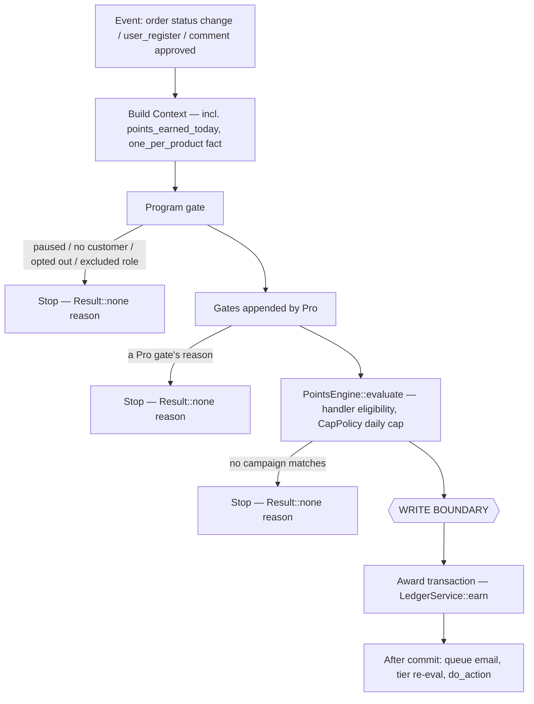

# YayLoyalty — Data Model: Points Lifecycle

Part of the [data model reference](../data-model.md), which owns the conventions, relationships,
invariants and write paths every table here follows. This is a process spec, not a table spec: it
walks how an order (or a signup, or a review) becomes an `earn` ledger row, and how a cancellation
or refund takes the points back — the write paths `data-model.md` §"Write paths, table by table"
only summarises in one line each. Read [`customers-and-ledger.md`](./customers-and-ledger.md) first
for the `ledger`/`customers` column meanings this spec assumes.

## Implementation status

**This is the authoritative design for both directions. Both are built for earning: points go in
(§01–§05) and come back out (§06–§08). The spend side of a reversal — restoring redeemed points
(`refund_redeem`) — belongs to redemption (F08) and has no code yet.** Status per component:

| Component | File | Status |
|---|---|---|
| `PointsEngine::evaluate()` | `Engine/Points/PointsEngine.php` | **Implemented** |
| `ContextFactory::from_order()` | `Engine/Points/ContextFactory.php` | **Implemented** |
| `ContextFactory::from_user()` / `from_comment()` | same | **Implemented** |
| `ContextFactory::customer_facts()` | same | **Implemented** — calls `CustomerFactsReader::read()` when evaluator attached |
| `CustomerFactsReader::read()` | `Engine/Points/CustomerFactsReader.php` | **Implemented** |
| `PurchaseHandler`, `Registry`, `IdempotencyKey::compose()` | `Engine/Points/Triggers/*`, `Engine/Earning/IdempotencyKey.php` | **Implemented** |
| `LedgerService::earn()` | `Services/LedgerService.php` | **Implemented** |
| `LedgerService::redeem()` | `Services/LedgerService.php` | Stub (`TODO(F08)`) |
| `LedgerService::refund_earn()` / `restore_refund()` | `Services/LedgerService.php` | **Implemented** — cumulative clawback under the customer lock; restore of a deleted refund |
| `LedgerService::refund_redeem()` | `Services/LedgerService.php` | Does not exist (F08) |
| `Reversal` (`full_order()` / `refund()` / `refund_deleted()` / `full_review()`), `ClawbackMath::owed()` | `Engine/Earning/Reversal.php`, `ClawbackMath.php` | **Implemented** |
| `EarningService::build()` | `Engine/Earning/EarningService.php` | **Implemented** |
| `EarningService::preview()` / `award()` | `Engine/Earning/EarningService.php` | **Implemented** |
| `PendingPoints::stage()` / `release()` / `mark_awarded()` | `Engine/Earning/PendingPoints.php` | **Implemented** |
| `ProgramGate::check()` | `Engine/Earning/ProgramGate.php` | **Implemented** |
| `OrderListener::register()` / `on_status_changed()` / `on_order_created()` / `route()` / `on_stageable()` / `on_awardable()` | `Engine/Earning/Listeners/OrderListener.php` | **Implemented** — cancelled/trash/refunded statuses route to `OrderReversalListener` |
| `OrderReversalListener` — cancel, `refunded` status, `woocommerce_order_refunded`, `woocommerce_refund_deleted`, `woocommerce_trash_order` / `trashed_post` | same directory | **Implemented** |
| `ReviewListener`, `SignupListener` — `register()`, their hook adapters, `on_registered()` / `on_approved()` | same directory | **Implemented** — award writes; `on_unapproved()` claws back on unapprove / spam / trash / delete |
| `CommitWriter::commit()` (redemption) | `Engine/Redemption/CommitWriter.php` | Stub — its own docblock calls the cancel/refund side "Zone 3 ... undesigned" |

Every stub above already carries a docblock that states its intended contract; this document and
those docblocks agree by construction (same source). Where they don't, the code's docblock is a
bug in this document — fix here, not there.

## 01 — The two moments

An order is evaluated twice: once at creation, for the pending figure shown to the shopper, and
once at the award status, for the real one — because the order (or the campaign catalogue) can
change in between. Both calls receive the **same timestamp: the order's creation date**
(`WC_Order::get_date_created()`), never the award date and never `now()`. `ContextFactory::from_order()`
throws if the order has no creation date rather than falling back to `now()` — an order without one
is a caller bug, not license to invent an event time.

Using the award time instead would silently deny a customer a promotion they shopped for (a
Black-Friday 2× campaign that ended before the merchant got around to marking the order
Completed), and would make the points depend on when staff happened to click a button. The
creation date also makes re-running `evaluate()` a year later return the identical number —
liveness is `Enums\Status::is_live_at()` against that same fixed instant, not against whatever is
live today.

`PointsEngine::evaluate( $trigger, $ctx )` reads `$ctx->get_occurred_at()` itself; there is no
separate `$at` parameter to keep in sync with the Context.

## 02 — The pipeline

Gates run before the engine because they are cheap and because the engine must not know about
users, roles or the ledger — it is pure, replayable, and runs from cron. Each gate exits with a
reason string (`Gate::check()` returns `?string`), never a bare `false`; that reason is what an
admin's "customers aren't earning" banner would read, and what `Result::none()` / `Outcome::skipped()`
carry back to the caller. `ProgramGate` is implemented and evaluates paused status, no customer, opt-out meta, and excluded roles. `EarningService::blocked_reason()` walks the gate list in order and the
first non-null reason wins; other gates attach via `yayloyalty_earning_gates` filter.

Everything above the write boundary is re-runnable and side-effect-free. Everything below it runs
exactly once per idempotency key. A rule that needs the ledger reads it above the boundary but
outside the engine, into the `Context`: the listener passes `LedgerRepository::points_earned_today()`
(per source) for `CapPolicy`'s daily cap, and `ContextFactory::from_comment()` sets
`ReviewHandler::EXTRA_PRODUCT_ALREADY_EARNED` for `one_per_product`, which the handler decides
because only it knows the matched campaign's config.

## 03 — The write transaction

One transaction, five steps, in this order (`LedgerService::earn()`, implemented):

1. `CustomerRepository::ensure_row()` — materialise the customer row before locking it. `SELECT ...
   FOR UPDATE` on a row that doesn't exist yet takes a gap lock, not a row lock, so two concurrent
   first-touch writers could otherwise both insert.
2. `CustomerRepository::lock_and_get()` — locks the customer row, serialising every write for this
   user. A concurrent award for the same user queues up behind this one.
3. Duplicate check under the lock: `LedgerRepository::find_by_idempotency_key()`. If a row already
   exists, return `Outcome::duplicate()` — a normal outcome, not an error.
4. `LedgerRepository::insert_unless_duplicate()` — attempts the insert; the `uniq_idempotency_key`
   unique index is the real guard, the pre-check in step 3 is only an optimisation. Two processes
   can both pass a bare `if (already_awarded())` check in the same millisecond; only the unique
   index cannot be raced. A duplicate-key result here also returns `Outcome::duplicate()` rather
   than throwing.
5. `apply_aggregates()` — moves `customers.balance`, `lifetime_earned`, `last_activity_at` inside
   the same lock, then the transaction commits and `announce()` (via `Transaction::after_commit()`) fires
   `yayloyalty_ledger_recorded` **after** commit — a subscriber on another connection cannot see an
   uncommitted row, and nothing slow or externally fallible runs while the lock is held.

`EarningService::award()` wraps this with the order-meta side effects: releasing
`PendingPoints` and writing the award projections happen inside the same transaction as the ledger
insert, so the cache and the ledger move together or not at all.

## 04 — Triggers

A deferred trigger (purchase, first order) stages pending points at order creation and awards
later, at the award status. An immediate trigger (signup, review) evaluates and writes in one
step — there's nothing to stage because there's no order waiting to be paid.

| Trigger | Shape | Hook | Idempotency key | Status |
|---|---|---|---|---|
| Purchase | Deferred | `woocommerce_order_status_changed` at `completed`; `woocommerce_new_order` stages at `pending`/`on-hold` | `earn:{user_id}:order:{order_id}:purchase` | **Implemented** |
| First order | Deferred | same as purchase | `earn:{user_id}:order:{order_id}:first_order` | Pro only — `CampaignTrigger::FIRST_ORDER` is recognised but not in `lite_triggers()` |
| Signup | Immediate | `user_register` (storefront self-registration only) | `earn:{user_id}:user:{user_id}:signup` | **Implemented** |
| Review | Immediate | `comment_post` / `transition_comment_status` when approved | `earn:{user_id}:comment:{comment_id}:review` | **Implemented** |

The key format is `{type}:{user_id}:{reference_type}:{reference_id}:{qualifier}`, composed by
`Engine\Earning\IdempotencyKey::compose()` — see
[`customers-and-ledger.md`](./customers-and-ledger.md#yayloyalty_ledger--every-balance-change-10)
for the full rationale. **The user id is always the second segment; the trigger (or reward type,
on the redeem side) is always the last.** Two independent facts are folded into that one string on
purpose: one reference may legitimately pay two people (the user id — a referral order pays
advocate and friend), and one reference may legitimately move points more than once (the qualifier
— an order can earn once for `purchase` and once for `first_order`; a redemption row can be
refunded and re-redeemed under different reward types). Neither the reference type nor the
reference id alone is enough to guarantee "once".

## 05 — Guards

| Guard | Mechanism | Stops | Status |
|---|---|---|---|
| Unique idempotency key | `UNIQUE KEY uniq_idempotency_key` on `ledger.idempotency_key`; the insert is the guarantee, the pre-check is only an optimisation | Double award | **Implemented** |
| Customer row lock | `SELECT balance ... FOR UPDATE` inside the transaction | A broken `balance_after` chain | **Implemented** |
| Release-once flag | `PendingPoints::META_RELEASED`, separate from the staged-figure meta, set exactly once | Pending underflow on a status bounce (award → cancel → award again) | **Implemented** |

## 06 — The reversal grid (earn side implemented)

Earning is provisional until the award; spending is immediate. So reversing an earn is a ledger row
**only if the award already happened**; reversing a spend always is.

| | Not yet awarded | Already awarded |
|---|---|---|
| No points spent | Pending only — decrement `pending_points`, no ledger row at all | One row — `refund_earn`, negative, keyed by refund id |
| Points spent | One row — decrement pending **and** `refund_redeem` | Two rows — `refund_redeem` then `refund_earn` |

Restore before clawback, always. Both land in one transaction either way, but `balance_after` is a
stored chain the customer reads in their history — restoring first avoids recording a transient
negative that immediately corrects itself.

The earn column is built: `OrderReversalListener::on_cancelled()` releases pending and
`Reversal::full_order()` writes `refund_earn` per earn row the order has. The spend column is not:
`CommitWriter`'s own docblock names it "Zone 3 ... undesigned", and it needs
`LedgerService::refund_redeem()` and `Redemption::restored_points` before it can be built.

Rules the earn side keeps:

- **The balance may go negative.** Points already spent are still owed back; nothing floors the
  clawback at the balance.
- **A full reversal is final.** Cancel, trash, a paid review removed, or an order marked refunded
  outside WooCommerce claws back everything left, keyed on the order (or comment). Completing the
  order again finds the earn key spent: a duplicate, and an order note tells the merchant to adjust
  manually. Deleting an earlier refund after a full reversal restores nothing.
- **Reversal rows copy the earn's user, source, campaign and order** and key on the reversing
  reference plus the earn's trigger (`IdempotencyKey::qualifier_of()`), so a re-fired hook is a
  duplicate.

## 07 — Status machine

`pending`/`on-hold` stage, `completed` awards, `cancelled`/trash reverse. `failed` looks like it
should act but does nothing, because the order is still payable.

```mermaid
stateDiagram-v2
    [*] --> Placed: pending / on-hold (stage points)
    Placed --> Completed: completed (award & release)
    Placed --> Failed: failed (no action)
    Placed --> Processing: processing (no action)
    Placed --> Cancelled: cancelled / trashed (release pending)
    Completed --> Cancelled: cancelled / trashed (claw back all)

    Completed --> [*]: earn row written, pending released
    Failed --> [*]: order remains payable
    Processing --> [*]: no stage or award
    Cancelled --> [*]: pending released, earn clawed back; redeemed restored (F08)
```

Refund events are driven by refund **objects** (`woocommerce_order_refunded`), never by the
`refunded` status — a status alone carries no refund id to key the ledger row on, and an order can
be partially refunded more than once. One exception: a `refunded` order with no refund object
(`Reversal::refunded_status()`, read from the database) means an admin reversed it outside WooCommerce, a full reversal referenced to the *order*,
not to a refund id; the `refunded` status also releases pending. A deleted refund
(`woocommerce_refund_deleted`) writes the inverse of that refund's own ledger rows as `adjust` rows
referencing the refund — no separate bookkeeping of "what was clawed" is needed, because the rows
keyed to that refund id already are that record. HPOS trashes an order without
`woocommerce_order_status_changed`, so trash is heard on `woocommerce_trash_order` (and
`trashed_post` for the posts screen).

`pending_points` is `bigint unsigned` (`CustomersTable::definition()`), so
`CustomerRepository::apply_pending_delta()` floors it at 0. The floor only hides a double release —
it would take the points of another order — so releasing twice is prevented by §05's release-once
flag, not by the floor.

## 08 — Clawback maths (implemented)

Points were earned on the order's **earning base** (subtotal minus discounts, in the campaign's
terms), so a refund claws back in proportion to the base it removed — a shipping-only or tax-only
refund removes none of that base and claws back nothing. Each refund recomputes the **total now
owed** from scratch rather than adding its own slice, because summing per-refund roundings strands
points: three sequential one-third refunds of a 100-point order at `floor(33.33)` each claw back
99, not 100. Recomputing cumulatively — `floor(100 × 1/3)`, `floor(100 × 2/3)`, then a shortcut of
exactly 100 once the order is fully refunded — lands exactly on 100 with no residue.

`ClawbackMath::owed()` owns that formula. The **ratio** is per earn row: the refunded amount of the
lines that row's campaign counted (`BaseCalculator::includes_line()` — refunding an excluded product
claws back nothing), summed over every refund of the order so far (refund lines point at the
original through `_refunded_item_id`), over those lines' original total. Refunds are read from the
database, not from the order's cached totals, which can still count a deleted refund. An amount-only
refund (no line items) removes no base and claws back nothing — merchants refund line items for a
clawback — unless it completes the refund, when the full shortcut applies.

Bounds it keeps:

- `points_clawed_back ≤ points_earned`: `LedgerService::refund_earn()` writes only
  `min( owed, earned ) − already clawed`, read under the customer lock — a merchant who marks an
  order Refunded and later adds a real refund object does not claw twice.
- Already clawed is net of restores: `LedgerRepository::sum_refunded_for()` subtracts the `adjust`
  rows of deleted refunds, so a later refund claws again from the right point.
- A zero-difference clawback writes no ledger row at all (`Outcome::skipped( nothing_to_claw_back )`).
- `redemptions.restored_points ≤ redemptions.points` (listed as an invariant in
  [`data-model.md`](../data-model.md#invariants)) — the spend side, F08.

## Resolved reversal policy (2026-09-30)

- Refunds always claw back; there is no goodwill mode.
- A partial refund claws back proportionally and cumulatively (§08); shipping-only and tax-only
  refunds claw back nothing unless they complete the refund; a full refund lands exactly on what
  was earned.
- Balances may go negative.
- Cancel/trash of an awarded order, or unapprove/spam/trash/delete of a paid review, is a full and
  final clawback: no re-award, an order note asks the merchant to adjust manually.
- A deleted refund restores its clawback as an `adjust` row, unless the order was reversed in full.
- The spend side (`refund_redeem`, restore before clawback) is F08.

Resolved since the design first circulated (kept here so the resolution isn't re-litigated):
campaign liveness is scored at the order's *creation* date, not its award date
(`docs/data-model/campaigns.md`, `docs/code-standards.md` §11 — both corrected to match
`ContextFactory::from_order()`); `data-model.md`'s write-path table no longer pairs `cancelled` and
`failed` under one row, since `failed` writes nothing and `cancelled` releases and restores; and the
ledger's unique index is `uniq_idempotency_key` alone — the former composite
`uniq_ledger_event (user_id, source, reference_type, reference_id)` is dropped by
`Installer::run_migrations()`, so one order legitimately earning from two triggers is not blocked
by a stale composite key.
