# YayLoyalty — System Architecture

High-level system design: layers, the Pro/Lite build split, internal extension seams, and request flows.

---

## Backend Architecture (PHP)

The plugin follows a strict layered architecture to keep concerns separate and make the Pro/Lite split transparent.

```mermaid
flowchart TD
    subgraph REST["REST Layer (Controllers)"]
        CampCtrl["CampaignRestController"]
        CustCtrl["CustomerRestController"]
        LedgCtrl["LedgerRestController"]
        DashCtrl["DashboardRestController"]
        ActCtrl["ActivityRestController"]
        RedCtrl["RedemptionsRestController"]
        RefCtrl["ReferralsRestController"]
        SettCtrl["SettingsRestController"]
        DesignCtrl["DesignRestController"]
        EmailsCtrl["EmailsRestController"]
        CustAdjustCtrl["CustomerAdjustPreviewRestController"]
        RewardCtrl["(No RewardRestController)"]
    end

    subgraph Services["Service Layer"]
        Ledg["LedgerService"]
        DashSvc["Dashboard/* (PeriodWindow, DashboardMath, etc.)"]
        note1["(SOLE ledger writer)"]
    end

    subgraph Repos["Repository Layer (SQL)"]
        CampRepo["CampaignRepository"]
        CustRepo["CustomerRepository"]
        LedgRepo["LedgerRepository"]
        RewardRepo["RewardRepository"]
        DashRepo["DashboardRepository"]
    end

    subgraph Models["Model Layer"]
        Campaign["Campaign"]
        Customer["Customer"]
        LedgerEntry["LedgerEntry"]
        Reward["Reward"]
    end

    subgraph DB["Database"]
        CampDB["campaigns table"]
        CustDB["customers table"]
        LedgDB["ledger table"]
        RewardDB["rewards table"]
    end

    CampCtrl -->|call| CampRepo
    CustCtrl -->|call| CustRepo
    LedgCtrl -->|call| LedgRepo
    RewardCtrl -->|reads only| RewardRepo
    Ledg -->|call| CustRepo
    Ledg -->|call| LedgRepo

    CampRepo -->|read/write| CampDB
    CustRepo -->|read/write| CustDB
    LedgRepo -->|read/write| LedgDB
    RewardRepo -->|read only| RewardDB

    CampCtrl -.reads.-> Campaign
    CustCtrl -.reads.-> Customer
    LedgCtrl -.reads.-> LedgerEntry
    RewardRepo -.hydrate.-> Reward

    Repos -.hydrate.-> Models

    REST -.calls.-> Services

    note1 -.constraint.-> Services
```



**Layer contracts:**

| Layer | Owns | Must Not |
|---|---|---|
| **REST** | HTTP shape, schema, permissions, pagination | Touch database directly; contain business logic |
| **Services** | Invariants, transactions, atomicity, cross-table writes | Contain SQL; open raw transactions |
| **Repositories** | All SQL for one table; prepared statements; index selection | Open transactions; touch a second table; throw silently (throw instead) |
| **Models** | Data shape, casts, REST schema, immutability by convention | Database access |

**Capabilities (`Access\Capabilities`):** seven primitive caps on `WP_Role` — `view`, `manage_points`, `manage_tiers`, `manage_campaigns`, `manage_rewards`, `manage_settings`, `run_tools`. Granted to `administrator` (all) and `shop_manager` (all but settings/tools) by `Installer::install()`; `migrate()` on `plugins_loaded` brings older sites up via `yayloyalty_caps_version`; deactivation removes nothing. Enforced at three points only: the AdminShell menu (`YayLoyaltyPluginAdapter::get_capability()` → `view`), the page render callback, and every route's `permission_callback` (`AbstractRestController::requires()`). Services are user-unaware. The SPA reads `window.yayLoyaltyAdmin.capabilities` (`lib/access.tsx`) to hide screens and disable controls — cosmetics, not a gate. The adjustment ceiling (`settings.advanced.adjustment_ceiling`) is a policy value checked by `assert_ceiling()` after the cap; administrators bypass it.

---

## Frontend Architecture (React)

The admin SPA is built with React 18 + Vite 6 + TanStack Query + Zod validation.

```mermaid
flowchart LR
    subgraph Pages["Page Routes"]
        Dash["DashboardPage"]
        Camp["CampaignsPage"]
        Cust["CustomersPage"]
        Set["Settings (Design, Emails tabs shipped; General/Advanced stubs)"]
        Other["Rewards, Referral, VIP (placeholders)"]
    end

    subgraph Queries["API / Queries (TanStack Query)"]
        DashQry["dashboard.queries.ts"]
        CampQry["campaign.queries.ts"]
        CustQry["customer.queries.ts"]
        SetQry["settings.queries.ts"]
    end

    subgraph API["API Client (ky)"]
        KyClient["ky instance"]
    end

    subgraph Schema["Schema / Types"]
        ZodSchema["campaign.schema.ts, etc"]
    end

    Pages -->|useQuery| Queries
    Queries -->|call| KyClient
    KyClient -->|/yayloyalty/v1/*| WordPress["WordPress REST"]
    Queries -->|validate with| ZodSchema

    Pages -->|render| Components["UI Components"]
    Components -->|read| ZodSchema

    style Dash fill:#4ade80
    style Camp fill:#4ade80
    style Cust fill:#4ade80
    style Set fill:#fbbf24
    style Other fill:#fbbf24
```



**Page routes:**

| Route | Component | Status |
|---|---|---|
| `/dashboard` | `DashboardPage` | ✅ shipped |
| `/customers` | `CustomersPage` (list) | ✅ shipped |
| `/customers/:userId` | `CustomerDrawer` (F09) | ✅ shipped |
| `/campaigns` | `CampaignsPage` (list) | ✅ shipped |
| `/campaigns/new`, `/campaigns/new/:templateId` | `CampaignTemplatePicker` → `CampaignCreator` (Pro only) | ✅ shipped |
| `/campaigns/:id/edit` | `CampaignEditor` (Pro only) | ✅ shipped |
| `/campaigns/:id/performance` | `CampaignPerformance` (Pro only) | ✅ shipped |
| `/settings/design` | `DesignSettingsPage` (Free sections + Pro `tier`/`panel`/`typography`, admin-only, no storefront rendering) | ✅ shipped |
| `/settings/emails` | `EmailsSettingsPage` (12 transactional email toggles grouped by category, weekly throttle cap, read-only WC sending config) | ✅ shipped |
| `/rewards`, `/referral`, `/vip-tiers`, `/settings` (General/Advanced) | Stubs | ⚠️ placeholders |

**Tech stack:**
- React 18 with TSX
- **React Router 7** — hash-based routing
- **Vite 6** — bundler; `BUILD_TYPE=lite` → `import.meta.env.VITE_IS_PRO` = `false`
- **TanStack Query** — caching, sync, refetch
- **Zod** — runtime schema validation, type inference
- **Ky** — lightweight HTTP client
- **shadcn/Tailwind v4** — component library + CSS

---

## Pro/Lite Build Split

One repository, two zips. **Lite = Pro minus `includes/Pro/`**, with the SPA built with `BUILD_TYPE=lite`.

### The Mechanism

**Single seam in Lite code:**

```php
// includes/YayLoyalty.php — the ONLY place Lite names Pro

if ( self::is_pro() ) {
    \YayLoyalty\Pro\YayLoyaltyPro::boot();
}
```

This `class_exists` check:
- Returns `false` in Lite (no class; deleted by the build)
- Returns `true` in Pro (class exists)
- Triggers Pro boot or skips it silently

**Pro boot flow:**

```mermaid
flowchart TD
    Pro["Pro/YayLoyaltyPro::boot()"]

    Pro -->|add_filter| Triggers["yayloyalty_campaign_triggers"]
    Pro -->|add_filter| ConfigWL["yayloyalty_campaign_config_whitelist"]
    Pro -->|add_filter| CondEval["yayloyalty_campaign_conditions_evaluator"]
    Pro -->|add_filter| RewardTypes["yayloyalty_reward_types"]
    Pro -->|add_filter| RewardWL["yayloyalty_reward_config_whitelist"]
    Pro -->|add_filter| RestCtrlrs["yayloyalty_rest_controllers"]
    Pro -->|add_filter| Schema["yayloyalty_rest_item_schema"]
    Pro -->|add_filter| LocalizeData["yayloyalty_localize_admin_data"]
    Pro -->|add_filter| WCEmails["woocommerce_email_classes"]
    Pro -->|add_filter| WCEmailGroups["woocommerce_email_groups"]

    RestCtrlrs -.->|adds 4 controllers| Ctrls["CampaignPreviewRestController, CampaignPerformanceRestController, DashboardProRestController, CustomerSegmentsRestController"]
    
    Triggers -.->|offers| T["birthday, first_order, order_count, spend_milestone"]
    ConfigWL -.->|whitelists config for those 4 triggers| C["Lite already lists max_points_per_order / daily_cap"]
    CondEval -.->|supplies| E["ConditionsEvaluator"]
    RewardTypes -.->|offers| RT["fixed_coupon, percent_coupon, free_shipping, free_product"]
    RewardWL -.->|whitelists config for those types| RW["per-type key lists"]
    Schema -.->|extends| S["REST item schemas"]
    LocalizeData -.->|adds| LD["segments, paid settings"]
    WCEmails -.->|registers 9 emails| ProEmails["Pro LoyaltyEmail subclasses"]
    WCEmailGroups -.->|defines groups| Groups["4 groups for the 9 emails"]

    Pro -->|do_action| ProBooted["yayloyalty_pro_booted"]
```



### SPA Build-Time Gate

| Dir | Lite | Pro | Rule |
|---|---|---|---|
| `src/pro/` | **deleted** | shipped | Actual Pro features; tree-shake via `IS_PRO_BUILD &&` |
| `src/components/pro/` | **kept** | kept | Upsell UI (ProGate, badge); render always |

**Build process:**

1. `BUILD_TYPE=lite pnpm build` → `vite.config.ts` sets `VITE_IS_PRO = false` in `import.meta.env`
2. Dead code elimination: `if (import.meta.env.VITE_IS_PRO) { importPro() }` collapses to `if (false)`
3. Rollup tree-shakes `@/pro` subtree
4. Result: Lite bundle has no Pro code, no sentinel

**Validation (scripts/validate-build.php):**
- Sentinel `registerPro()` **absent** from Lite ✓
- Sentinel **present** in Pro ✓
- No `Pro` namespace reference outside `includes/YayLoyalty.php` (Lite) ✓
- Single entry chunk (no dynamic import side-effects) ✓
- Design's inline Pro fields (in `DesignStorefrontTextSection` / `DesignVisibilitySection`) sit in a file that also references `IS_PRO_BUILD`; checked in source, not the zip ✓
- `tsc --noEmit` passes on the app's own code (3 pre-existing errors from 2 files whose dependencies were never added to `package.json` — `@emoji-mart/data`/`@emoji-mart/react`, `@radix-ui/react-progress` — pre-existing on `main`, unrelated to any feature branch) ✓

### Strip Behavior, Not Vocabulary

Downgrading from Pro to Lite must not corrupt data.

**Example: Campaign Triggers**

```php
// includes/Enums/CampaignTrigger.php

public static function all() {
    // Filtered: what THIS BUILD can fire
    return apply_filters( 'yayloyalty_campaign_triggers', self::lite_triggers() );
}

public static function all_known() {
    // NOT filtered: what the schema recognizes (including Pro-only)
    return [ 'purchase', 'signup', 'review', 'birthday', 'first_order', ... ];
}
```

**Lite has no birthday campaign trigger** but can still store `trigger = 'birthday'` and `config` wholesale. On upgrade, birthday campaigns work. On downgrade, they persist silently (safe).

**Conditions:**
- Lite's `PointsEngine::conditions_match()` returns **true** (no evaluator) → awards slightly too broadly
- Pro's `ConditionsEvaluator::evaluate()` fails closed on unknown/unsupported type (`unsupported_condition_type`) → never awards on a condition it cannot check

---

## Internal Extension Seams (Filters)

These are **first-party, internal seams** for Pro to attach behavior. Not a third-party API; may change. This table is the one list of these Pro seams; other docs link here. The points engine's public filters are listed with the engine in [`codebase-summary.md`](./codebase-summary.md#points-engine-includesenginepoints).

| Filter | Context | Used By |
|---|---|---|
| **`yayloyalty_table_schemas`** | Called during Installer to collect table DDL | Pro can add Pro tables (currently unused) |
| **`yayloyalty_ledger_recorded`** | Fired by `LedgerService` after its own `Transaction::run()` commits (a savepoint when nested in `exec_write`) | `DashboardCache::flush`; `Engine\CustomerActivityListener::on_ledger_recorded` — captures `account_created`/`points_adjusted` into `yayloyalty_customer_meta` |
| **`yayloyalty_points_awarded`** | To be fired by `Engine\Earning\EarningService::award()` after commit, once per awarded `Outcome` (scaffold; not fired yet) | nothing yet — emails, YayMail placeholders |
| **`yayloyalty_points_redeemed`** | To be fired by `Engine\Redemption\RedemptionService::commit()` after commit, once per redeemed `Outcome` (scaffold; not fired yet) | nothing yet |
| **`yayloyalty_redemption_gates`** | To be applied by `RedemptionService::build()` over `[ ProgramGate, RewardGate ]` (scaffold) | Pro gates (tier-only rewards) |
| **`yayloyalty_reward_conditions_match`** | To be applied by `Engine\Redemption\RewardGate` with the reward and the `Rewards\Context` (default `true`; scaffold) | Pro reward conditions evaluator |
| **`yayloyalty_campaigns_changed`** | Fired by `CampaignRepository::flush_cache()` after any campaign write | `DashboardCache::flush` (the paused-campaign notice lives in the cached payload) |
| **`yayloyalty_rest_controllers`** | Called by RestAPI to collect controller instances | Pro adds CampaignPreviewRestController, CampaignPerformanceRestController, DashboardProRestController, CustomerSegmentsRestController |
| **`yayloyalty_campaign_triggers`** | Called by CampaignTrigger::all() | Pro adds birthday, first_order, order_count, spend_milestone |
| **`yayloyalty_campaign_config_whitelist`** | Called by `Campaign::config_whitelist()` | Pro adds whitelists for its four triggers; `max_points_per_order`/`daily_cap` are already in Lite's purchase schema and enforced by `Engine\Points\CapPolicy` |
| **`yayloyalty_reward_types`** | Called by RewardType::all() | Pro adds fixed_coupon, percent_coupon, free_shipping, free_product |
| **`yayloyalty_reward_config_whitelist`** | Called by `Reward::config_whitelist()` | Pro adds config keys for its four types |
| **`yayloyalty_register_trigger_handlers`** | Fired by `Engine\Points\Triggers\Registry::with_lite_handlers()` | Pro registers handlers for birthday, first_order, order_count, spend_milestone |
| **`yayloyalty_register_reward_handlers`** | Fired by `Engine\Rewards\Handlers\Registry::with_lite_handlers()` | Pro registers a `RewardHandler` per reward type; unused until Pro handlers exist |
| **`yayloyalty_rest_item_schema`** | Applied inside `AbstractRestController::get_item_schema()` | Pro extends campaign/reward schemas |
| **`yayloyalty_campaign_conditions_evaluator`** | Called by `Engine\Points\PointsEngine::conditions_match()` with the engine `Context` | Pro supplies ConditionsEvaluator instance (fails closed on unknown types) |
| **`yayloyalty_localize_admin_data`** | Called by `LocalizeHelper` to extend SPA payload | Pro adds `segments` (saved Customers-page filter sets) and paid feature flags |
| **`yayloyalty_localize_meta`** | Applied by `LocalizeHelper` to the localized `meta` payload (currency format and the like) | Extend the SPA meta payload |
| **`yayloyalty_max_manual_adjustment`** | Applied by `CustomerRestController::validate_adjustment()` | Sanity ceiling on one manual adjustment's absolute points (default 1,000,000), for every role; separate from the site-wide `settings.advanced.adjustment_ceiling` policy (non-administrators only; see `code-standards.md` § 9) |
| **`yayloyalty_run_migrations`** | Fired by the Installer's migration step | Custom migrations |
| **`yayloyalty_pro_booted`** | Action fired after Pro boot completes | Pro-only follow-up wiring |
| **`yayloyalty_erase_customer_data`** | **Documented, unbuilt, never wired** — nothing fires it | Nothing. What runs on `delete_user`/`wpmu_delete_user` today is capture, not erasure: `Engine\CustomerActivityListener` → `Services\CustomerActivityService::record_account_deleted()`. Do not build Pro cleanup against this seam until a real erasure tool fires it |

**Seam safety:** Match on `$rest_base` (route) and schema `title` — `yayloyalty_rest_item_schema` is shared across resources.

---

## Request & Data Flow

### Dashboard — one request in Free, two in Pro

`DashboardPage` → `useDashboardQuery(range)` → `GET /dashboard?range=7|30|90` (cap `VIEW`). The controller builds a `PeriodWindow` (range site-timezone calendar days ending today, previous period = the range before; UTC bounds for SQL, a fixed UTC offset for `DATE()` bucketing) and asks `DashboardStats` (tiles/series/lists via `DashboardRepository`, ratios via `Utils\PointsMath`, zero-fill via `DashboardMath`) and `DashboardNotices` (three detectors: negative balances, paused default campaign, points jump via `AnomalyDetector` over its own 30-day series) for the payload. Pro's `DashboardProPanels` issues a second request, `GET /dashboard/pro`, for per-campaign series and top campaigns; both queries sit under the `['dashboard']` key so one invalidation covers them.

**Cache rule.** Above `yayloyalty_dashboard_cache_threshold` members (10,000) the site-wide payload — stats, series, lists and **raw notices** — is served from a transient per range and variant (`yayloyalty_dashboard_v1_[pro_]{range}`, TTL `yayloyalty_dashboard_cache_ttl`, 5 min), flushed on every ledger write and campaign write. Nothing per-user enters the transient: `NoticeDismissals::filter()` (user meta `{key: fingerprint}`) runs after it, so a dismissal hides a notice for that user until its fingerprint changes and it re-surfaces. `refresh=1` flushes first. Below the threshold every request is live.

**Copy lives in the client.** Notices are `{key, severity, fingerprint, data}`; `dashboard-page.notice-copy.ts` composes every title, body and action from `data` (thresholds quoted from `data.threshold`), and ledger rows are described by `ledger.helper.ts` — the same rule as the Customers list.

**Dev scenario switch.** A `WP_DEBUG`-only `?scenario=` arg swaps the payload for a fixture artboard; values and both gates: [`deployment-guide.md`](./deployment-guide.md#fixture-backed-endpoints). Production builds are verified on real data.

### Customers list & bulk actions data flow

Bulk "Adjust points" and "Export" share selection resolution: user may have selected specific rows OR 'all'-mode (all matching current filters, minus any exclusions). Client-side selection state does not hold the full list, so both actions resolve the actual target rows before executing:

Selection state (`customers-page.selection.ts`) is either `{ mode: 'partial', ids }` (explicit picks, kept across page navigation) or `{ mode: 'all', excludedIds }` ("Select all N matching these filters" — an O(1) flip, count from the server's `totalItems`).

1. **Fast path:** `mode === 'partial'` and every id in `ids` is on the currently loaded page (`isSelectionFullyLoaded()`) → filter the loaded rows, no request.
2. **Fetch path:** otherwise (`'all'` mode always, or `'partial'` with picks on other pages) `fetchAllMatchingCustomers()` walks `GET /customers` with the same committed filters and sort at `per_page=100`, sequentially, up to `MAX_PAGES = 500` (fails fast with a "narrow the filters" error beyond that); abortable via `AbortSignal` on unmount. `resolveSelectedCustomers()` then narrows the result to the selection (`ids`, or everything minus `excludedIds`). Ordering is stable across pages because the server's `ORDER BY` ends in `c.user_id ASC`.

See `customers-page.matching-customers.ts` for selection resolution; `customers-page.bulk-actions.ts` for both actions; `customers-page.export.ts` for RFC 4180 CSV generation (CRLF, UTF-8 BOM).

### Customer drawer (F09) — per-customer detail view

Opened from Customers-list row; shows balance, stats, four tabs (Points ledger and Activity, both real; Redemptions and Referrals, empty envelopes until their tables exist). All five drawer endpoints (`GET /customers/{id}`, `/ledger`, `/activity`, `/redemptions`, `/referrals`) serve real data only (no fixtures), and take their id through `member_id_param()`, so a deleted member's drawer still opens. Responses are validated by Zod mirrors in `src/lib/schema/`. Response shape helpers: `Controllers/CustomerItemFormatter.php` (detail item), `Controllers/Schemas/{CustomerItemSchema,LedgerQueryArgs,ActivityQueryArgs}.php` (shape and filter vocabulary).

### Manual points adjustment — wired end-to-end, including the SPA

The only complete ledger write path, and the only one reachable from the admin UI today. Every future award path (order, signup, review, referral) will enter at the same place: `LedgerService`. Reachable from the Customers list's Bulk Actions → "Adjust points" (`CustomersBulkActionBar` → `CustomersAdjustPointsDialog`); there is no bulk REST endpoint, so `useBulkAdjustPointsMutation` fires one request per selected customer.

```
Admin Customers page (React) — Bulk Actions → "Adjust points"
    ↓
useBulkAdjustPointsMutation → adjustCustomerPoints( user_id, { points, note, adjustLifetime } )   one call per selected customer
    ↓
ky.post('customers/{user_id}/adjust', { points, note, adjust_lifetime })
    ↓
CustomerRestController  →  BaseRestController::exec_write()
    │   permission_callback: requires( Capabilities::MANAGE_POINTS ), then assert_ceiling()
    │   args: from get_write_args() — readonly fields already stripped
    │   wraps the callback in Transaction::run()
    ↓
LedgerService::adjust( user_id, points, note, actor_id, adjust_lifetime )   type: ADJUST, or CORRECTION (balance only) when adjust_lifetime is false
    ↓ record() [private method]
    ├─ CustomerRepository::ensure_row( user_id )   INSERT … ON DUPLICATE KEY UPDATE (create-then-lock)
    ├─ CustomerRepository::lock_and_get( user_id ) SELECT … FOR UPDATE — serialises writers per customer
    ├─ LedgerRepository::insert( entry )           balance_after = locked balance + points
    ├─ CustomerRepository::apply_delta( … )        balance, lifetime_earned / lifetime_redeemed
    └─ event queued, NOT dispatched
    ↓
Transaction::run() commits (or releases the savepoint)
    ↓
do_action( 'yayloyalty_ledger_recorded', $entry )   ← after commit, so a subscriber never sees a rolled-back row
    ↓
REST returns the LedgerEntry → zod parse → `useBulkAdjustPointsMutation` invalidates the `['customer', kind, userId]` prefix plus activity → list, detail, ledger and activity all refetch
```

### Account-deletion capture — the first WP-core-hook subscriptions in this codebase

Every prior hook in this table is a `yayloyalty_*` seam this plugin itself fires. `delete_user`/
`wpmu_delete_user` are the first subscriptions to a raw WP-core hook, both registered directly in
`yayloyalty.php` (no dedicated Listeners/Hooks class exists) because multisite fires
`wpmu_delete_user` INSTEAD of `delete_user`, never both:

```
wp_delete_user( $id )                          wpmu_delete_user( $id )
    │ do_action('delete_user', $id, ..., $user)     │ do_action('wpmu_delete_user', $id, $user)
    ▼                                                ▼
CustomerActivityListener::on_delete_user()      CustomerActivityListener::on_wpmu_delete_user()
    │ bails if is_multisite()                        │ always trusted as "really gone"
    └──────────────────┬──────────────────────────────┘
                        ▼ try/catch \Throwable → Log::error
           CustomerActivityService::record_account_deleted()
                        │ CustomerRepository::find_by_user_id() — non-member → no-op
                        │ CustomerMetaRepository::has() — already captured → no-op
                        ▼
           CustomerMetaRepository::insert( 'account_deleted' row )
```

No `Transaction::run()` here (one single-table insert; the WP deletion itself is not this plugin's
transaction to hold open). `yayloyalty_customers` and `yayloyalty_ledger` are read-only in this
path and never touched — the frozen balance IS the point. `GET /customers/{id}/activity` reads
these rows for real now (three of eight event types have a writer); it is no longer an empty
envelope on every request, only for a customer whose sole history would be one of the five
unwritten event types.

### Signup capture — customers row created at registration

`user_register` (fired by `wp_insert_user()`, including admin-created accounts, not only
self-registration) is the third raw WP-core-hook subscription, registered in `yayloyalty.php`
alongside `delete_user`/`wpmu_delete_user`. `CustomerActivityListener::on_user_register()` calls
`CustomerRepository::ensure_row()` directly, except for staff (a user with `edit_posts` or
`manage_woocommerce`, WooCommerce's own back-office rule: admins, shop managers, editors), who get
no row until a ledger write creates one. No ledger write, no `yayloyalty_ledger_recorded`
event, nothing logged to `yayloyalty_customer_meta` (a brand-new account has no points activity
yet, only a row to reserve at balance 0). This makes `yayloyalty_customers` row creation eager on
WP registration instead of lazy-on-first-earn; the `account_created` activity-log entry
(`CustomerActivityService`, subscribed to `yayloyalty_ledger_recorded`) is unaffected and still
only appears on first ledger write. `ensure_row()` is idempotent (`ON DUPLICATE KEY UPDATE`), so a
double-fire from a third party is harmless; try/catch `\Throwable` around the call, same as every
other listener callback, so a DB failure here never blocks WP's own user-creation flow.

### Campaign editor (Pro-only) — create and edit

**Routes:** `/campaigns/new` (template chooser) → `/campaigns/new/:templateId` (create form), and `/campaigns/:id/edit` (edit form). Pro-only; gated by `IS_PRO_BUILD` AND `requires(CAP.MANAGE_CAMPAIGNS)` with Pro lock winning if both apply.

**Access:** "Add campaign" on `CampaignsPage`/`CampaignTable` opens the chooser. `CampaignTable`'s row name-link opens edit. Its "Duplicate" action opens create pre-seeded from that row (`navigate('/campaigns/new/scratch?from=' + row.id)`) — a real new campaign on Save, never a mutation of the source.

**Create flow:** `CampaignTemplatePicker` (`pro/campaigns/add/`) shows one card per supported trigger's starting point plus "Start from scratch", each seeding the create form with a template's own `name`/`priority`/`config`/`conditions` and `status: 'draft'`. Nothing is written until Save — a template is a starting point, not a commitment. Duplicate seeds the same form via `duplicateToFormValues()` instead of a template's `seed()`: every field copied from the source except `id`/`slug`, name gets " (copy)", status resets to `draft`.

**Editor structure:** One component tree, two modes (`CampaignEditorContext`'s `mode: 'create' | 'edit'`). Six sections (Basics, Trigger, Reward, Conditions, Schedule, Priority) plus a live-updating summary rail ("What this means", "Before it can run", save actions). `trigger` lives outside react-hook-form state — in context, as `campaign.trigger` (edit, immutable) or component state plus `onTriggerChange` (create) — because changing it also resets `config`/`conditions`, which a plain form field can't drive from the section that owns it. Uses react-hook-form + zodResolver (first RHF adoption in this codebase). Per-trigger reward config editors for Lite triggers (purchase/signup/review); generic read-only fallback for Pro-only triggers that preserves config byte-for-byte. The purchase reward's Advanced block and the rail read the same facts from `editor/campaign-reward.copy.ts`: the collapsed toggle lists what is set, and the rail spells out the rate, how the amount is counted and any limits, with engine truths the fields cannot show (a minimum is checked on the whole order before discounts; a multiplier over a paused or missing default earns nothing). Include shipping has no control because the calculator never reads it; the stored key round-trips. 10-type condition builder whose list values are picked, never typed: roles, payment gateways, countries and currencies come from the bootstrap payload (`LocalizeHelper::get_meta()` → `lib/helpers/meta-options.helper.ts`), products, categories and customers from `GET /lookups/{entity}` (`Controllers\LookupRestController`, shared with the coming reward conditions) through `components/ui/custom/lookup-multi-select.tsx`. Nullable start/end scheduling with site-timezone conversion at display/input edges (form/wire values stay raw UTC).

**Persistence:** Both endpoints persist for real. Create validates trigger/config/conditions, generates and de-duplicates the slug server-side, and inserts via `CampaignRepository::insert()`. Update loads the campaign from `CampaignRepository`, validates, applies whichever fields the request body carries (partial write), and writes via `Campaign::to_update_row()` (pairs `to_row()`'s data with `get_format()`'s placeholders position-for-position, since `$wpdb->update()` consumes `$format` with `array_shift()` — dropping immutable columns from one without the other would silently misalign every placeholder after the cut). Archiving a built-in is rejected with 403 before any setter runs, not via `set_status()`'s exception.

```
GET /campaigns/:id   (read for detail pre-load)
    ↓
CampaignRestController::get_item()
    └─ decorate(): adds points_issued (SUM over LedgerRepository::totals_by_campaign()) and is_deletable

POST|PUT|PATCH /yayloyalty/v1/campaigns/:id   (WP_REST_Server::EDITABLE)
    ↓
CampaignRestController::update_item()  via  exec_write()
    ├─ CampaignTrigger::is_valid( trigger )        must be fireable in THIS build (all(), filtered) — trigger itself is immutable after create
    ├─ Campaign::validate_config( trigger, config ) keys whitelisted per trigger
    ├─ Campaign::conditions_are_valid()            validates the 10-type condition set
    ├─ purchase rate: points_per_unit / multiplier must be > 0 (config_schema exclusive_min), and a rate-mode config must carry points_per_unit → else 400
    │     a campaign that matches and earns 0 stops every lower-priority campaign, and a missing rate reads as 0
    ├─ default-purchase switching to multiplier mode → 400 (every multiplier reads its rate)
    ├─ archiving a built-in → 403, checked before any setter runs
    ├─ CampaignRepository::update() via Campaign::to_update_row()
    └─ Response: decorate() → Campaign::to_array() + points_issued + is_deletable
    
Admin SPA (CampaignEditor / CampaignCreator, one component tree)
    ├─ useUpdateCampaignMutation() / useCreateCampaignMutation()
    ├─ six form sections reading/writing through consolidated data layer (campaign.schema.ts/api.ts/queries.ts)
    └─ summary rail live-updates from form state
```

**Pro bulk actions:** Archive, pause, and other status changes from the campaigns table's row menu and bulk-action bar (CampaignBulkActionBar, CampaignArchiveDialog, CampaignPauseDialog) submit through the same `update_item()` endpoint, subject to the same guards (no archiving built-ins, same config/conditions validation).

**Known gaps (not built, not faked):**
- No store-wide ledger aggregate → rail's "cost estimate" line omitted.
- `include_shipping` config key still stored but never read by `BaseCalculator` (dead key).

### Campaign create/delete

```
POST /yayloyalty/v1/campaigns
    ↓
CampaignRestController::create_item()  via  exec_write()
    ├─ CampaignTrigger::is_valid( trigger )        must be fireable in THIS build (all(), filtered)
    ├─ Campaign::validate_config( trigger, config ) keys whitelisted per trigger
    ├─ slug generated server-side and de-duplicated; is_builtin never read from the request
    └─ CampaignRepository::insert()
    ↓
Response: decorate() → Campaign::to_array() + points_issued (0) + is_deletable (true)

DELETE /yayloyalty/v1/campaigns/:id
    ↓
CampaignRestController::delete_item()  via  exec_write()
    ├─ is_builtin → 403
    ├─ LedgerRepository::totals_by_campaign([id]).count > 0 → 409 (archive instead; count, never points — a
    │  campaign earned-then-fully-refunded nets 0 points but still has rows naming it)
    └─ CampaignRepository::delete()
```

### Campaign performance (Pro-only) — real ledger aggregate

**Route:** `/campaigns/:id/performance` (Pro-only; gated by `IS_PRO_BUILD` AND `requires(CAP.MANAGE_CAMPAIGNS)`). Supports `purchase`, `signup`, `review` only — any other trigger (e.g. `birthday`) 404s from both the loaded campaign client-side and the server's own trigger allowlist.

**Access:** `CampaignTable`'s row menu ("View performance") and the campaign editor rail's "Performance" link, both rendered only when `hasPerformancePage(trigger)` is true.

**Contract:** `GET /campaigns/{id}/performance` returns `{ campaign, window, totals, daily, skipped, estimate }` — `campaign` is the `GET /campaigns/{id}` shape verbatim (`CampaignRestController::decorate()`), so the page makes no second request for its header; `GET /campaigns/{id}/performance/entries` returns a paged/searchable row list (order/signup/review depending on trigger). **Nullability rule:** every nullable field means "not applicable to this trigger" or "not computable yet" — never `0`. A purchase-only total is `null` on a signup/review campaign; an average is `null` on zero entries (division by zero), not `0`. The SPA renders `null` as `—`, same rule the dashboard uses for its own null fields.

**Two time bases, on purpose:** `totals` is lifetime (no date bound), so it always agrees with `CampaignRestController`'s own `points_issued` column. `window`/`daily` is the last 30 days, clamped to the campaign's own run — a chart spanning a campaign's entire life would be unreadable. The chart prints its own `window` next to its title so the narrower span is never mistaken for the lifetime tiles above it. Full specification lives in `lib/schema/campaign-performance.schema.ts` and the `CampaignPerformanceRestController` class docblock.

```
GET /campaigns/:id/performance
    ↓
CampaignPerformanceRestController::get_performance()
    ├─ resolve_row()  CampaignRepository::find_campaign() (real row) + trigger allowlist; 404 for unknown id OR unsupported trigger (identical either way — no timing/error-shape difference an unauthorized trigger check could leak)
    ├─ CampaignPerformanceRepository::totals()  one aggregate query over `ledger` (SUM/COUNT/COUNT DISTINCT, points>0, campaign_id-scoped) → shape_totals() adds liability (PointsMath) and the sitewide completed-order count (DashboardRepository::count_orders())
    └─ chart_window() + CampaignPointsRepository::daily_by_campaign()  the 30-day zero-filled series
    ↓
Response validated by lib/schema/campaign-performance.schema.ts (zod)
    ↓
CampaignPerformance.tsx: one useCampaignPerformanceQuery — header from the embedded campaign, tiles/chart/side panel from the rest
```

**Known limitation:** `skipped`, `estimate` and `totals.avg_order_subtotal` ship `null` unconditionally — all three need either replaying every order through the earning engine (`Engine\Earning\EarningService`, scaffold — see "Order award — SCAFFOLDED" below, F01-4) or a scored base amount the engine does not yet persist. Their panels/sublines already self-hide on `null`; no SPA change needed when F01-4 lands. `GET /campaigns/{id}/performance/entries` (`CampaignPerformanceRepository::paginate_entries()`) is a paged, searchable `ledger` query joined to `wp_users`, real end to end including each purchase row's `subtotal` (`wc_get_order()`).

### Order award — SCAFFOLDED (shape real, bodies stubbed, not registered at boot)

**Engine status:** `PointsEngine` is complete and unit-tested (`BaseCalculator`, `PurchaseHandler`, `PointsEngine`, plus `ContextFactory` and `Triggers/Registry`); its rounding step is `Utils\PointsMath::round_points()`, covered by the shared PHP/TS vector suite. It computes what an order earns given the live campaigns, at `Context::occurred_at` (no timestamp argument).

**Scaffold (`includes/Engine/Earning/`, 2026-09-22):** the award path is split into two moments that share one `Context` and one `occurred_at`:
1. **Evaluation** — `Listeners\OrderListener` → `ContextFactory::from_order()` → `EarningService::preview()`: `Gate` chain (`ProgramGate`: excluded roles, opt-out meta) then `PointsEngine::evaluate()`. Pure; the result is staged as pending order meta on order creation.
2. **Award** — `EarningService::award()` previews again, then inside one `Transaction::run()`: `CustomerRepository::lock_and_get()` → `LedgerRepository::insert()` under the single-column UNIQUE `idempotency_key` (`IdempotencyKey::compose()`; MySQL 1062 → `Outcome::duplicate`, a normal return) → aggregates → `PendingPoints::release()`. Hooks (`yayloyalty_ledger_recorded`, `yayloyalty_points_awarded`) fire after commit.

**The guard is real (2026-09-23).** `LedgerService::earn()`, `LedgerRepository::find_by_idempotency_key()` / `insert_unless_duplicate()` and `QueryException::is_duplicate_key()` are implemented: the insert is attempted, the driver's 1062 becomes `Outcome::duplicate` carrying the row that won, and wpdb's error reporting is suppressed for the attempt so the guard firing never logs a line that reads like a failure. Verified against MySQL 8 on a scratch table (errno readable through `wpdb->dbh` after a suppressed insert; NULL keys do not collide, so manual `adjust()` rows stay non-idempotent). **Caveat:** the column and index reach a site only through `dbDelta`, and `Installer::maybe_upgrade()` early-returns while the stored `yayloyalty_db_version` equals `YAYLOYALTY_VERSION` — a site installed before the DDL changed keeps the old table and has no guard until the version moves.

**Award is a set of statuses, decided in the listener.** `OrderListener` is the only class in the plugin that reads a WooCommerce order status: one hook (`woocommerce_order_status_changed`), routed on `$to`, awarding when `$to` is in `general.award_statuses` (default `processing` + `completed`). A fully downloadable-and-virtual order never passes through `processing`; many physical stores never leave it. The engine, the ledger and every domain service stay status-blind.

**Still missing (F01-4):** every remaining stub body — listener handlers, `preview()`/`award()`, `PendingPoints`, `LedgerRepository::points_earned_today()`, `Installer::drop_index_if_exists()` for the superseded `uniq_ledger_event` — plus the `award_statuses` / `hold_days` settings shape and registering the listeners from `YayLoyalty::__construct()` via `EarningService::build()`. Refund / clawback is an attachment point, not a design. The ten invariants and the full call graph are in `includes/Engine/Earning/README.md`; the incomplete tests under `tests/unit/Earning/` are the specification.

### Redemption — SCAFFOLDED (three zones, bodies stubbed, not registered at boot)

**Zone 1 — quote** (`includes/Engine/Rewards/`, pure): `RedemptionService::quote()` → `Quoter` (gates, then `RewardEngine::evaluate()`) → `FlexibleDiscountHandler` → `Clamp::apply()`, the single place every limit is computed (balance, reward max, cart after other coupons, step, min) and reported as `Result::get_bound_by()`. Writes nothing; the only state is one integer in the WC session (`SessionIntent`, `yayloyalty_redeem_points`); the discount value is derived on every recalculation. `CouponProvider` materialises it as the virtual coupon `yayloyalty-redeem` (`woocommerce_get_shop_coupon_data`, `individual_use` false, sorted last via `woocommerce_coupon_sort`).

**Zone 2 — commit** (`includes/Engine/Redemption/`): `RedemptionService::commit()` → `CommitWriter` in one `Transaction::run()`: `lock_and_get` → `RedemptionRepository::find_by_order` (duplicate) → re-quote with the locked balance → redemptions row → `LedgerService::redeem()` (hard-refuses a balance below zero) → order meta `_yayloyalty_points_redeemed` / `_yayloyalty_redeem_value` → session cleared. Affordability is checked at checkout submission (`checkout_error()` from `woocommerce_after_checkout_validation` / `woocommerce_store_api_cart_errors`); a commit that still loses a race leaves the order created without the debit, with an order note.

**Zone 3 — reverse:** not designed. Named seam `Engine\Redemption\Reversal` from `Earning\Listeners\OrderListener::on_cancelled()` / `on_refunded()`.

**Adapters:** `Adapters\ClassicCheckoutAdapter` (shortcode cart/checkout hooks) and `Adapters\StoreApiAdapter` (`ExtendSchema` cart data, `yayloyalty-redeem` update callback) translate hooks into the same three service calls and hold no rule.

**Still missing (F08):** every stub body, `RedemptionsTable` registration in `Installer::schemas()`, `RedemptionService::build()` wiring from `YayLoyalty::__construct()`, the block UI. Real today: `Clamp` (tested), `Quoter` (tested), the value objects. See `includes/Engine/Redemption/README.md`.

---

## Transaction & Lock Strategy

**Why custom transaction handling?**
- WordPress and WooCommerce share the same `$wpdb`
- Either may already be inside a transaction when we arrive
- Foreign `START TRANSACTION` would implicitly commit their work (silent corruption)

**Solution: `Transaction::run()`**

1. Probe for foreign transaction via savepoint round-trip
   - Take savepoint → roll back → release (all succeed if inside transaction)
   - If `ROLLBACK TO SAVEPOINT` fails with error 1305, we're outside
2. If foreign transaction detected: take savepoint instead of `START TRANSACTION`
3. Else: start real transaction
4. Guard connection identity before commit/rollback (compare connection ids to detect reconnect)
5. Treat failed rollback as fatal (not recoverable)

**Lock order: Always `customers` before `ledger`**
- `ensure_row()` (insert-or-ignore) then `lock_and_get()` (SELECT FOR UPDATE)
- Reverse order = deadlock in concurrent first-touch writes

### Loyalty emails — registered as WooCommerce email classes

Each loyalty email (points earned, expiring, expired, etc.) is a `WC_Email` subclass. Lite registers 3 emails; Pro adds 9 more (12 total), registered during `YayLoyaltyPro::boot()` through WooCommerce's `woocommerce_email_classes` and `woocommerce_email_groups` filters. The email id (`yayloyalty_points_earned`, …) is the registration key, so it is also the email's settings section; WooCommerce stores its settings in `woocommerce_{id}_settings`. Registration only: no `trigger()` is hooked, so nothing sends yet.

The Admin Emails page (`/settings/emails`) is a wrapper around WooCommerce's own email management:
- **GET `/emails`** lists registered emails (3 Lite / 12 Pro) with their on/off state and metadata
- **POST `/emails`** patches the on/off toggle per email (WooCommerce option) and the weekly send throttle (plugin settings)
- **Edit link** routes to WooCommerce's Emails tab for the specific email

Storage: [data model](./data-model.md) (Options, WooCommerce email settings). Status of sending and the throttle: [roadmap](./project-roadmap.md).

---

## Tech Stack Reference

| Layer | Tech | Why |
|---|---|---|
| **Backend** | PHP 7.4+ | WordPress floor; no enums, promotion, readonly, nullsafe |
| **Database** | WooCommerce's MySQL / MariaDB minimum | InnoDB required — savepoints do not exist on MyISAM; JSON stored as LONGTEXT because a native JSON type is not guaranteed at that floor |
| **Frontend** | React 18 | Declarative; hooks + suspense; TanStack Query integration |
| **Bundler** | Vite 6 | ESM, HMR, dead code elimination (critical for Pro/Lite) |
| **Validation** | Zod | Type inference; both JS and runtime validation |
| **HTTP** | Ky | Lightweight; same origin by default; abort support |
| **Styling** | Tailwind + shadcn | Utility CSS; component library; customizable |
| **State** | TanStack Query | Server cache synchronization; automatic refetch |

---

## Related Documentation

- **`codebase-summary.md`** — Directory map, entry points, file reference
- **`code-standards.md`** — Conventions, layer rules, Pro/Lite seams, transaction safety
- **`deployment-guide.md`** — Build commands, validation, headless setup
- **`data-model.md`** — Schema: 13 tables planned; 5 implemented; invariants
