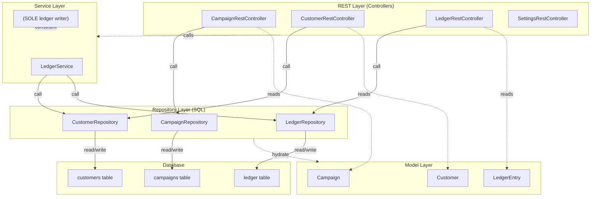
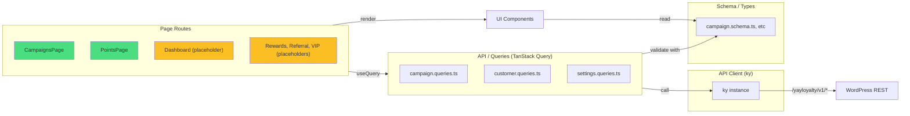
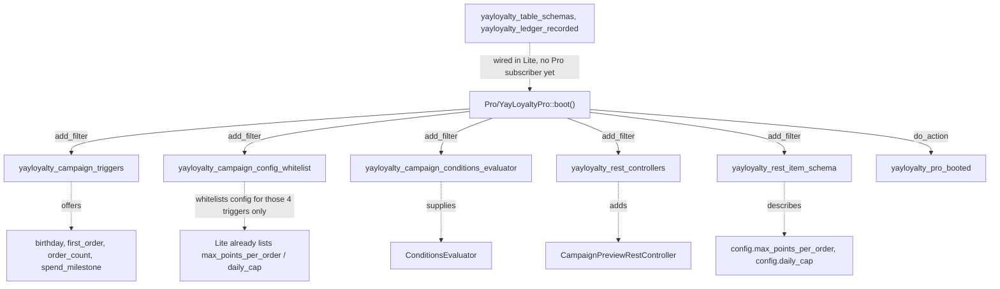

# YayLoyalty — System Architecture

High-level system design: layers, the Pro/Lite build split, internal extension seams, and request flows.

---

## Backend Architecture (PHP)

The plugin follows a strict layered architecture to keep concerns separate and make the Pro/Lite split transparent.



**Layer contracts:**

| Layer | Owns | Must Not |
|---|---|---|
| **REST** | HTTP shape, schema, permissions, pagination | Touch database directly; contain business logic |
| **Services** | Invariants, transactions, atomicity, cross-table writes | Contain SQL; open raw transactions |
| **Repositories** | All SQL for one table; prepared statements; index selection | Open transactions; touch a second table; throw silently (throw instead) |
| **Models** | Data shape, casts, REST schema, immutability by convention | Database access |

**Capabilities (`Access\Capabilities`):** seven primitive caps on `WP_Role` — `view`, `manage_points`, `manage_tiers`, `manage_campaigns`, `manage_rewards`, `manage_settings`, `run_tools`. Granted to `administrator` (all) and `shop_manager` (all but settings/tools) by `Installer::install()`; `migrate()` on `plugins_loaded` brings older sites up via `yayloyalty_caps_version`; deactivation removes nothing. Enforced at three points only: the AdminShell menu (`YayLoyaltyPluginAdapter::get_capability()` → `view`), the page render callback, and every route's `permission_callback` (`AbstractRestController::requires()`). Services are user-unaware. The SPA reads `window.yayLoyaltyAdmin.capabilities` (`lib/access.tsx`) to hide screens and disable controls — cosmetics, not a gate. The adjustment ceiling (`settings.advanced.adjustment_ceiling`) is a policy value checked by `assert_ceiling()` after the cap; administrators bypass it.

---

## Frontend Architecture (React)

The admin SPA is built with React 18 + Vite 6 + TanStack Query + Zod validation.



**Tech stack:**
- React 18 with TSX
- **Vite 6** — bundler; `BUILD_TYPE=lite` → `IS_PRO_BUILD` define = `false`
- **TanStack Query** — caching, sync, refetch
- **Zod** — runtime schema validation, type inference
- **Ky** — lightweight HTTP client
- **shadcn/Tailwind** — component library + CSS

---

## Pro/Lite Build Split

One repository, two zips. **Lite = Pro minus `includes/Pro/`**, with the SPA built with `BUILD_TYPE=lite`.

### The Mechanism

**Single seam in Lite code:**

```php
// includes/YayLoyalty.php — the ONLY place Lite names Pro

if ( self::is_pro() ) {
    \YayLoyalty\Pro\YayLoyaltyPro::boot();
}
```

This `class_exists` check:
- Returns `false` in Lite (no class; deleted by the build)
- Returns `true` in Pro (class exists)
- Triggers Pro boot or skips it silently

**Pro boot flow:**



### SPA Build-Time Gate

| Dir | Lite | Pro | Rule |
|---|---|---|---|
| `src/pro/` | **deleted** | shipped | Actual Pro features; tree-shake via `IS_PRO_BUILD &&` |
| `src/components/pro/` | **kept** | kept | Upsell UI (ProGate, badge); render always |

**Build process:**

1. `pnpm build --mode lite` → `BUILD_TYPE=lite` → Vite sets `IS_PRO_BUILD = false`
2. Dead code elimination: `if (IS_PRO_BUILD) { importPro() }` collapses to `if (false)`
3. Rollup tree-shakes `@/pro` subtree
4. Result: Lite bundle has no Pro code, no sentinel

**Validation (scripts/validate-build.php):**
- Sentinel `registerPro()` **absent** from Lite ✓
- Sentinel **present** in Pro ✓
- No `Pro` namespace reference outside `includes/YayLoyalty.php` (Lite) ✓
- Single entry chunk (no dynamic import side-effects) ✓

### Strip Behavior, Not Vocabulary

Downgrading from Pro to Lite must not corrupt data.

**Example: Campaign Triggers**

```php
// includes/Enums/CampaignTrigger.php

public static function all() {
    // Filtered: what THIS BUILD can fire
    return apply_filters( 'yayloyalty_campaign_triggers', self::lite_triggers() );
}

public static function all_known() {
    // NOT filtered: what the schema recognizes (including Pro-only)
    return [ 'purchase', 'signup', 'review', 'birthday', 'first_order', ... ];
}
```

**Lite has no birthday campaign trigger** but can still store `trigger = 'birthday'` and `config` wholesale. On upgrade, birthday campaigns work. On downgrade, they persist silently (safe).

**Conditions:**
- Lite's `Campaign::conditions_match()` returns **true** (no evaluator) → awards slightly too broadly
- Pro's `ConditionsEvaluator::matches()` throws on unknown type → fails strictly

---

## Internal Extension Seams (Filters)

These are **first-party, internal seams** for Pro to attach behavior. Not a third-party API; may change.

| Filter | Context | Used By |
|---|---|---|
| **`yayloyalty_table_schemas`** | Called during Installer to collect table DDL | Pro can add Pro tables (currently unused) |
| **`yayloyalty_ledger_recorded`** | Fired by `LedgerService` after commit | No subscriber yet |
| **`yayloyalty_rest_controllers`** | Called by RestAPI to collect controller instances | Pro adds CampaignPreviewRestController |
| **`yayloyalty_campaign_triggers`** | Called by CampaignTrigger::all() | Pro adds birthday, first_order, order_count, spend_milestone |
| **`yayloyalty_campaign_config_whitelist`** | Called by `Campaign::config_whitelist()` | Pro adds whitelists for its four triggers. It does **not** add `max_points_per_order` / `daily_cap` — Lite lists those itself so a downgrade preserves them |
| **`yayloyalty_rest_item_schema`** | Applied inside the final `AbstractRestController::get_item_schema()` | Pro describes `config.max_points_per_order` and `config.daily_cap` on the campaign schema; nothing else yet |
| **`yayloyalty_campaign_conditions_evaluator`** | Called by Campaign::conditions_match() | Pro supplies ConditionsEvaluator instance |

**Seam safety:** Match on `$rest_base` (route) and schema `title` — `yayloyalty_rest_item_schema` is shared across resources.

---

## Request & Data Flow

### Manual points adjustment — the one write path that exists today

The only flow that writes the ledger end to end. Every future award path (order, signup, review, referral) will enter at the same place: `LedgerService`.

```
PointsPage (React)
    ↓ useAdjustPointsMutation
ky.post('customers/{user_id}/adjust', { points, note })
    ↓
CustomerRestController  →  BaseRestController::exec_write()
    │   permission_callback: requires( Capabilities::MANAGE_POINTS ), then assert_ceiling()
    │   args: from get_write_args() — readonly fields already stripped
    │   wraps the callback in Transaction::run()
    ↓
LedgerService::adjust( user_id, points, note, actor_id )
    ↓ record()
    ├─ CustomerRepository::ensure_row( user_id )   INSERT … ON DUPLICATE KEY UPDATE (create-then-lock)
    ├─ CustomerRepository::lock_and_get( user_id ) SELECT … FOR UPDATE — serialises writers per customer
    ├─ LedgerRepository::insert( entry )           balance_after = locked balance + points
    ├─ CustomerRepository::apply_delta( … )        balance, lifetime_earned / lifetime_redeemed
    └─ event queued, NOT dispatched
    ↓
Transaction::run() commits (or releases the savepoint)
    ↓
do_action( 'yayloyalty_ledger_recorded', $entry )   ← after commit, so a subscriber never sees a rolled-back row
    ↓
REST returns the LedgerEntry → zod parse → TanStack Query invalidates → PointsPage refetches
```

### Campaign create — REST only, no SPA form yet

```
POST /yayloyalty/v1/campaigns   (no admin UI issues this yet; the campaigns page is a read-only list)
    ↓
CampaignRestController::create_item()  via  exec_write()
    ├─ CampaignTrigger::is_valid( trigger )        must be fireable in THIS build (all(), filtered)
    ├─ Campaign::validate_config( trigger, config ) keys whitelisted per trigger
    ├─ slug generated server-side and de-duplicated; is_builtin never read from the request
    └─ CampaignRepository::insert()
    ↓
Response: Campaign::to_array()
```

### Order award — NOT IMPLEMENTED

No code listens to WooCommerce order events. When it lands it will hook an order status transition, resolve the live campaigns for the `purchase` trigger (`CampaignRepository::find_live_by_trigger()`), check `Campaign::conditions_match()`, and call `LedgerService` — nothing else in the write path changes. See `project-roadmap.md`.

---

## Transaction & Lock Strategy

**Why custom transaction handling?**
- WordPress and WooCommerce share the same `$wpdb`
- Either may already be inside a transaction when we arrive
- Foreign `START TRANSACTION` would implicitly commit their work (silent corruption)

**Solution: `Transaction::run()`**

1. Probe for foreign transaction via savepoint round-trip
   - Take savepoint → roll back → release (all succeed if inside transaction)
   - If `ROLLBACK TO SAVEPOINT` fails with error 1305, we're outside
2. If foreign transaction detected: take savepoint instead of `START TRANSACTION`
3. Else: start real transaction
4. Guard connection identity before commit/rollback (detect reconnect on error 2006)
5. Treat failed rollback as fatal (not recoverable)

**Lock order: Always `customers` before `ledger`**
- `ensure_row()` (insert-or-ignore) then `lock_and_get()` (SELECT FOR UPDATE)
- Reverse order = deadlock in concurrent first-touch writes

---

## Tech Stack Reference

| Layer | Tech | Why |
|---|---|---|
| **Backend** | PHP 7.4+ | WordPress floor; no enums, promotion, readonly, nullsafe |
| **Database** | WooCommerce's MySQL / MariaDB minimum | InnoDB required — savepoints do not exist on MyISAM; JSON stored as LONGTEXT because a native JSON type is not guaranteed at that floor |
| **Frontend** | React 18 | Declarative; hooks + suspense; TanStack Query integration |
| **Bundler** | Vite 6 | ESM, HMR, dead code elimination (critical for Pro/Lite) |
| **Validation** | Zod | Type inference; both JS and runtime validation |
| **HTTP** | Ky | Lightweight; same origin by default; abort support |
| **Styling** | Tailwind + shadcn | Utility CSS; component library; customizable |
| **State** | TanStack Query | Server cache synchronization; automatic refetch |

---

## Related Documentation

- **`codebase-summary.md`** — Directory map, entry points, file reference
- **`code-standards.md`** — Conventions, layer rules, Pro/Lite seams, transaction safety
- **`deployment-guide.md`** — Build commands, validation, headless setup
- **`data-model.md`** — Schema: 12 tables planned; 3 implemented; invariants
