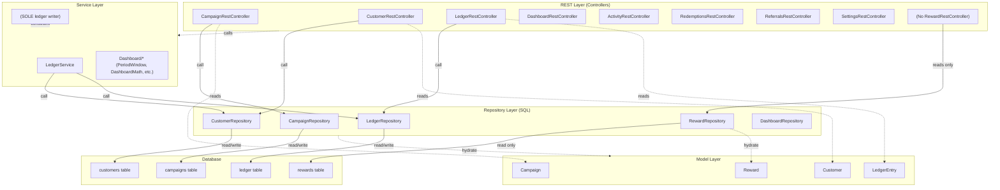
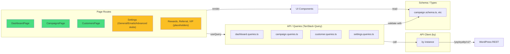
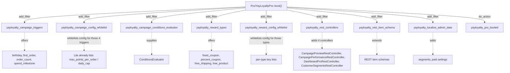

# YayLoyalty — System Architecture

High-level system design: layers, the Pro/Lite build split, internal extension seams, and request flows.

---

## Backend Architecture (PHP)

The plugin follows a strict layered architecture to keep concerns separate and make the Pro/Lite split transparent.



**Layer contracts:**

| Layer | Owns | Must Not |
|---|---|---|
| **REST** | HTTP shape, schema, permissions, pagination | Touch database directly; contain business logic |
| **Services** | Invariants, transactions, atomicity, cross-table writes | Contain SQL; open raw transactions |
| **Repositories** | All SQL for one table; prepared statements; index selection | Open transactions; touch a second table; throw silently (throw instead) |
| **Models** | Data shape, casts, REST schema, immutability by convention | Database access |

**Capabilities (`Access\Capabilities`):** seven primitive caps on `WP_Role` — `view`, `manage_points`, `manage_tiers`, `manage_campaigns`, `manage_rewards`, `manage_settings`, `run_tools`. Granted to `administrator` (all) and `shop_manager` (all but settings/tools) by `Installer::install()`; `migrate()` on `plugins_loaded` brings older sites up via `yayloyalty_caps_version`; deactivation removes nothing. Enforced at three points only: the AdminShell menu (`YayLoyaltyPluginAdapter::get_capability()` → `view`), the page render callback, and every route's `permission_callback` (`AbstractRestController::requires()`). Services are user-unaware. The SPA reads `window.yayLoyaltyAdmin.capabilities` (`lib/access.tsx`) to hide screens and disable controls — cosmetics, not a gate. The adjustment ceiling (`settings.advanced.adjustment_ceiling`) is a policy value checked by `assert_ceiling()` after the cap; administrators bypass it.

---

## Frontend Architecture (React)

The admin SPA is built with React 18 + Vite 6 + TanStack Query + Zod validation.



**Page routes:**

| Route | Component | Status |
|---|---|---|
| `/dashboard` | `DashboardPage` | ✅ shipped |
| `/customers` | `CustomersPage` (list) | ✅ shipped |
| `/customers/:userId` | `CustomerDrawer` (F09) | ✅ shipped |
| `/campaigns` | `CampaignsPage` (list, fixture-backed) | ⚠️ fixture data |
| `/campaigns/:id/edit` | `CampaignEditor` (Pro only) | ⚠️ not persisted |
| `/campaigns/:id/performance` | `CampaignPerformance` (Pro only) | ⚠️ fixture data |
| `/rewards`, `/referral`, `/vip-tiers`, `/settings` | Stubs | ⚠️ placeholders |

**Tech stack:**
- React 18 with TSX
- **React Router 7** — hash-based routing
- **Vite 6** — bundler; `BUILD_TYPE=lite` → `import.meta.env.VITE_IS_PRO` = `false`
- **TanStack Query** — caching, sync, refetch
- **Zod** — runtime schema validation, type inference
- **Ky** — lightweight HTTP client
- **shadcn/Tailwind v4** — component library + CSS

---

## Pro/Lite Build Split

One repository, two zips. **Lite = Pro minus `includes/Pro/`**, with the SPA built with `BUILD_TYPE=lite`.

### The Mechanism

**Single seam in Lite code:**

```php
// includes/YayLoyalty.php — the ONLY place Lite names Pro

if ( self::is_pro() ) {
    \YayLoyalty\Pro\YayLoyaltyPro::boot();
}
```

This `class_exists` check:
- Returns `false` in Lite (no class; deleted by the build)
- Returns `true` in Pro (class exists)
- Triggers Pro boot or skips it silently

**Pro boot flow:**



### SPA Build-Time Gate

| Dir | Lite | Pro | Rule |
|---|---|---|---|
| `src/pro/` | **deleted** | shipped | Actual Pro features; tree-shake via `IS_PRO_BUILD &&` |
| `src/components/pro/` | **kept** | kept | Upsell UI (ProGate, badge); render always |

**Build process:**

1. `BUILD_TYPE=lite pnpm build` → `vite.config.ts` sets `VITE_IS_PRO = false` in `import.meta.env`
2. Dead code elimination: `if (import.meta.env.VITE_IS_PRO) { importPro() }` collapses to `if (false)`
3. Rollup tree-shakes `@/pro` subtree
4. Result: Lite bundle has no Pro code, no sentinel

**Validation (scripts/validate-build.php):**
- Sentinel `registerPro()` **absent** from Lite ✓
- Sentinel **present** in Pro ✓
- No `Pro` namespace reference outside `includes/YayLoyalty.php` (Lite) ✓
- Single entry chunk (no dynamic import side-effects) ✓
- `tsc --noEmit` passes on the app's own code (3 pre-existing errors from 2 files whose dependencies were never added to `package.json` — `@emoji-mart/data`/`@emoji-mart/react`, `@radix-ui/react-progress` — pre-existing on `main`, unrelated to any feature branch) ✓

### Strip Behavior, Not Vocabulary

Downgrading from Pro to Lite must not corrupt data.

**Example: Campaign Triggers**

```php
// includes/Enums/CampaignTrigger.php

public static function all() {
    // Filtered: what THIS BUILD can fire
    return apply_filters( 'yayloyalty_campaign_triggers', self::lite_triggers() );
}

public static function all_known() {
    // NOT filtered: what the schema recognizes (including Pro-only)
    return [ 'purchase', 'signup', 'review', 'birthday', 'first_order', ... ];
}
```

**Lite has no birthday campaign trigger** but can still store `trigger = 'birthday'` and `config` wholesale. On upgrade, birthday campaigns work. On downgrade, they persist silently (safe).

**Conditions:**
- Lite's `Campaign::conditions_match()` returns **true** (no evaluator) → awards slightly too broadly
- Pro's `ConditionsEvaluator::evaluate()` fails closed on unknown/unsupported type (`unsupported_condition_type`) → never awards on a condition it cannot check

---

## Internal Extension Seams (Filters)

These are **first-party, internal seams** for Pro to attach behavior. Not a third-party API; may change.

| Filter | Context | Used By |
|---|---|---|
| **`yayloyalty_table_schemas`** | Called during Installer to collect table DDL | Pro can add Pro tables (currently unused) |
| **`yayloyalty_ledger_recorded`** | Fired by `LedgerService` after its own `Transaction::run()` commits (a savepoint when nested in `exec_write`) | `DashboardCache::flush`; `Engine\CustomerActivityListener::on_ledger_recorded` — captures `account_created`/`points_adjusted` into `yayloyalty_customer_meta` |
| **`yayloyalty_campaigns_changed`** | Fired by `CampaignRepository::flush_cache()` after any campaign write | `DashboardCache::flush` (the paused-campaign notice lives in the cached payload) |
| **`yayloyalty_rest_controllers`** | Called by RestAPI to collect controller instances | Pro adds CampaignPreviewRestController, CampaignPerformanceRestController, DashboardProRestController, CustomerSegmentsRestController |
| **`yayloyalty_campaign_triggers`** | Called by CampaignTrigger::all() | Pro adds birthday, first_order, order_count, spend_milestone |
| **`yayloyalty_campaign_config_whitelist`** | Called by `Campaign::config_whitelist()` | Pro adds whitelists for its four triggers; `max_points_per_order`/`daily_cap` are already in Lite's purchase schema and enforced by `Engine\Points\CapPolicy` |
| **`yayloyalty_reward_types`** | Called by RewardType::all() | Pro adds fixed_coupon, percent_coupon, free_shipping, free_product |
| **`yayloyalty_reward_config_whitelist`** | Called by `Reward::config_whitelist()` | Pro adds config keys for its four types |
| **`yayloyalty_register_trigger_handlers`** | Fired by `Engine\Points\Triggers\Registry::with_lite_handlers()` | Pro registers handlers for birthday, first_order, order_count, spend_milestone |
| **`yayloyalty_register_reward_handlers`** | Fired by `Engine\Rewards\Handlers\Registry::with_lite_handlers()` | Pro registers a `RewardHandler` per reward type; unused until Pro handlers exist |
| **`yayloyalty_rest_item_schema`** | Applied inside `AbstractRestController::get_item_schema()` | Pro extends campaign/reward schemas |
| **`yayloyalty_campaign_conditions_evaluator`** | Called by Campaign::conditions_match() | Pro supplies ConditionsEvaluator instance (fails closed on unknown types) |
| **`yayloyalty_localize_admin_data`** | Called by `LocalizeHelper` to extend SPA payload | Pro adds `segments` (saved Customers-page filter sets) and paid feature flags |

**Seam safety:** Match on `$rest_base` (route) and schema `title` — `yayloyalty_rest_item_schema` is shared across resources.

---

## Request & Data Flow

### Dashboard — one request in Free, two in Pro

`DashboardPage` → `useDashboardQuery(range)` → `GET /dashboard?range=7|30|90` (cap `VIEW`). The controller builds a `PeriodWindow` (range site-timezone calendar days ending today, previous period = the range before; UTC bounds for SQL, a fixed UTC offset for `DATE()` bucketing) and asks `DashboardStats` (tiles/series/lists via `DashboardRepository`, ratios via `Utils\PointsMath`, zero-fill via `DashboardMath`) and `DashboardNotices` (three detectors: negative balances, paused default campaign, points jump via `AnomalyDetector` over its own 30-day series) for the payload. Pro's `DashboardProPanels` issues a second request, `GET /dashboard/pro`, for per-campaign series and top campaigns; both queries sit under the `['dashboard']` key so one invalidation covers them.

**Cache rule.** Above `yayloyalty_dashboard_cache_threshold` members (10,000) the site-wide payload — stats, series, lists and **raw notices** — is served from a transient per range and variant (`yayloyalty_dashboard_v1_[pro_]{range}`, TTL `yayloyalty_dashboard_cache_ttl`, 5 min), flushed on every ledger write and campaign write. Nothing per-user enters the transient: `NoticeDismissals::filter()` (user meta `{key: fingerprint}`) runs after it, so a dismissal hides a notice for that user until its fingerprint changes and it re-surfaces. `refresh=1` flushes first. Below the threshold every request is live.

**Copy lives in the client.** Notices are `{key, severity, fingerprint, data}`; `dashboard-page.notice-copy.ts` composes every title, body and action from `data` (thresholds quoted from `data.threshold`), and ledger rows are described by `ledger.helper.ts` — the same rule as the Customers list.

**Dev scenario switch.** `?scenario=empty|small|large|notices|anomaly` swaps the payload for a `DashboardFixture` artboard. The argument is registered only when `WP_DEBUG` is true and the SPA reads it only through `hooks/useDevScenario.ts` (`undefined` outside the Vite dev server, so a built bundle never sends it); production builds are verified on real data.

### Customers list & bulk actions data flow

Bulk "Adjust points" and "Export" share selection resolution: user may have selected specific rows OR 'all'-mode (all matching current filters, minus any exclusions). Client-side selection state does not hold the full list, so both actions resolve the actual target rows before executing:

Selection state (`customers-page.selection.ts`) is either `{ mode: 'partial', ids }` (explicit picks, kept across page navigation) or `{ mode: 'all', excludedIds }` ("Select all N matching these filters" — an O(1) flip, count from the server's `totalItems`).

1. **Fast path:** `mode === 'partial'` and every id in `ids` is on the currently loaded page (`isSelectionFullyLoaded()`) → filter the loaded rows, no request.
2. **Fetch path:** otherwise (`'all'` mode always, or `'partial'` with picks on other pages) `fetchAllMatchingCustomers()` walks `GET /customers` with the same committed filters and sort at `per_page=100`, sequentially, up to `MAX_PAGES = 500` (fails fast with a "narrow the filters" error beyond that); abortable via `AbortSignal` on unmount. `resolveSelectedCustomers()` then narrows the result to the selection (`ids`, or everything minus `excludedIds`). Ordering is stable across pages because the server's `ORDER BY` ends in `c.user_id ASC`.

See `customers-page.matching-customers.ts` for selection resolution; `customers-page.bulk-actions.ts` for both actions; `customers-page.export.ts` for RFC 4180 CSV generation (CRLF, UTF-8 BOM).

### Customer drawer (F09) — per-customer detail view

Opened from Customers-list row; shows balance, stats, four tabs (Points ledger + three empty-on-real-path tabs: Activity, Redemptions, Referrals). All five drawer endpoints (`GET /customers/{id}`, `/ledger`, `/activity`, `/redemptions`, `/referrals`) accept a `scenario` query arg only when `WP_DEBUG` is true, reaching `CustomerDrawerFixture` with named scenarios (new/large/deleted/negative/expiring). The default (no arg) always returns real data or an honest empty envelope. Schema validation is identical for both paths via Zod mirrors in `src/lib/schema/`. Shared helpers: `Schemas/CustomerItemSchema.php` (the item shape), `Schemas/LedgerQueryArgs.php` (filter groups + vocabulary), `Controllers/CustomerListFormatter.php` (wire shape helpers).

### Manual points adjustment — wired end-to-end, including the SPA

The only complete ledger write path, and the only one reachable from the admin UI today. Every future award path (order, signup, review, referral) will enter at the same place: `LedgerService`. Reachable from the Customers list's Bulk Actions → "Adjust points" (`CustomersBulkActionBar` → `CustomersAdjustPointsDialog`); there is no bulk REST endpoint, so `useBulkAdjustPointsMutation` fires one request per selected customer.

```
Admin Customers page (React) — Bulk Actions → "Adjust points"
    ↓
useBulkAdjustPointsMutation → adjustCustomerPoints( user_id, { points, note } )   one call per selected customer
    ↓
ky.post('customers/{user_id}/adjust', { points, note })
    ↓
CustomerRestController  →  BaseRestController::exec_write()
    │   permission_callback: requires( Capabilities::MANAGE_POINTS ), then assert_ceiling()
    │   args: from get_write_args() — readonly fields already stripped
    │   wraps the callback in Transaction::run()
    ↓
LedgerService::adjust( user_id, points, note, actor_id )
    ↓ record() [private method]
    ├─ CustomerRepository::ensure_row( user_id )   INSERT … ON DUPLICATE KEY UPDATE (create-then-lock)
    ├─ CustomerRepository::lock_and_get( user_id ) SELECT … FOR UPDATE — serialises writers per customer
    ├─ LedgerRepository::insert( entry )           balance_after = locked balance + points
    ├─ CustomerRepository::apply_delta( … )        balance, lifetime_earned / lifetime_redeemed
    └─ event queued, NOT dispatched
    ↓
Transaction::run() commits (or releases the savepoint)
    ↓
do_action( 'yayloyalty_ledger_recorded', $entry )   ← after commit, so a subscriber never sees a rolled-back row
    ↓
REST returns the LedgerEntry → zod parse → `useBulkAdjustPointsMutation` invalidates the `['customer']` query prefix → list, detail and ledger all refetch
```

### Account-deletion capture — the first WP-core-hook subscriptions in this codebase

Every prior hook in this table is a `yayloyalty_*` seam this plugin itself fires. `delete_user`/
`wpmu_delete_user` are the first subscriptions to a raw WP-core hook, both registered directly in
`yayloyalty.php` (no dedicated Listeners/Hooks class exists) because multisite fires
`wpmu_delete_user` INSTEAD of `delete_user`, never both:

```
wp_delete_user( $id )                          wpmu_delete_user( $id )
    │ do_action('delete_user', $id, ..., $user)     │ do_action('wpmu_delete_user', $id, $user)
    ▼                                                ▼
CustomerActivityListener::on_delete_user()      CustomerActivityListener::on_wpmu_delete_user()
    │ bails if is_multisite()                        │ always trusted as "really gone"
    └──────────────────┬──────────────────────────────┘
                        ▼ try/catch \Throwable → Log::error
           CustomerActivityService::record_account_deleted()
                        │ CustomerRepository::find_by_user_id() — non-member → no-op
                        │ CustomerMetaRepository::has() — already captured → no-op
                        ▼
           CustomerMetaRepository::insert( 'account_deleted' row )
```

No `Transaction::run()` here (one single-table insert; the WP deletion itself is not this plugin's
transaction to hold open). `yayloyalty_customers` and `yayloyalty_ledger` are read-only in this
path and never touched — the frozen balance IS the point. `GET /customers/{id}/activity` reads
these rows for real now (three of eight event types have a writer); it is no longer an empty
envelope on every request, only for a customer whose sole history would be one of the five
unwritten event types.

### Signup capture — customers row created at registration

`user_register` (fired by `wp_insert_user()`, including admin-created accounts, not only
self-registration) is the third raw WP-core-hook subscription, registered in `yayloyalty.php`
alongside `delete_user`/`wpmu_delete_user`. `CustomerActivityListener::on_user_register()` calls
`CustomerRepository::ensure_row()` directly — no ledger write, no `yayloyalty_ledger_recorded`
event, nothing logged to `yayloyalty_customer_meta` (a brand-new account has no points activity
yet, only a row to reserve at balance 0). This makes `yayloyalty_customers` row creation eager on
WP registration instead of lazy-on-first-earn; the `account_created` activity-log entry
(`CustomerActivityService`, subscribed to `yayloyalty_ledger_recorded`) is unaffected and still
only appears on first ledger write. `ensure_row()` is idempotent (`ON DUPLICATE KEY UPDATE`), so a
double-fire from a third party is harmless; try/catch `\Throwable` around the call, same as every
other listener callback, so a DB failure here never blocks WP's own user-creation flow.

### Campaign editor (Pro-only) — create and edit

**Route:** `/campaigns/:id/edit` (Pro-only; gated by `IS_PRO_BUILD` AND `requires(CAP.MANAGE_CAMPAIGNS)` with Pro lock winning if both apply).

**Access:** Reachable from `CampaignTable` row name-link (detail pre-load) and "Duplicate" action. "Add campaign" intentionally inert — the campaigns list reads from a dummy fixture, not the database, so a genuine create would produce an invisible row (same SWAP POINT as update, below).

**Editor structure:** Six sections (Basics, Trigger, Reward, Conditions, Schedule, Priority) plus a live-updating summary rail ("What this means", "Before it can run", save actions). Uses react-hook-form + zodResolver (first RHF adoption in this codebase). Per-trigger reward config editors for Lite triggers (purchase/signup/review); generic read-only fallback for Pro-only triggers that preserves config byte-for-byte. 10-type condition builder. Nullable start/end scheduling with site-timezone conversion at display/input edges (form/wire values stay raw UTC).

**SWAP POINT caveat:** The PHP update endpoint validates and returns the campaign, but **does NOT persist to the database**. This is a deliberate, explicitly-marked temporary state — both the read-side (list/detail from dummy fixture) and write-side (update validation without persist) SWAP POINTs are intended to be resolved together in a future CRUD task.

```
GET /campaigns/:id   (read for detail pre-load)
    ↓
CampaignRestController::get_item()

POST|PUT|PATCH /yayloyalty/v1/campaigns/:id   (WP_REST_Server::EDITABLE)
    ↓
CampaignRestController::update_item()  via  exec_write()
    ├─ CampaignTrigger::is_valid( trigger )        must be fireable in THIS build (all(), filtered)
    ├─ Campaign::validate_config( trigger, config ) keys whitelisted per trigger
    ├─ Campaign::conditions_are_valid()            validates the 10-type condition set (NEW: now wired as a real gate, not a stub)
    ├─ [SWAP POINT: NO persist to database; controller strips readonly fields and returns the validated campaign]
    └─ Response: Campaign::to_array()
    
Admin SPA (CampaignEditorPage)
    ├─ useUpdateCampaignMutation() (NEW)
    ├─ six form sections reading/writing through consolidated data layer (campaign.schema.ts/api.ts/queries.ts, extended with updateCampaignInput schema and updateCampaign() call)
    └─ summary rail live-updates from form state
```

**Known gaps (not built, not faked):**
- No product/category/customer search endpoint → id-entry via existing `TagsInput` pickers deferred.
- No store-wide ledger aggregate → rail's "cost estimate" line omitted.
- `updated_by` column exists; controller never sets it.
- `include_shipping` config key still stored but never read by `BaseCalculator` (dead key).

### Campaign create — REST only, no SPA form yet

```
POST /yayloyalty/v1/campaigns   (no admin UI issues this yet; the campaigns page reads from a dummy fixture)
    ↓
CampaignRestController::create_item()  via  exec_write()
    ├─ CampaignTrigger::is_valid( trigger )        must be fireable in THIS build (all(), filtered)
    ├─ Campaign::validate_config( trigger, config ) keys whitelisted per trigger
    ├─ slug generated server-side and de-duplicated; is_builtin never read from the request
    └─ CampaignRepository::insert()
    ↓
Response: Campaign::to_array()
```

### Campaign performance (Pro-only) — fixture-backed, real endpoint shape

**Route:** `/campaigns/:id/performance` (Pro-only; gated by `IS_PRO_BUILD` AND `requires(CAP.MANAGE_CAMPAIGNS)`). Supports `purchase`, `signup`, `review` only — any other trigger (e.g. `birthday`) 404s from both the loaded campaign client-side and the server's own trigger allowlist.

**Access:** `CampaignTable`'s row menu ("View performance") and the campaign editor rail's "Performance" link, both rendered only when `hasPerformancePage(trigger)` is true.

**Contract:** `GET /campaigns/{id}/performance` returns `{ window, totals, daily, skipped, estimate }`; `GET /campaigns/{id}/performance/entries` returns a paged/searchable row list (order/signup/review depending on trigger). **Nullability rule:** every nullable field means "not applicable to this trigger" or "not computable yet" — never `0`. A purchase-only total is `null` on a signup/review campaign; an average is `null` on zero entries (division by zero), not `0`. The SPA renders `null` as `—`, same rule the dashboard uses for its own null fields. Full specification lives in `lib/schema/campaign-performance.schema.ts` and the `CampaignPerformanceRestController` docblock.

```
GET /campaigns/:id/performance
    ↓
CampaignPerformanceRestController::get_performance()
    ├─ resolve_row()  404 for unknown id OR unsupported trigger (identical either way — no timing/error-shape difference an unauthorized trigger check could leak)
    └─ [SWAP POINT: answers entirely from CampaignPerformanceFixture — deterministic-per-id, invented]
    ↓
Response validated by lib/schema/campaign-performance.schema.ts (zod)
    ↓
CampaignPerformance.tsx: useCampaignQuery (header) + useCampaignPerformanceQuery (tiles/chart/side panel) — independent; a summary failure never hides the header
```

**Swap procedure** (see the controller's own class docblock): `get_performance()` moves to a new `CampaignPerformanceRepository` aggregate over `ledger` rows carrying `campaign_id`, wrapped in `DashboardCache` (large-table per-request aggregate); `skipped`/`estimate` may ship `null` at first since both need re-evaluating every order in the window — the SPA already hides each panel on `null`. `get_entries()` moves to a paged `ledger` query (`WHERE campaign_id = ? ORDER BY created_at DESC, id DESC`) joined to `customers`, through `respond_paginated()` exactly as today. `CampaignPerformanceFixture` is then deleted. **No SPA change either way** — both routes are already real HTTP calls.

### Order award — NOT IMPLEMENTED (Engine built, Listener missing)

**Engine status:** `PointsEngine` is complete with 46 unit tests for `BaseCalculator`, `PurchaseHandler`, `PointsEngine`, plus `ContextFactory` and `Triggers/Registry`; its rounding step is `Utils\PointsMath::round_points()`, covered by the shared PHP/TS vector suite. It computes what an order earns given the live campaigns.

**Missing:** No code listens to WooCommerce order events. `LedgerService::earn()` does not exist yet — only `adjust()` (for manual adjustments). When F01-4 lands, it will:
1. Hook an order status transition (e.g., `woocommerce_order_status_*`)
2. Call `ContextFactory::from_order()` to build an immutable context
3. Resolve live campaigns for the `purchase` trigger via `CampaignRepository::live_for_trigger()`
4. Call `PointsEngine::evaluate()` — pure, no side effects
5. Call `LedgerService::earn()` with the result

Nothing else in the write path (lock order, transaction safety, idempotency) changes. See `project-roadmap.md`.

### Redemption — SCAFFOLDED (Engine wiring only)

`RewardEngine` is complete with wiring (registry lookup, delegation, Pro seam) but all evaluation gates (liveness, balance vs cost, conditions filter) are TODO and the Lite handler always denies `not_implemented`. Missing: gates 1–3, `FlexibleDiscountHandler::quote()`, Pro handlers, the write path (`redemptions` table, `RedemptionRepository`, `LedgerService::redeem()`), `ContextFactory` (build Context from cart), and the checkout hook. Call order: customer picks reward → `Context` built from cart/balance → `RewardEngine::evaluate()` → if allowed, caller writes ledger via `LedgerService::redeem()`. See `includes/Engine/Rewards/README.md`.

---

## Transaction & Lock Strategy

**Why custom transaction handling?**
- WordPress and WooCommerce share the same `$wpdb`
- Either may already be inside a transaction when we arrive
- Foreign `START TRANSACTION` would implicitly commit their work (silent corruption)

**Solution: `Transaction::run()`**

1. Probe for foreign transaction via savepoint round-trip
   - Take savepoint → roll back → release (all succeed if inside transaction)
   - If `ROLLBACK TO SAVEPOINT` fails with error 1305, we're outside
2. If foreign transaction detected: take savepoint instead of `START TRANSACTION`
3. Else: start real transaction
4. Guard connection identity before commit/rollback (compare connection ids to detect reconnect)
5. Treat failed rollback as fatal (not recoverable)

**Lock order: Always `customers` before `ledger`**
- `ensure_row()` (insert-or-ignore) then `lock_and_get()` (SELECT FOR UPDATE)
- Reverse order = deadlock in concurrent first-touch writes

---

## Tech Stack Reference

| Layer | Tech | Why |
|---|---|---|
| **Backend** | PHP 7.4+ | WordPress floor; no enums, promotion, readonly, nullsafe |
| **Database** | WooCommerce's MySQL / MariaDB minimum | InnoDB required — savepoints do not exist on MyISAM; JSON stored as LONGTEXT because a native JSON type is not guaranteed at that floor |
| **Frontend** | React 18 | Declarative; hooks + suspense; TanStack Query integration |
| **Bundler** | Vite 6 | ESM, HMR, dead code elimination (critical for Pro/Lite) |
| **Validation** | Zod | Type inference; both JS and runtime validation |
| **HTTP** | Ky | Lightweight; same origin by default; abort support |
| **Styling** | Tailwind + shadcn | Utility CSS; component library; customizable |
| **State** | TanStack Query | Server cache synchronization; automatic refetch |

---

## Related Documentation

- **`codebase-summary.md`** — Directory map, entry points, file reference
- **`code-standards.md`** — Conventions, layer rules, Pro/Lite seams, transaction safety
- **`deployment-guide.md`** — Build commands, validation, headless setup
- **`data-model.md`** — Schema: 12 tables planned; 4 implemented; invariants
